# Retrieval heads: отчёт по экспериментам

Обновлено **11 октября 2026 года**. Ниже — актуальные результаты; в конце
сохранён исторический отчёт за 8 октября. Его статусы и описание backend
относятся к тому моменту, а не к текущему состоянию.

## Главное на текущий момент

- Добавлена opt-in detection-метрика **QRScore** (`query_retrieval_score_v1`)
  по QRHead Eq.3–4: prefill-внимание токенов вопроса к полной вставленной needle,
  среднее по токенам вопроса/примерам, без фильтра успешности ответа.
  [Описание и команды](retrieval_heads/attention/QRSCORE.md).
  Отдельный дополнительный prefill не изменяет исторический decode-путь;
  GPU-прогон новой метрики ещё не запускался.
- Первый **Colab Qwen3-8B no-thinking smoke** завершён на A10040GB:
  3/3 score100, EOS36/28/33токена, безthink, multiset/mass1152голов.
  Результаты наDrive и локально `colab-results/qwen3-smoke/`, A100 освобождена.
  Это функциональный smoke, не полноценный survey; [Colab setup](colab/README.md).
- Завершены оба **GLM-4.6V-Flash Paul Graham masking**:3740/3740 результатов.
  [63 фигуры PNG/SVG и анализ](report-assets/glm4-6v-flash-paul-graham-mask/README.md).
  Mass top10 снижает средний ROUGE-1/2/3 recall до69.09%, multiset —до98.01%.
  Multiset bottom100 сохраняет100% recall, но все110 ответов обрываются
  по лимиту256 с повторами; precision4.48%, F1 8.58% по исходному тексту.
- Завершён **GLM-4.6V-Flash no-thinking detection survey**: 27/27, средний
  ROUGE-1 recall99.79%, все EOS. Рейтинги1280 голов рассчитаны по всем27 случаям;
  [анализ и10 графиков двух метрик](report-assets/glm4-6v-flash-no-thinking-survey/README.md).
- Завершены два thinking masking-прогона на трёх корпусах до 48k: **504 результата**.
  Анализ выявил 116 завершений по лимиту, из них 109 с незакрытым think.
- Реализован no-thinking адаптер **тех же весов Qwen3-8B**. Thinking выключается
  через `enable_thinking=False` в chat template, а не удалением мыслей после генерации.
- Завершён no-thinking detection survey: **27/27 случаев, ROUGE-1 recall = 100**.
  Обе метрики голов рассчитаны на одних и тех же генерациях и сохранены отдельно.
- Завершён no-thinking masking на Paul Graham с исходной San Francisco needle:
  **1400/1400 результатов**, все исходные JSON скачаны и проверены.
- Для этих 1400 ответов отдельно посчитаны ROUGE-1/2/3, их среднее и точное
  совпадение эталонной фразы; построены **12 фигур в PNG и SVG**.
- Завершён masking top5–40 по **новому no-thinking mass-рейтингу** на A100:
  **1800/1800 результатов**. Итоговые оценки и таблицы добавлены в раздел 4.
- Завершён Ministral 3 8B BF16 context-only detection survey: **27/27**, средний
  ROUGE86.81; **23 случая >50** вошли в рейтинги1088 голов. Готовы графики
  [top-15, карты слоёв/голов, распределения и корреляции](report-assets/ministral3-8b-context-only-survey/README.md).
- Завершены оба Ministral Paul Graham masking-прогона: **3740/3740 результатов**.
  [Галереи attention mass и multiset](report-assets/ministral3-8b-paul-graham-mask/README.md):
  63 фигуры в PNG/SVG, включая карты всех условий и парные изменения против baseline.

## GLM-4.6V-Flash: Paul Graham masking

Оба задания SUCCESS10 октября2026: mass `bt1cskrr10furlk74bdu`17:50:21 МСК,
multiset `bt1af8nq5baf9a9t6b6f`18:53:49 МСК. Исходные JSON/логи скачаны.
По1870 уникальных результатов,34 complete manifests; та же сетка и masking
протокол, что у Ministral:11длин1000–30000 ×10глубин ×17условий.
Baseline + top/bottom5,10,15,20,40,60,80,100;256токенов,BF16/A100,Flash,
context-only,штатный no-thinking,seed42. Legacy_uniform —только Q decode.
Заблокированные головы точно совпадают с frozen GLM survey ranking.
Все110 prompt-хэшей парные между условиями и рейтингами; baseline token IDs
совпадают в110/110. Сгенерированных think-блоков нет.

| Условие | Mass: средний ROUGE-1/2/3 recall | Multiset: средний ROUGE-1/2/3 recall |
|---|---:|---:|
| Baseline | 100.00 | 100.00 |
| Top5 | 98.34 | 100.00 |
| Top10 | 69.09 | 98.01 |
| Top15 | 56.62 | 89.36 |
| Top20 | 46.56 | 73.41 |
| Top40 | 16.78 | 82.32 |
| Top60 | 17.18 | 60.06 |
| Top80 | 17.73 | 40.24 |
| Top100 | 14.61 | 17.72 |

Mass сильнее снижает извлечение уже при top10. При top100 exact0% у обоих,
типично остаётся только «Eat a sandwich». Зависимость не строго монотонная;
multiset top40 лучше top20. Все top-ответы EOS, не обрывы по лимиту.
Mass:1870 EOS. Bottom5–80 recall/exact100%; bottom100 recall91.30%,
exact68.18% по исходным ответам.

Multiset:1505 EOS +365 max_new_tokens, все обрывы в bottom40/60/80/100:
56/106/93/110 соответственно. **Bottom100 recall/exact100% скрывает повторы**:
precision4.48%, F1 8.58%, все110 ответов256токенов. Baseline precision67.20%
и F1 80.06% сами по себе занижены GLM box-маркерами в102/110 ответах.
Диагностическая замена маркеров пробелами даёт baseline100% всех метрик;
multiset bottom100 всё ещё precision5.73%, F1 10.83%.
Это не только артефакт разметки, а потеря краткости/остановки.
Нормализованные оценки не заменяют исходные score и основные графики.

Все100 multiset bottom100 голов имеют нулевой detection score и относятся
к слоям36–39. Это конкретный выбор из924 нулевых голов при стабильном
tie-order, а не универсальный эффект любых «неретривальных»100голов.


[Полная галерея](report-assets/glm4-6v-flash-paul-graham-mask/README.md),
[подробный анализ и оговорки](report-assets/glm4-6v-flash-paul-graham-mask/ANALYSIS.md),
[mass](report-assets/glm4-6v-flash-paul-graham-mask/attention-mass/README.md),
[multiset](report-assets/glm4-6v-flash-paul-graham-mask/multiset/README.md).
Как у Ministral:63 PNG +63 SVG, CSV/JSON, heatmaps каждой маски,
сравнения по длине/глубине/k, парные delta-карты, диагностика обрывов.
Воспроизведение: `.venv/bin/python plot_ministral_paul_graham_mask.py --model glm`.
Один seed; сравнение разных моделей не строго парное из-за токенизаторов.
Код генерации и исходные результаты не менялись, новых jobs не запускалось.

## GLM-4.6V-Flash: графики голов

Job `bt13713fk021qlqi1imi` завершился SUCCESS 10 октября в15:29:05 МСК.
Исходные результаты и логи скачаны; повторная агрегация точно совпала.
Context-only prompt, штатный no-thinking, A100/BF16, лимит256,
8000/16000/30000 ×15/45/75% ×3кейса. Все27 EOS,19–36 токенов,
сгенерированных think-блоков нет. Средний ROUGE-1 recall99.79%;
26 ответов100%, один94.44% (detect-3/30k/45% — пропущено «Because»).
Все27 проходят >50 и вошли в рейтинги40слоёв ×32Q-головы.

Лидеры mass: **26-21,26-26,5-0,17-27,23-3**.
Лидеры multiset: **26-21,26-26,5-3,5-0,27-31**.
В галерее только multiset и attention mass; multiset/mass Pearson0.7164,
Spearman0.7649. Пересечение top20 —8голов;924 нулевых multiset scores,
у mass нулевых нет. Это наблюдение внимания, не доказательство причинной
важности: GLM masking ещё не проводился.


[Полная галерея10 графиков двух метрик, top-15 и общая диагностика](report-assets/glm4-6v-flash-no-thinking-survey/README.md).
Средний precision79.60%, F1 87.75% считаются по исходным ответам, включая
box-маркеры в9 случаях; не следует принимать эту разметку за провалы retrieval.
Сравнение с Ministral описательное, не строго парное: разные токенизаторы
могут давать разные контексты при одинаковом nominal length.

## Ministral 3 8B: графики голов

Новый context-only prompt, без thinking, A100/BF16, лимит256; все ответы EOS.
Графики построены теми же скриптами, что для Qwen, по23 выбранным случаям.
Здесь retrieval score, не ROUGE. Индексация голов начинается с0.

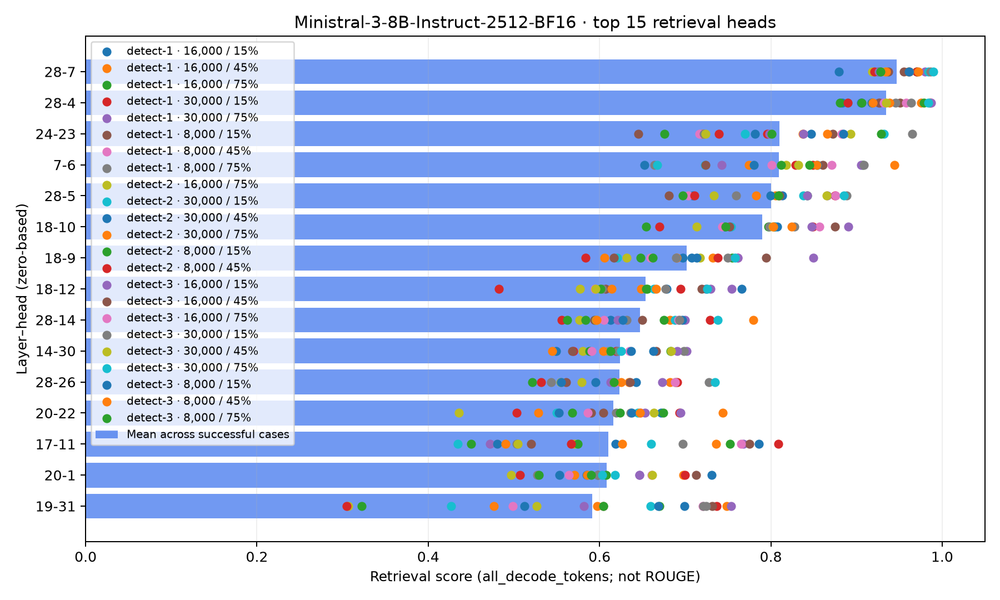

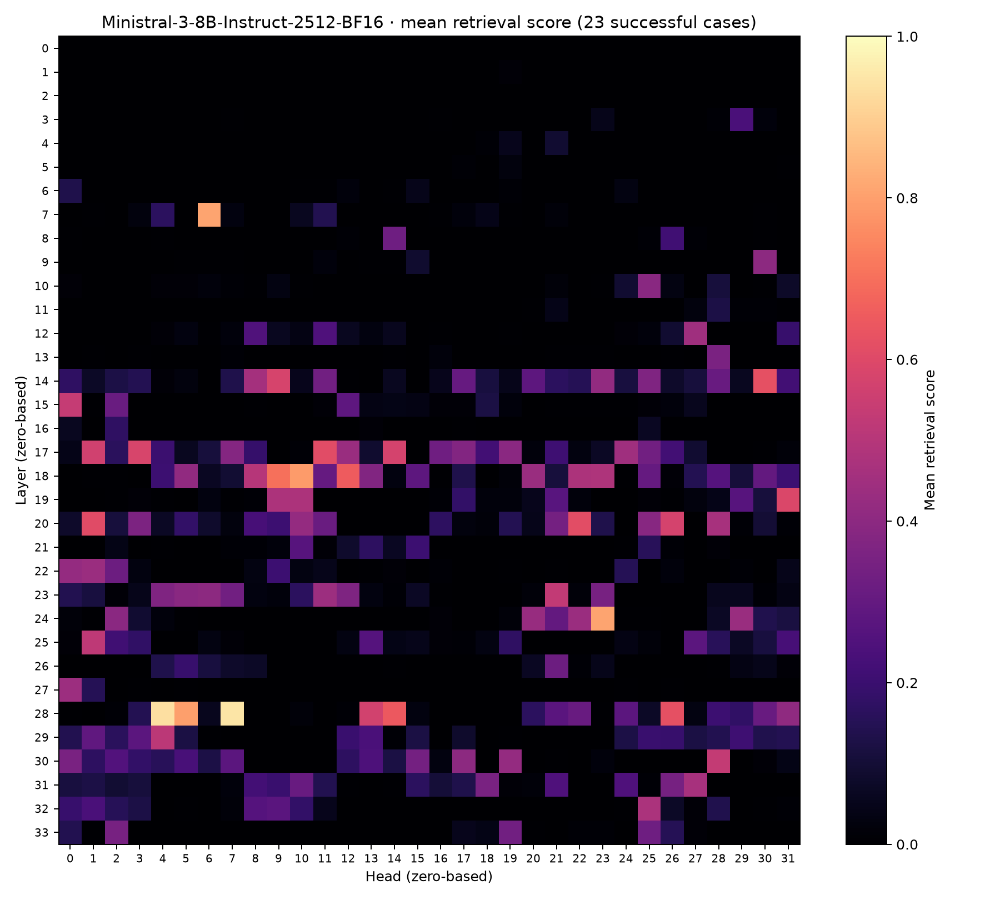

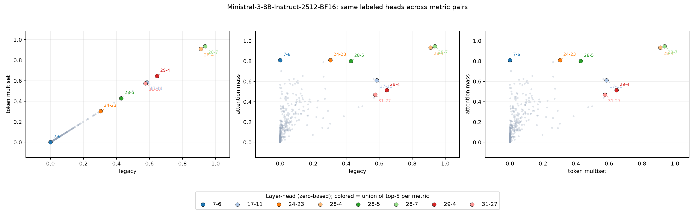

Полная галерея всех трёх метрик и детали расчёта:
[Ministral context-only survey](report-assets/ministral3-8b-context-only-survey/README.md).
Detection scores сами по себе не доказывают причинную важность голов;
завершённые masking-прогоны описаны ниже.

## Ministral 3 8B: Paul Graham masking

Оба задания завершились успешно 10 октября: mass `bt1a99kjkl896agbasll`
в 14:47:31 МСК, multiset `bt1r9dq8r7o220va20k5` в 14:23:27 МСК.
Скачаны исходные JSON и логи. Проверено по1870 уникальных результатов:
11 длин1000–30000 ×10 глубин ×17 условий (baseline и top/bottom
k=5,10,15,20,40,60,80,100). Один context seed42; все110 prompt-хэшей
совпадают между условиями и между рейтингами.

Context-only prompt, BF16/A100, Flash prefill/decode, лимит256.
Маска legacy_uniform применяется только при decode к выбранным Q-головам;
K/V и prefill не маскируются. Рейтинги взяты из context-only detection survey.
ROUGE пересчитан тем же кодом, что для Qwen, по сохранённому model_response.
Исходные score/JSON не изменены. Среднее ROUGE-1/2/3 recall — сводная,
не стандартная ROUGE-метрика; exact — наличие полной нормализованной фразы.

| Условие | Mass: среднее ROUGE-1/2/3 | Multiset: среднее ROUGE-1/2/3 |
|---|---:|---:|
| Baseline | 100.00 | 100.00 |
| Top5 | 99.00 | 100.00 |
| Top10 | 69.42 | 100.00 |
| Top15 | 63.75 | 100.00 |
| Top20 | 66.11 | 96.50 |
| Top40 | 58.22 | 84.23 |
| Top60 | 26.67 | 62.05 |
| Top80 | 23.78 | 26.38 |
| Top100 | 16.58 | 11.28 |
| Bottom5–100, каждое условие | 100.00 | 100.00 |

Multiset: все1870 ответов EOS. Mass:1695 EOS и175 завершений по лимиту256:
bottom60 —10, bottom80 —61, bottom100 —104. Обрывы сохранены в оценках и
отражены на диагностических графиках. **Bottom100% recall/exact не означает
отсутствие деградации:** ответы могут содержать иголку, а затем повторения/лишний
текст. Общая фигура поэтому показывает также precision и F1. Baseline содержит
полную эталонную фразу во всех110 случаях каждого задания. Bottom-маскирование
сохранило100% и по exact match; top100 —0% exact для обоих рейтингов.
Mass-рейтинг сильнее снижает качество уже при top10; зависимость не строго
монотонная, например top20 немного лучше top15. Это результат конкретной
иголки/сетки/одного seed, а не универсальная специализация голов.
С Qwen нельзя сравнивать как строго парный эксперимент: отличаются модель,
prompt, сетка длин и рейтинги.

При **mass bottom100** среднее precision всего7.97%, F1 —13.29%, несмотря
на100% recall. У multiset bottom100 precision98.69%, F1 —99.17%.
Это существенно меняет интерпретацию bottom-контроля: mass-bottom головы
могут влиять на остановку/краткость ответа, сохраняя извлечение нужной фразы.
Это предположение по данному прогону, не доказательство функции конкретных голов.

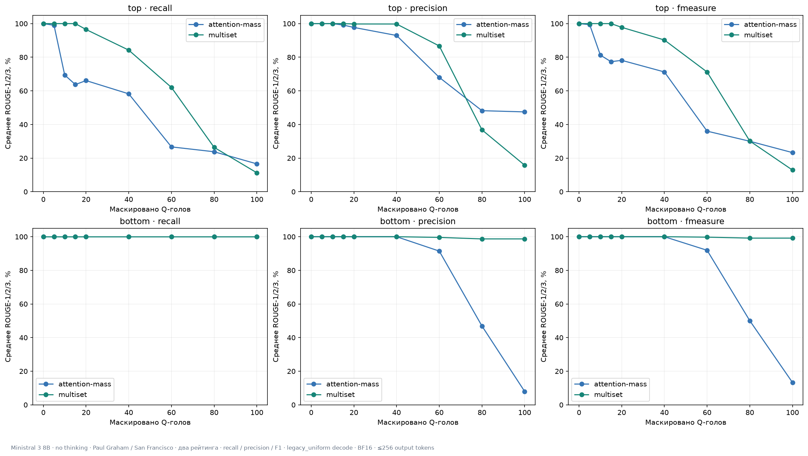

Галереи: [attention mass](report-assets/ministral3-8b-paul-graham-mask/attention-mass/README.md),
[multiset](report-assets/ministral3-8b-paul-graham-mask/multiset/README.md).
Каждая содержит17 наборов тепловых карт (ROUGE-1/2/3, среднее, exact),
5 сравнений по длине/глубине/k, 8 парных delta-карт и диагностику генераций;
вместе с общей фигурой —63 PNG и63 SVG. CSV и JSON оценок лежат рядом.
Повторное построение: `.venv/bin/python plot_ministral_paul_graham_mask.py`.

## 1. Протокол актуальных no-thinking экспериментов

Модель — `Qwen/Qwen3-8B`, адаптер `qwen3_8b_no_thinking`, FP16, A100-SXM4-80GB.
Checkpoint загружается с проектного диска, без повторного скачивания весов.
Контекст нативный, без YaRN; длина haystack до 30k, программный бюджет модели
32 768 включает chat prompt и выход. Генерация greedy.

Prefill использует `sdpa_flash`. В **detection** decode наблюдаемый: явно
вычисляет attention для сбора метрик. В **masking** decode использует Flash SDPA
с поддержкой GQA. Полные attention-матрицы в результатах не сохраняются.

Маска — `legacy_uniform`, только при decode; prefill не маскируется. Это
равномерное внимание выбранной головы, **не нулевой выход**: её вклад остаётся
усреднением V по доступным позициям. Поэтому «отключено k голов» в графиках —
сокращённое обозначение именно этой абляции, а не удаления k модулей модели.

Метрики голов и качества ответов не следует смешивать:

- `needle_token_multiset_v1` — совпадение generated token ID с top-1 источником
  внимания внутри needle-span, с ограничением повторных зачётов частотами токенов.
- `needle_attention_mass_v1` — сумма вероятностей attention на needle-span,
  усреднённая по decode-шагам, где generated token ID встречается в этом span.
  Это **не QRScore**: QRScore использует позиции входного вопроса, а не decode.
- ROUGE — лексическое совпадение ответа с `expected_answer`, не attention-score
  и не вероятность семантически правильного ответа.

## 2. Новый detection survey без thinking

[Конфиг](datasphere/qwen3-8b-no-thinking-survey.yaml),
[пересечения и полные списки голов](datasphere-results/qwen3-8b-no-thinking-survey/HEAD_INTERSECTIONS.md).

Задание `bt1l1difgr99qg632c60`: **SUCCESS**, завершено 9 октября в 22:56:57 МСК,
от создания до завершения — **7 мин 10 с**, включая подготовку.

Данные прежнего detection survey: три needle/вопроса × длины 8000/16000/30000
× глубины 15/45/75 = **27 генераций**. Context seed 42, лимит выхода 2048.
Это не 27 независимых вопросов. Агрегация по средним per-case scores;
все 27 случаев прошли прежний порог ROUGE-1 recall > 50.

| Сравнение множеств top-k | 4 | 16 | 64 | 120 |
|---|---:|---:|---:|---:|
| Новые mass ∩ multiset | 4 | 7 | 35 | 86 |
| Mass: thinking ∩ no-thinking | 1 | 10 | 58 | 112 |
| Multiset: thinking ∩ no-thinking | 4 | 14 | 56 | 110 |

Новый mass top-5: **29-11, 22-23, 24-22, 13-13, 13-29**.
Общие top-4 новых метрик: **29-11, 22-23, 24-22, 13-13**;
порядок между метриками различается. Индексы слоя и головы начинаются с нуля.

У mass заметно переставилась верхушка, но top-64 сохранил 58 голов прежнего
набора. Это не изолированная абляция thinking: prefill backend также изменён
с memory-efficient на Flash. QRScore и причинная специализация голов здесь
не проверялись.

## 3. Завершённый masking: Paul Graham / San Francisco

[Конфиг](datasphere/qwen3-8b-no-thinking-paul-graham-attention-mass-mask.yaml),
[исходные результаты](datasphere-results/qwen3-8b-no-thinking-paul-graham-attention-mass-mask-san-francisco/),
[галерея и описание пересчёта](report-assets/qwen3-8b-no-thinking-paul-graham-mask/README.md).

Задание `bt1k7k78e6t20kj241br`: **SUCCESS**, завершено 10 октября в 00:18:03 МСК.
Полное время от создания — около **2 ч 19 мин**.

**Здесь использован старый mass-рейтинг thinking survey**, не новый no-thinking
рейтинг. Сама модель генерирует без thinking. Один корпус, одна needle, seed 42.
Ожидаемый ответ: `eat a sandwich and sit in Dolores Park on a sunny day`.

20 длин от 1000 до 30000 × 10 глубин (0/11/22/33/44/56/67/78/89/100)
× 7 условий (baseline, top20/40/60/80/100/120) = **1400 генераций**,
по 200 на условие. Выход до 256 токенов. Сетка полная, SHA256 prompt совпадает
между условиями в каждой точке сетки. Исходный ROUGE-1 воспроизведён пересчётом.

### Качество: n-граммы вместо одних общих слов

ROUGE-1/2/3 ниже — **recall со stemming × 100**. «Среднее» — арифметическое
среднее этих трёх recall, пользовательская сводная оценка, не стандартный ROUGE.
Exact phrase — доля ответов с полной эталонной фразой подряд после нормализации
регистра и пунктуации, без stemming. Это строгая лексическая проверка, не оценка
смысловой эквивалентности. Precision и F1 также сохранены в CSV/JSON.

| Маска | ROUGE-1 | ROUGE-2 | ROUGE-3 | Среднее 1/2/3 | Exact phrase, % |
|---|---:|---:|---:|---:|---:|
| baseline | 100.00 | 99.91 | 99.85 | 99.92 | 99.5 |
| top20 | 74.08 | 60.95 | 59.10 | 64.71 | 45.0 |
| top40 | 34.92 | 1.91 | 1.35 | 12.73 | 0.0 |
| top60 | 32.42 | 2.86 | 1.55 | 12.28 | 0.0 |
| top80 | 26.13 | 6.50 | 3.15 | 11.93 | 0.0 |
| top100 | 22.63 | 5.14 | 2.55 | 10.10 | 0.0 |
| top120 | 21.04 | 3.00 | 1.80 | 8.61 | 0.0 |

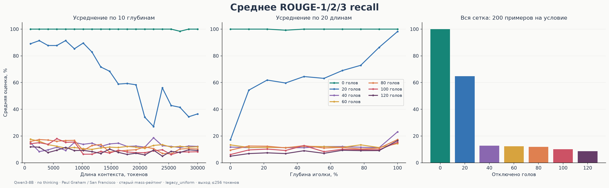

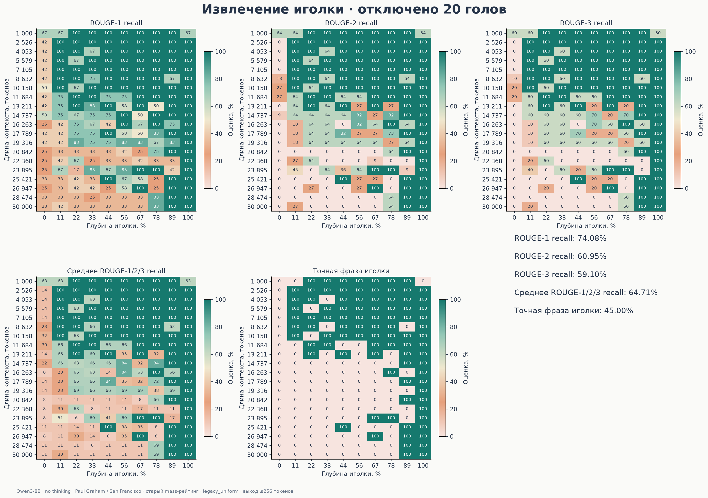

Карты для каждого размера маски и сравнения всех метрик доступны в галерее.
[cases.csv](report-assets/qwen3-8b-no-thinking-paul-graham-mask/cases.csv),
[summary.csv](report-assets/qwen3-8b-no-thinking-paul-graham-mask/summary.csv),
[скрипт пересчёта и графиков](plot_paul_graham_mask.py).
Пересчёт использует сохранённый `model_response`; исходные JSON и `score`
не изменялись, повторная генерация не выполнялась.

### Интерпретация

При top20 качество снижается на длинных контекстах и у начала контекста;
иголка у конца значительно устойчивее. Начиная с top40, ROUGE-2/3 почти
обнуляются: общие ответы про город дают unigram overlap, но практически
не воспроизводят нужные последовательности слов. В ответах встречаются
повторы и общие рассуждения, несмотря на выключенный thinking.

Нулевой exact match сам по себе не доказывает полного отсутствия сведений:
частичный ответ или перефразирование тоже не пройдут эту проверку. Recall
не штрафует лишний текст и не проверяет отрицание/согласие с процитированным
фактом. Один корпус и одна needle ограничивают переносимость выводов.

## 4. Завершённый эксперимент: новый mass-рейтинг, top5–40

[Конфиг](datasphere/qwen3-8b-no-thinking-paul-graham-new-mass-top5-40-mask.yaml).
Задание **bt1fsj89jp523daa3n8g**, создано 10 октября в **00:40 МСК**.
**SUCCESS**, завершено в **03:03:41 МСК**; от создания — **2 ч 23 мин 32 с**.
Все 1800 исходных JSON скачаны; подтверждены полная сетка, одинаковые prompt
SHA256 между условиями и воспроизведение исходного ROUGE-1 пересчётом.

От предыдущего протокола меняются рейтинг и размеры маски:

- Входной рейтинг — `qwen3-8b-no-thinking-survey`, **needle_attention_mass_v1**.
- Baseline + top5/10/15/20/25/30/35/40, без bottom и random.
- Те же корпус, needle, 20 длин, 10 глубин, seed 42, A100, выход 256 токенов.
- **1800 генераций**, отдельная папка результатов
  `datasphere-results/qwen3-8b-no-thinking-paul-graham-new-mass-top5-40-mask-san-francisco`.

### Итоговые оценки: новый рейтинг

Метрики и нормализация совпадают с разделом 3; по 200 примеров на строку.

| Маска | ROUGE-1 | ROUGE-2 | ROUGE-3 | Среднее 1/2/3 | Exact phrase, % |
|---|---:|---:|---:|---:|---:|
| baseline | 100.00 | 99.91 | 99.85 | 99.92 | 99.5 |
| top5 | 99.67 | 99.50 | 99.50 | 99.56 | 99.5 |
| top10 | 99.50 | 99.00 | 99.00 | 99.17 | 99.0 |
| top15 | 85.54 | 79.64 | 78.05 | 81.08 | 69.0 |
| top20 | 60.92 | 40.55 | 38.20 | 46.55 | 16.0 |
| top25 | 44.67 | 16.64 | 14.45 | 25.25 | 3.5 |
| top30 | 41.71 | 13.50 | 11.45 | 22.22 | 1.5 |
| top35 | 39.08 | 11.27 | 9.75 | 20.04 | 0.0 |
| top40 | 34.96 | 5.09 | 3.15 | 14.40 | 0.0 |

| Маска | Время генераций, мин | Достигнут лимит 256, случаев |
|---|---:|---:|
| baseline | 9.38 | 0 |
| top5 | 9.30 | 1 |
| top10 | 9.55 | 1 |
| top15 | 11.22 | 3 |
| top20 | 17.19 | 22 |
| top25 | 19.29 | 17 |
| top30 | 18.87 | 7 |
| top35 | 19.42 | 4 |
| top40 | 19.84 | 0 |

Отключение 5–10 голов почти не меняет средние оценки в этой сетке.
Заметная деградация возникает между top10 и top20; при top25–40 полная
эталонная фраза практически исчезает. При top40 все ответы завершились до
лимита, но качество осталось низким: деградацию нельзя объяснить только
обрывом генерации. Это вывод по одному needle/корпусу, не универсальный порог.

При top20 среднее ROUGE-1/2/3 нового рейтинга — **46.55 против 64.71** у старого;
exact phrase — **16% против 45%**. При top40 среднее — **14.40 против 12.73**.
То есть новый рейтинг не усиливает деградацию монотонно при каждом k.
Сравниваются разные наборы голов, а не только один параметр thinking.

[Полные таблицы](report-assets/qwen3-8b-no-thinking-paul-graham-new-mass-top5-40/README.md):
для всех пяти метрик — средние по длине, по глубине и отдельные таблицы
«длина × глубина» для baseline и каждого top-k.
[cases.csv](report-assets/qwen3-8b-no-thinking-paul-graham-new-mass-top5-40/cases.csv),
[summary.csv](report-assets/qwen3-8b-no-thinking-paul-graham-new-mass-top5-40/summary.csv),
[скрипт](tabulate_new_mass_mask.py). Исходные JSON и рейтинги не изменены.

[Галерея графиков нового прогона](report-assets/qwen3-8b-no-thinking-paul-graham-new-mass-top5-40/visualizations/README.md):
9 отдельных фигур с тепловыми картами для baseline и top5–40 и 5 сравнительных
фигур по метрикам, каждая в PNG и SVG. Построены по тем же 1800 исходным JSON.


## 5. Предыдущие thinking-прогоны до 48k

Два парных эксперимента: multiset и attention-mass, по 252 результата,
3 корпуса × 4 длины × 3 глубины × 7 условий, выход до 2048.
**504 файла — не 504 независимых наблюдения**: входы парные, baseline дублируется.
Проверены совпадение prompt SHA256 и baseline выходных токенов между заданиями.

116 генераций достигли лимита: **109 внутри think и 7 после начала ответа**.
Пустой финальный ответ при незакрытом think давал нулевой final-answer ROUGE.
Пересчёт по полному сгенерированному тексту (think + ответ, без prompt)
сохранён отдельно: он показывает лексическое наличие сведений, но не заменяет
оценку завершённого ответа. Наблюдения совместимы с нарушением завершения
рассуждений при masking, однако не доказывают существование специальных
«голов завершения thinking».

Подробности: [анализ](report-assets/qwen3-8b-three-corpora-mask/ANALYSIS.md),
[все случаи обрыва](report-assets/qwen3-8b-three-corpora-mask/TRUNCATION_CASES.md),
[галерея full-generation ROUGE](report-assets/qwen3-8b-three-corpora-mask/full-generation-rouge/plots/README.md).

---

# Исторический отчёт: состояние на 8 октября 2026 года

Следующие разделы сохранены для истории. На тот момент masking и no-thinking
survey ещё не были выполнены; актуальные результаты находятся выше.

## 1. Краткий итог

- Реализованы адаптеры Qwen3-4B-Thinking-2507, обычной Qwen3-8B и Qwen3-8B с YaRN.
- Attention анализируется онлайн; полные матрицы по умолчанию не накапливаются.
- Три метрики голов можно вычислять на одной генерации, с thinking или без него.
- Сбор результатов, агрегация рейтингов и masking разделены на отдельные этапы.
- Проверена работа Qwen3-4B на 48k и Qwen3-8B на 30k на V100 32 ГБ.
- Survey 8B: 27 завершённых случаев, все EOS, средний ROUGE-1 recall — 93,15 из 100.
- Legacy и multiset почти одинаково ранжируют головы; attention-mass даёт
  отличающийся рейтинг. Это наблюдение, не доказательство причинной важности.

## 2. Что изменилось в коде

### Модели и загрузка

Общие загрузка checkpoint, chat prompt и cached decode находятся в
[`qwen_common.py`](retrieval_heads/models/qwen_common.py). Загружается исходная
модель Transformers; собственный attention-backend подключается для наблюдения
и маскирования во время decode, а не заменяет архитектуру модели.

Доступны адаптеры:

| Имя | Checkpoint / назначение | Бюджет контекста |
|---|---|---|
| `qwen35` | Qwen3.5, гибридная архитектура; наблюдаются full-attention слои | Из конфигурации модели |
| `qwen3` | Dense Qwen3, по умолчанию Qwen3-4B-Thinking-2507 | Из конфигурации модели |
| `qwen3_8b` | Qwen/Qwen3-8B, без включения YaRN | 32 768 токенов |
| `qwen3_8b_no_yarn_64k` | Те же веса 8B, исходный RoPE без масштабирования | 65 536 токенов (экспериментально) |
| `qwen3_8b_yarn` | Те же веса 8B, static YaRN × 4 | 131 072 токена |

Бюджет включает **полный chat prompt + max_new_tokens**. Thinking и финальный
ответ делят общий лимит генерации. Вариант `qwen3_8b_no_yarn_64k` только
поднимает программный предел позиций, сохраняя исходные параметры RoPE; это
немасштабированная экстраполяция за нативные 32 768 токенов, и качество на 48k
может снизиться. Вариант YaRN отличается настройками RoPE и расширенным лимитом:
код inference, метрики и masking общие. Настройки применяются
при загрузке; веса и `config.json` на диске не изменяются.

[`model_source.py`](retrieval_heads/model_source.py) поддерживает явный локальный
checkpoint и заданные корни поиска. Готовый локальный checkpoint проверяется и
загружается с `local_files_only=True`. В облачных Qwen3-конфигах используется
проектный диск и offline-режим: повторного скачивания весов между джобами нет.

### Prefill, память и наблюдение

Prompt обрабатывается через выбранный prefill-backend, затем модель генерирует
по одному токену с KV-кэшем. Генерация сейчас greedy; sampling-параметры в этих
экспериментах не используются.

В [`prefill.py`](retrieval_heads/attention/prefill.py) добавлен
`sdpa_memory_efficient`: K/V временно повторяются до числа query-голов, GQA-флаг
не используется, разрешён только efficient SDPA backend. Тихий fallback на
квадратично затратный math-backend запрещён. Кэш остаётся компактным GQA-кэшем.
Обычный `sdpa` и `flash_attention_2` остаются выбираемыми; установленный и
проверенный путь в описанных длинных прогонах — `sdpa_memory_efficient`.

Controller на каждом анализируемом шаге передаёт компактные значения:
top-1 позицию для старых метрик и/или сумму attention по needle-span для новой.
Данные шага освобождаются после обновления коллектора. `--capture full` — отдельный
дорогой режим сохранения полных decode-распределений, в описанных прогонах выключен.

### Thinking и оценка ответа

`--attention-scope answer_only` анализирует только шаги после `</think>`;
`all_decode_tokens` включает thinking. Qwen3 по умолчанию использует answer_only,
но survey явно выбирает all_decode_tokens. ROUGE независимо от scope считается
по финальному ответу; незавершённое thinking не считается финальным ответом.
EOS завершает Qwen3; переводы строки не останавливают её thinking.

### Три метрики голов

Реализации разделены на классы в [`scoring.py`](retrieval_heads/experiment/scoring.py).
Здесь «needle-span» — диапазон в промпте, найденный исходным overlap-locator по
**ожидаемому ответу** (`real_needle`), не обязательно вся вставленная фраза.
Совпадения определяются по token ID токенизатора, а не по целым словам.

| Метрика | Правило | Диапазон |
|---|---|---|
| `legacy` | Top-1 внимания попал в span, и token ID источника совпал с генерируемым: +1 / длина span. Повторы не ограничены | Может быть > 1 |
| `needle_token_multiset_v1` | То же попадание, но число зачётов каждого token ID ограничено его частотой в span отдельно для каждой головы | 0–1 |
| `needle_attention_mass_v1` | На шагах, где generated token ID встречается в span, суммируется внимание головы по всему span; затем среднее по таким шагам | 0–1 |

Attention-mass учитывает повторные квалифицирующие шаги и нулевую массу;
если таких шагов нет, score равен нулю. Это не вероятность правильности ответа.
Все три метрики считаются на одной генерации, поэтому сравнение не смешивает
разные выводы модели. Отсортированные общие рейтинги используют средние
per-case scores; у attention-mass это среднее средних по случаям, а не единое
среднее всех токенов всех случаев.

### Разделение этапов и сохранение результатов

1. [`retrieval_head_detection.py`](retrieval_head_detection.py) сохраняет каждый
   завершённый случай без отсева: контекст, ответ, thinking, выходные token IDs,
   ROUGE, время, причину остановки и итоговые scores всех голов по всем метрикам.
2. [`aggregate_head_scores.py`](aggregate_head_scores.py) работает на CPU:
   читает эти результаты, отбирает случаи и создаёт общий рейтинг.
3. [`needle_in_haystack_with_mask.py`](needle_in_haystack_with_mask.py) читает
   выбранный рейтинг и проверяет влияние маскирования.

По умолчанию агрегация включает только случаи с ROUGE **строго > 50**. Можно
использовать `--all-cases`, другой порог, фильтры корпусов/длин/позиций и отдельную
папку вывода. Исходные per-case результаты при этом не меняются.
Именованные рейтинги и manifest агрегации лежат в `detection/aggregation/`.
Общего alias `head_scores.json` новые прогоны не создают. `run_id` позволяет
отличить результаты текущего запуска от файлов, оставшихся в той же папке.

**Детализация по умолчанию:** одна генерация → метрика → голова → итоговый score.
Пошаговые scores, attention-векторы, logits, скрытые состояния и KV-кэш не
сохраняются. Полный входной список token IDs также не сохраняется, только его
SHA256 и текст контекста. Для attention-mass сохраняется число учтённых шагов.
Низкий ROUGE не мешает сохранить индивидуальные scores; технический сбой до
завершения генерации может оставить текущий случай без result JSON.

### Masking и запуск этапов

`datasphere/job.py` имеет режимы `smoke` (detection), `mask` (готовый рейтинг)
и `full` (detection → агрегация → masking). В survey-YAML detection и агрегатор
последовательно вызываются напрямую, без masking.

Алгоритмы выбора: top-k, bottom-k и random. Bottom-k берёт хвост всего рейтинга;
при равных оценках выбор фиксируется порядком рейтинга. Random по прежней схеме
исключает лидирующие головы. В обёртке выбирается набор `--mask-selections`,
размеры маски, context seeds и число random-повторов; baseline выполняется один
раз на соответствующий вход.

Выбор голов и способ воздействия — разные параметры. Прежний `legacy_uniform`
обнуляет attention-logits выбранных голов до softmax, получая равномерное
распределение, **не нулевой выход головы**. `zero_output` — отдельная абляция.
Masking применяется ко всему decode, включая thinking; prefill не маскируется.

## 3. Что уже протестировано

| Прогон | GPU / контекст | Результат |
|---|---|---|
| Qwen3-4B Thinking smoke | T4, 1k, лимит генерации — 2048 | 3 случая, ROUGE recall — 100, EOS |
| Memory smoke 4B | T4, 24k | 3 случая, recall — 100, EOS; peak allocated — 12,536 GiB |
| Thinking smoke 4B | T4, 24k, all_decode_tokens | Те же входы и выходные token IDs, но анализ включает thinking |
| Single smoke 4B | V100, 48k | Recall — 100, EOS после 514 токенов, 137,58 с, peak — 17,612 GiB |
| Single smoke 8B без YaRN | V100, 30k, три метрики | Recall — 85, EOS после 475 токенов, 89,47 с, peak — 22,343 GiB |
| Survey 8B без YaRN | V100, 8k / 16k / 30k | 27 из 27 завершённых случаев и default aggregation |

Диагностические неудачи тоже важны:

- Обычный SDPA на T4 завершился OOM на первом случае 8k после трёх успешных случаев 4k:
  путь GQA перешёл на math attention. Исправление проверено memory-efficient
  smoke на 24k и последующими V100-прогонами.
- Попытка запуска на 48k на `gt4i.1` отклонена сервисом: конфигурация недоступна сообществу;
  реального замера T4i нет.
- Первый smoke 8B на 30k остановлен из-за CUDA busy/unavailable на выделенной машине;
  это не OOM. Один повтор на V100 успешно завершился.

Локальная проверка на момент отчёта: **53 теста, все прошли**.
В локальных тестах проверены tiny original Qwen3 forward/cache, восстановление
backend после ошибок, attention scope, компактный capture, три формулы, выбор
ranking/bottom-k, общие full/mask циклы и отдельная агрегация. Проверка YaRN на
tiny checkpoint подтвердила одинаковые веса, разные RoPE частоты и finite
forward на позиции 48k; это не проверка качества реальной 8B с YaRN.

## 4. Основной результат: Qwen3-8B survey

Конфигурация: [`qwen3-8b-survey.yaml`](datasphere/qwen3-8b-survey.yaml).
Полные локальные данные: `datasphere-results/qwen3-8b-survey/` (игнорируются Git).

- 3 исходных корпуса: `part1`, `part2`, `part3`; по одному needle и вопросу на корпус.
- Длины: 8 000 / 16 000 / 30 000 токенов; позиции: 15 / 45 / 75 %; context seed — 42.
- 3 × 3 × 3 = **27 генераций**, а не 27 независимых вопросов.
- Нативная 8B, V100 с 32 ГБ VRAM, FP16, memory-efficient prefill; лимит генерации — 2048 токенов.
- Все 3 метрики, scope — `all_decode_tokens`; корпусные файлы не изменялись.

Джоба работала примерно с 12:47 до 13:19 МСК — около 32 минут с подготовкой и выгрузкой.
Суммарное время генераций — **1 530,77 с (25,51 мин)**.
Все 27 случаев остановились по EOS; средняя длина выхода — 401,04 токена,
максимальная — 563. Поэтому эти результаты не проверяют худший случай — 2048 токенов decode.
Пик PyTorch allocated в survey достиг 22,338 GiB. Это не общий расход GPU:
CUDA и reserved memory учитываются мониторингом отдельно.

ROUGE-1 здесь — **recall со stemming × 100**, не F1 и не семантическая accuracy:

| Разрез | Средний recall |
|---|---:|
| Все 27 случаев | 93,15 |
| detect-1: отчёт WMO | 98,33 |
| detect-2: прогулка в Beijing | 90,37 |
| detect-3: Mr. Green | 90,74 |
| Контекст 8k | 97,53 |
| Контекст 16k | 86,67 |
| Контекст 30k | 95,25 |

Минимум — 53,33, максимум — 100; все 27 прошли default-порог > 50, поэтому в этом
survey агрегация по успешным случаям совпадает с агрегацией всех случаев.
Немонотонность по длине не доказывает улучшение на 30k: выборка маленькая,
различаются позиции и ответы.

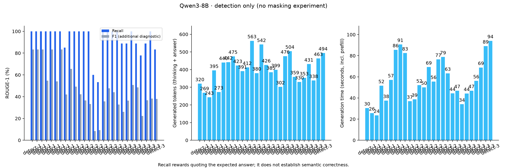

### Лидирующие головы

Обозначение — `слой-голова`, индексы начинаются с 0. В каждой метрике ранжируются
1152 головы по среднему score по 27 случаям.

| Метрика | Первые 5 голов |
|---|---|
| Legacy | 22-23, 13-15, 29-11, 24-22, 20-26 |
| Multiset | 22-23, 29-11, 24-22, 13-13, 20-26 |
| Attention-mass | 22-23, 23-10, 13-15, 7-4, 19-24 |

Голова 22-23 лидирует во всех трёх: средние — 2,070533 / 0,982456 / 0,375923
соответственно. Числа разных метрик не сравниваются напрямую по величине.

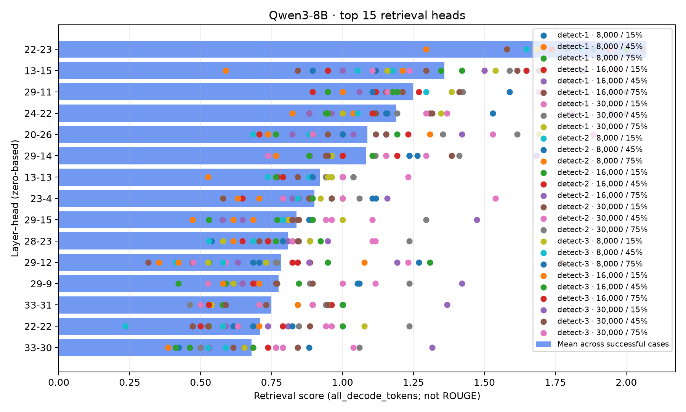

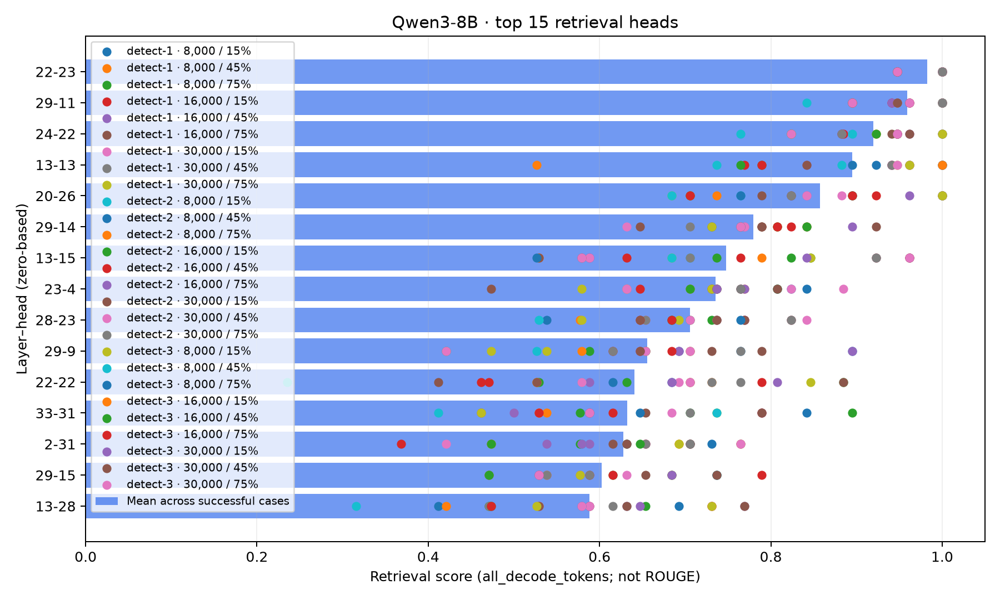

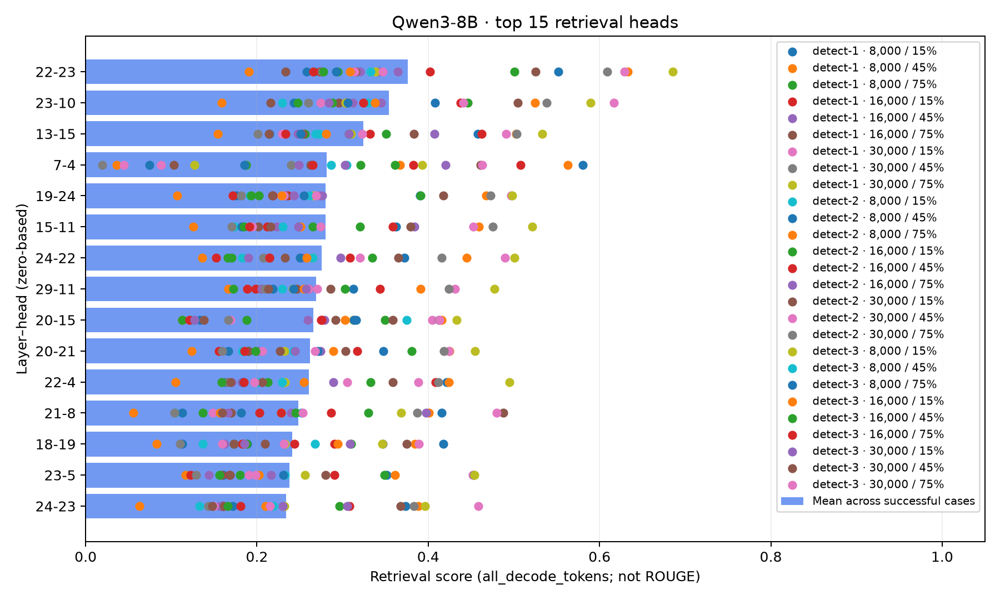

Ниже heatmap основной top-1 метрики **multiset**: внимание должно попасть
в needle-span с совпадающим token ID, а повторные зачёты ограничены частотами
токенов. Карта показывает средние оценки всех слоёв и голов на шкале 0–1.

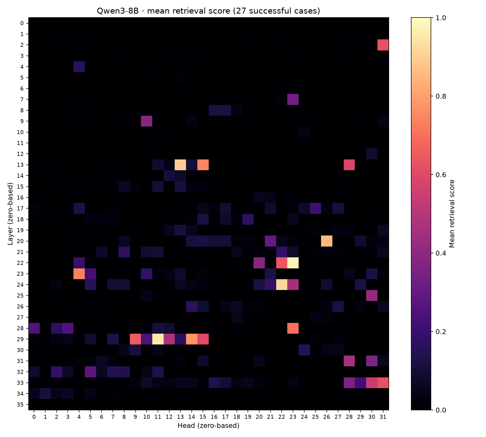

### Связь между метриками

Корреляции рассчитаны между **средними scores 1152 голов** по 27 случаям.
Пирсон сравнивает величины, Спирмен — ранги с усреднением связанных рангов.

| Пара | Пирсон | Спирмен |
|---|---:|---:|
| Legacy / Multiset | 0,9744 | 0,9989 |
| Legacy / Attention-mass | 0,6813 | 0,7551 |
| Multiset / Attention-mass | 0,6688 | 0,7571 |

У legacy и multiset 798 голов имеют нулевое среднее, у attention-mass нулевых нет.
Совпадающие нули влияют на корреляции. Высокий глобальный коэффициент не означает
одинаковый top-k или устойчивость каждой головы между корпусами.

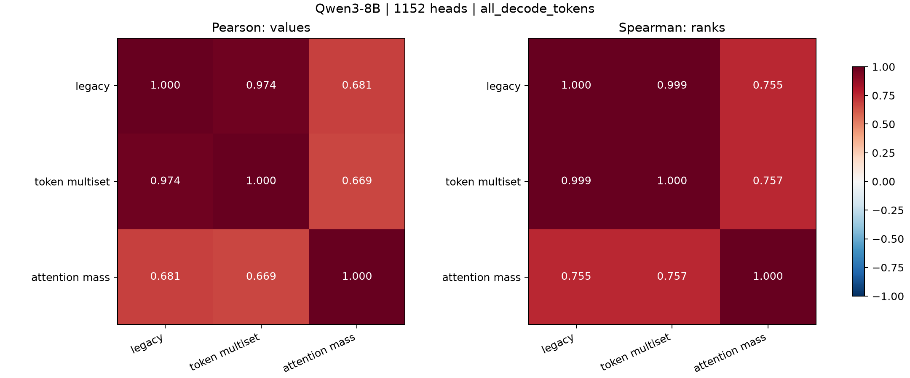

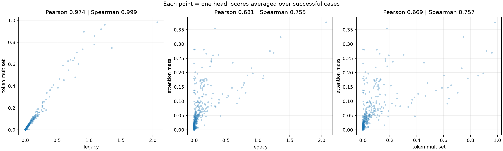

На следующем графике выделены конкретные головы: объединение top-5 каждой
метрики, остальные головы показаны серым фоном. Всего в анализе 1152 головы.
Подписи — `слой-голова` с индексацией от 0; цвет одной головы одинаков во всех трёх панелях.
Это позволяет увидеть, как одна и та же голова оценивается разными метриками.
Выделение top-5 не меняет коэффициенты корреляции по всем головам выше.

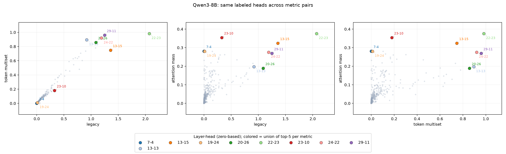

## 5. Ограничения и дальнейшая проверка

1. **Мало независимых задач:** три needle/вопроса. Длины и позиции — повторные
   условия на этих задачах, не новые независимые корпуса.
2. **Recall недостаточен:** модель может процитировать needle и одновременно
   оспорить её как постороннюю вставку; высокий ROUGE не гарантирует смысловую
   корректность. Это наблюдалось в smoke 4B и встречается в оговорках ответов 8B.
3. **Greedy и лимит генерации 2048:** выводы относятся к текущему decoding-протоколу; длинное
   thinking может исчерпать бюджет. В survey этого не произошло.
4. **Причинная важность не проверена для нового survey 8B:** нужны baseline,
   top/bottom/random masking с одинаковыми входами и одинаковым числом голов.
5. **YaRN survey отсутствует:** реализация протестирована локально, но реальное
   качество и память 8B с YaRN ещё не измерены.
6. **Парность сравнений:** при одинаковых данных/tokenizer/grid/context-seed
   нативный и YaRN adapters должны получить одинаковые промпты. Проверять
   `prompt_sha256` по каждому случаю; если успешные наборы различаются, рейтинги
   сравнивать на общем выбранном наборе, а не смешивать разные случаи.
7. **Новых метрик из сохранённых attention не получить:** трейсы не сохранены.
   Можно повторно менять отбор и агрегацию уже рассчитанных per-case scores.

Следующие разумные шаги: разобрать оценки отдельно по трём корпусам и проверить
пересечение top-k, затем парный survey с YaRN на той же сетке, затем уменьшенный
masking-эксперимент. Это план, не уже полученные результаты.

## 6. Как воспроизвести обработку результатов

Команды выполняются из `updated/`, после скачивания результатов джобы:

```bash
python aggregate_head_scores.py --run datasphere-results/qwen3-8b-survey
python plot_results.py --run datasphere-results/qwen3-8b-survey --metric legacy
python plot_results.py --run datasphere-results/qwen3-8b-survey --metric needle_token_multiset_v1
python plot_results.py --run datasphere-results/qwen3-8b-survey --metric needle_attention_mass_v1
python plot_metric_correlations.py --run datasphere-results/qwen3-8b-survey
```

Для альтернативного отбора задавайте отдельную папку, чтобы не перезаписать
default aggregation:

```bash
python aggregate_head_scores.py --run datasphere-results/qwen3-8b-survey \
  --all-cases --output-dir datasphere-results/qwen3-8b-survey/detection/aggregation-all
```

Иллюстрации отчёта — копии выбранных графиков в [`report-assets/`](report-assets/).
Эта папка находится вне игнорируемой `datasphere-results/`, поэтому отчёт
можно хранить с изображениями без добавления всех сырых результатов в Git.
