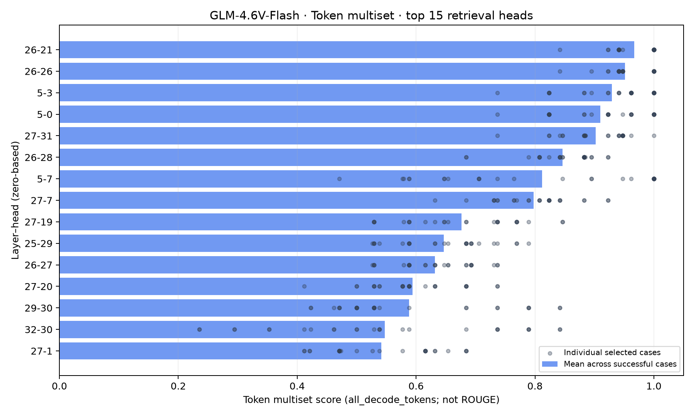
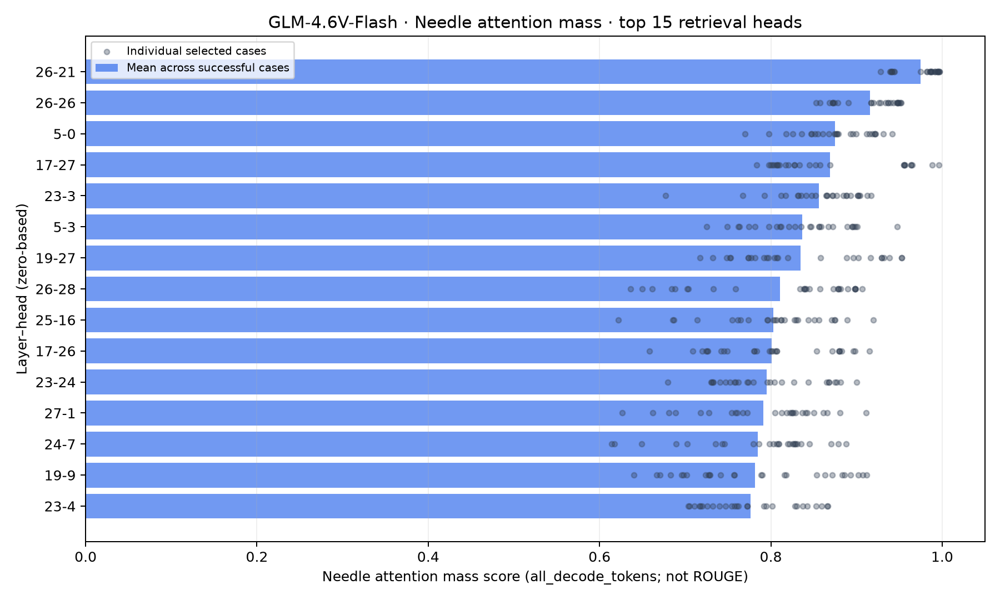
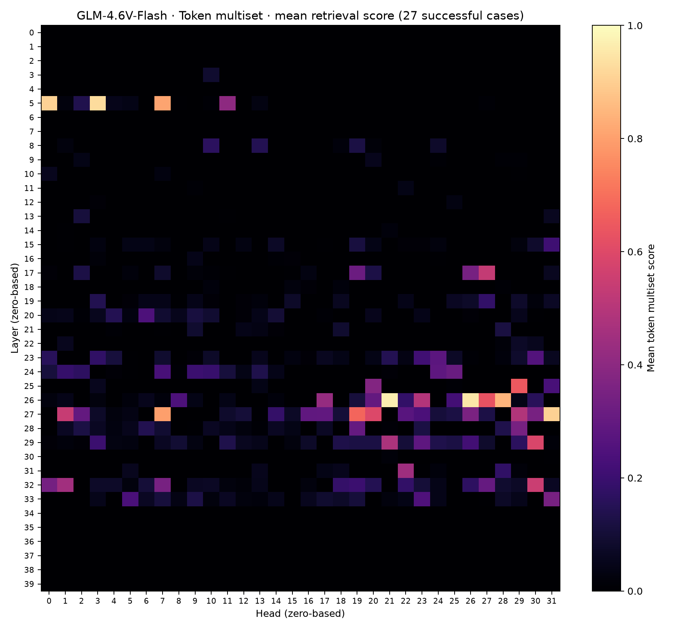
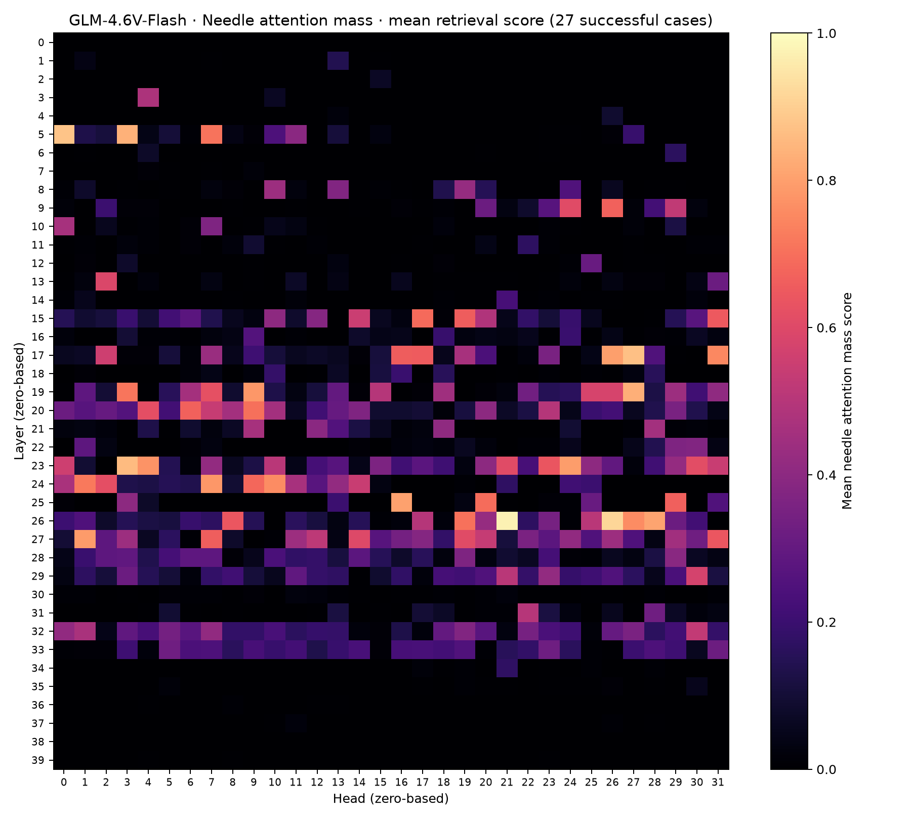
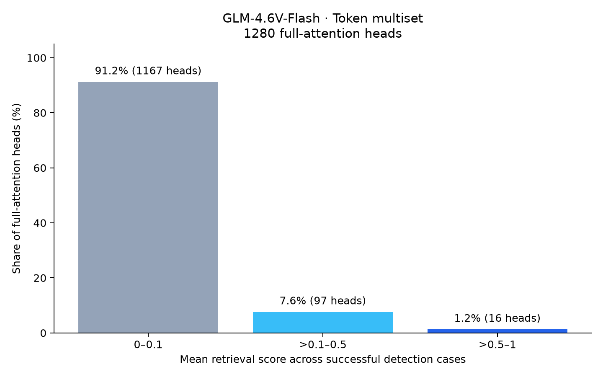
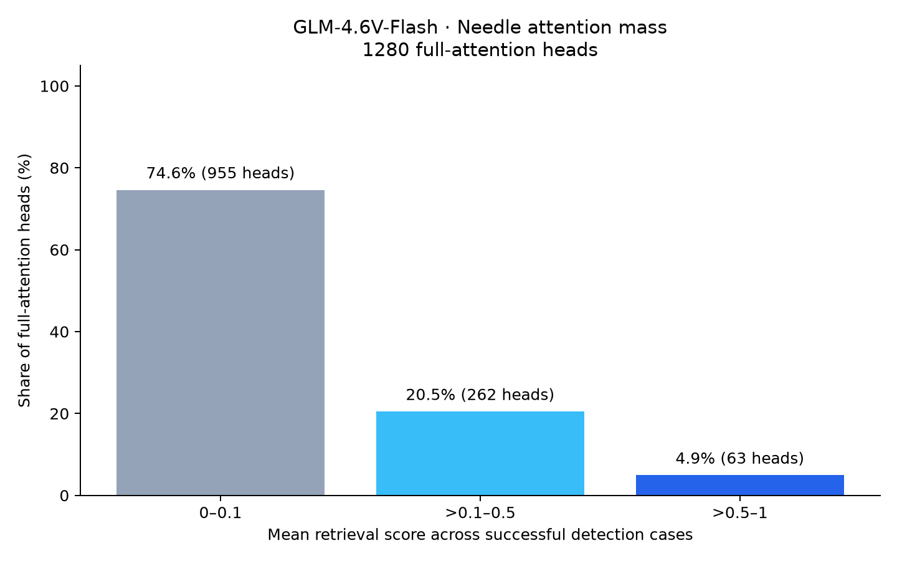
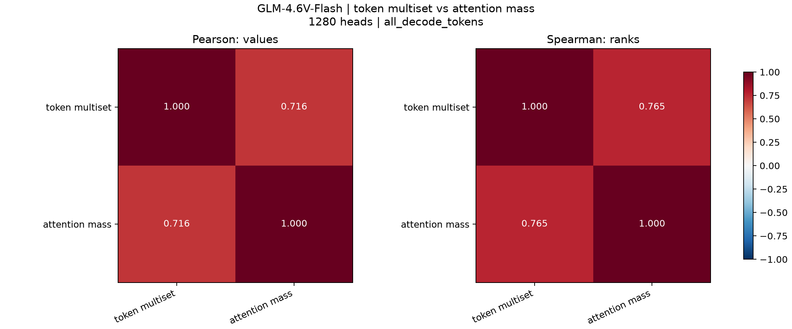
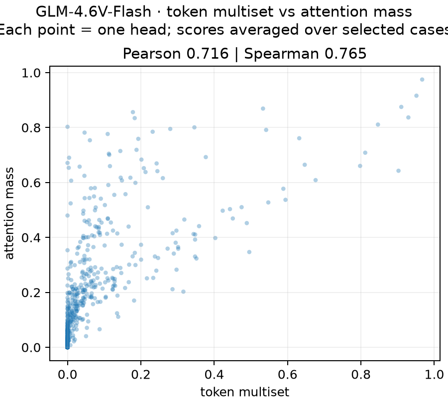
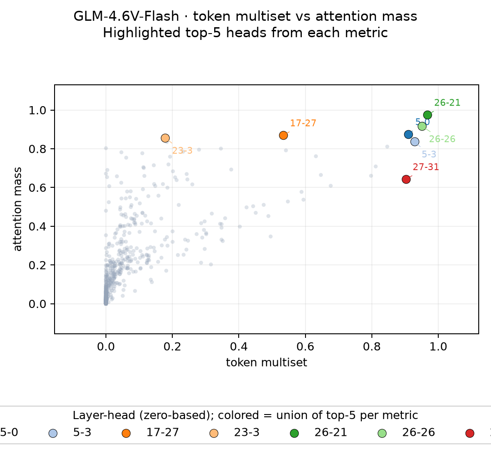
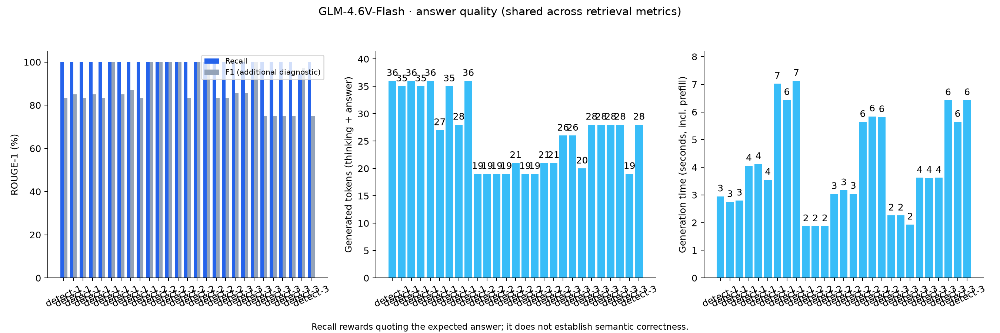

# GLM-4.6V-Flash: анализ retrieval heads без thinking

Job `bt13713fk021qlqi1imi` завершился SUCCESS 10 октября 2026 в 15:29:05 МСК.
Скачаны исходные результаты и логи. Сетка как у Ministral context-only survey:
3 detection-кейса × длины 8000/16000/30000 × глубины 15/45/75%; seed42,
A100/BF16, Flash prefill, наблюдаемый eager decode, лимит256,
`all_decode_tokens`. Использован штатный `enable_thinking=False`.

Источник: [detection manifest](../../datasphere-results/glm4-6v-flash-survey-download/glm4-6v-flash-no-thinking-context-only-survey/detection/run.json),
[агрегация](../../datasphere-results/glm4-6v-flash-survey-download/glm4-6v-flash-no-thinking-context-only-survey/detection/aggregation/run.json).
Повторная CPU-агрегация в отдельной временной папке точно совпала с тремя
облачными histories. Исходные JSON и рейтинги не изменены.

## Качество и проверки

- Все27 результатов уникальны и соответствуют полной сетке; needle найдена
  дословно в каждом сохранённом контексте.
- Средний ROUGE-1 recall **99.79%**; 26 ответов100%, один94.44%
  (`detect-3`, 30000, 45%: отсутствует слово «Because», содержание сохранено).
- Все27 завершены по EOS; 19–36 токенов, среднее26.37. Сгенерированных
  `<think>`/`</think>` нет, `final_answer_started=True` во всех ответах.
- Все27 проходят исторический порог **ROUGE-1 recall >50**, поэтому рейтинги
  используют всю сетку. Всего **1280 Q-голов: 40 слоёв ×32**, без vision heads.
- Средний precision79.60%, F1 87.75%. Эти дополнительные оценки относятся
  к сохранённому `model_response`: девять ответов содержат служебные
  `<|begin_of_box|>`/`<|end_of_box|>`, которые ROUGE токенизирует как слова;
  также бывают вводные фразы. Их не следует трактовать как ошибки извлечения.
  Разметку намеренно не очищали задним числом.

## Лидеры рейтингов

Среднее по27 случаям; индексация `слой-голова` с нуля.
Retrieval score — метрика головы, **не ROUGE ответа**.

| Место | Token multiset | Score | Attention mass | Score |
|---|---|---:|---|---:|
| 1 | 26-21 | 0.966897 | 26-21 | 0.974859 |
| 2 | 26-26 | 0.951302 | 26-26 | 0.915955 |
| 3 | 5-3 | 0.929291 | 5-0 | 0.875142 |
| 4 | 5-0 | 0.909996 | 17-27 | 0.869089 |
| 5 | 27-31 | 0.902384 | 23-3 | 0.856180 |

У `26-21` mass score во всех27 случаях находится в диапазоне0.928–0.997,
у `26-26` —0.853–0.952: высокое среднее не возникает из одного удачного случая.
В top20 multiset 11 голов относятся к слоям26–27; mass выделяет более широкий
набор слоёв5,17,19,23–27. Пересечение top20 двух метрик — **8 голов**.

Multiset/mass: **Pearson0.7164, Spearman0.7649**, по всем1280 головам.
924 головы имеют нулевой средний multiset score; у mass нулевых нет.
Нулевая top1-метрика не означает отсутствия внимания к needle.
В галерее ровно две исследуемые метрики: **Token multiset** и
**Needle attention mass**. Исторический legacy сохранён в исходных данных,
но не показывается как третья метрика. Название метрики указано на каждой
карте, распределении и top-15.

Это detection, не абляция: причинная важность голов ещё не проверена masking.
Сравнение качества с Ministral (86.81% против99.79% recall) описательное:
одинаковые nominal lengths/seed не гарантируют одинакового текста контекстов
при разных токенизаторах. Номера голов между моделями напрямую не сопоставимы.

## Top-15

Столбцы — средние; точки — отдельные выбранные случаи в порядке агрегации.





## Карты слоёв и голов





## Распределения scores





## Корреляции и конкретные головы







Числа: [correlations.json](metric-correlations/correlations.json).

## Диагностика ответов



Диагностика ответов показана один раз: она не зависит от метрики голов.
Всего10 PNG: по3 для каждой метрики,3 сравнения двух метрик и1 диагностика.
Данные с полными средними scores всех голов и case-level оценками:
[multiset](needle_token_multiset_v1/plot_data.json),
[mass](needle_attention_mass_v1/plot_data.json).

## Воспроизведение

Из `updated/`:

```bash
for metric in needle_token_multiset_v1 needle_attention_mass_v1; do
  MPLCONFIGDIR=/tmp/retrieval-heads-mpl .venv/bin/python plot_results.py \
    --run datasphere-results/glm4-6v-flash-survey-download/glm4-6v-flash-no-thinking-context-only-survey \
    --metric "$metric" \
    --output "report-assets/glm4-6v-flash-no-thinking-survey/$metric" \
    --answer-output report-assets/glm4-6v-flash-no-thinking-survey/answer_quality.png
done
MPLCONFIGDIR=/tmp/retrieval-heads-mpl .venv/bin/python plot_metric_correlations.py \
  --run datasphere-results/glm4-6v-flash-survey-download/glm4-6v-flash-no-thinking-context-only-survey \
  --metrics needle_token_multiset_v1,needle_attention_mass_v1 \
  --output report-assets/glm4-6v-flash-no-thinking-survey/metric-correlations
```

Общая диагностика сохраняется в `answer_quality.png` без копий в каталогах
метрик. Использованы те же
скрипты, что для Qwen и Ministral; исправлены подписи и добавлен явный выбор
метрик для сравнения. Код генерации моделей не менялся.
