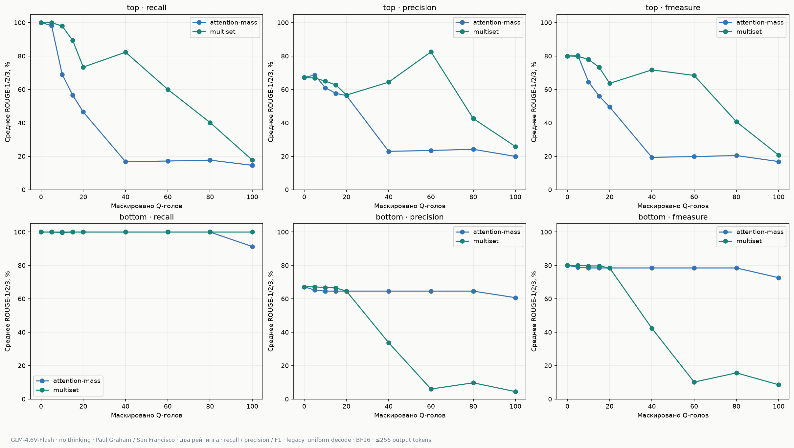

# GLM-4.6V-Flash: Paul Graham masking

Оба задания SUCCESS. Проверено 3740 уникальных результатов, по1870 на рейтинг.
Одинаковые 110 prompt-хэшей для всей сетки и обоих рейтингов.
Различия baseline generated_token_ids между заданиями: 0/110.

[Attention mass — полная галерея](attention-mass/README.md)

[Multiset — полная галерея](multiset/README.md)

Всего 63 фигуры, каждая в PNG и SVG. Исходные результаты не изменялись.

[SVG](plots/ranking_comparison.svg)

Общая фигура: recall, precision и F1. [Сводная CSV](quality_summary.csv).

Detection-карты слоёв и голов: [survey](../glm4-6v-flash-no-thinking-survey/README.md).

Не сравнивать напрямую с Qwen как контролируемую абляцию: отличаются модель, prompt, сетка и ranking.

[Подробный анализ и оговорки GLM-разметки](ANALYSIS.md)

[Диагностические оценки с box-маркерами, заменёнными пробелами](box_normalized_quality_summary.csv)
Эти оценки не заменяют исходные score и основные графики.