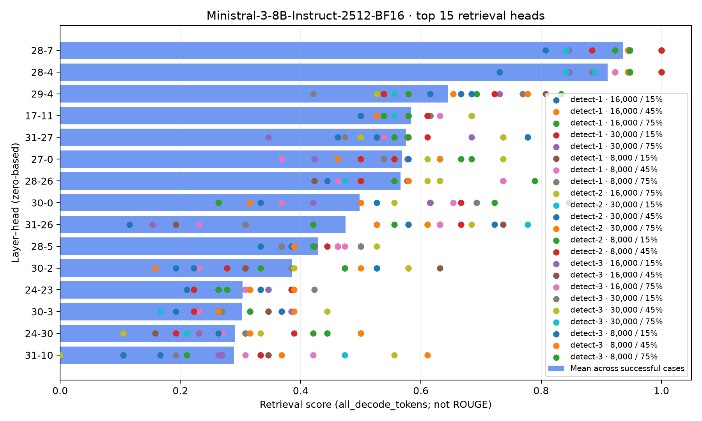
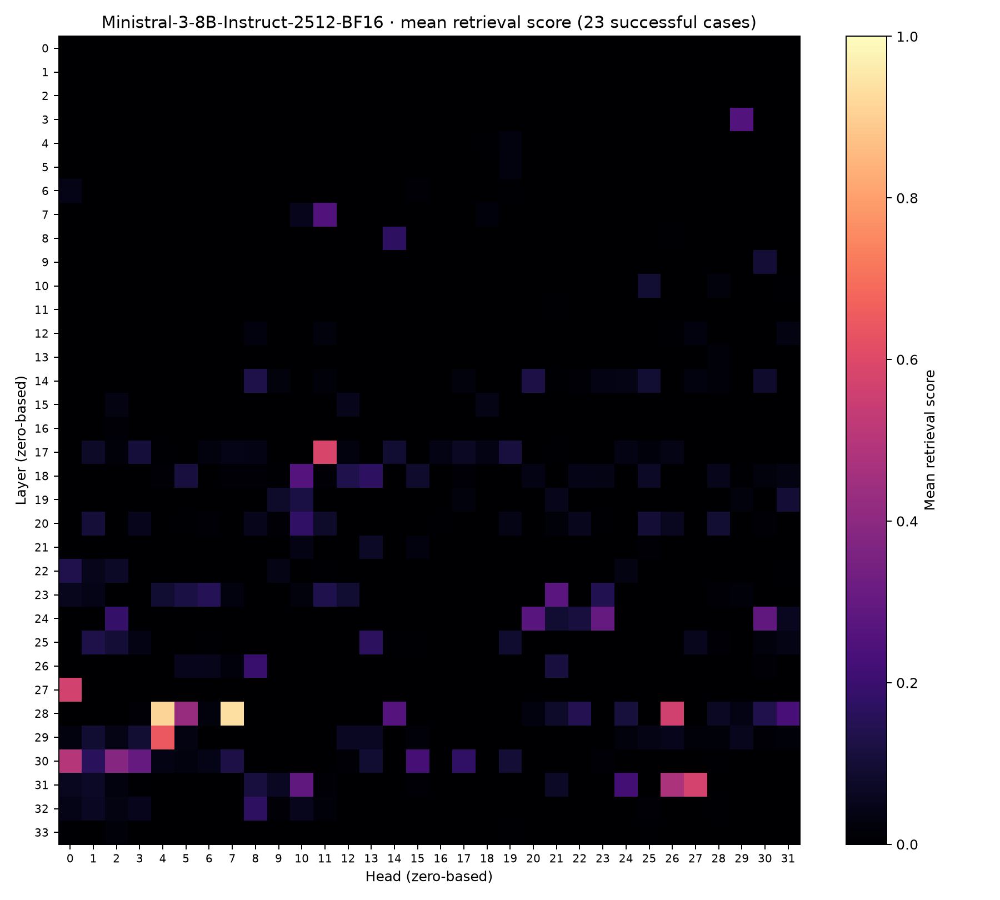
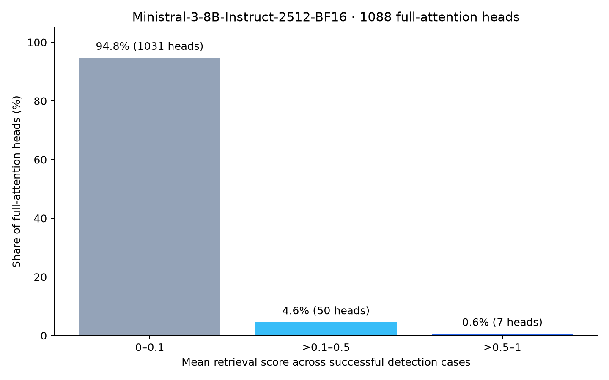
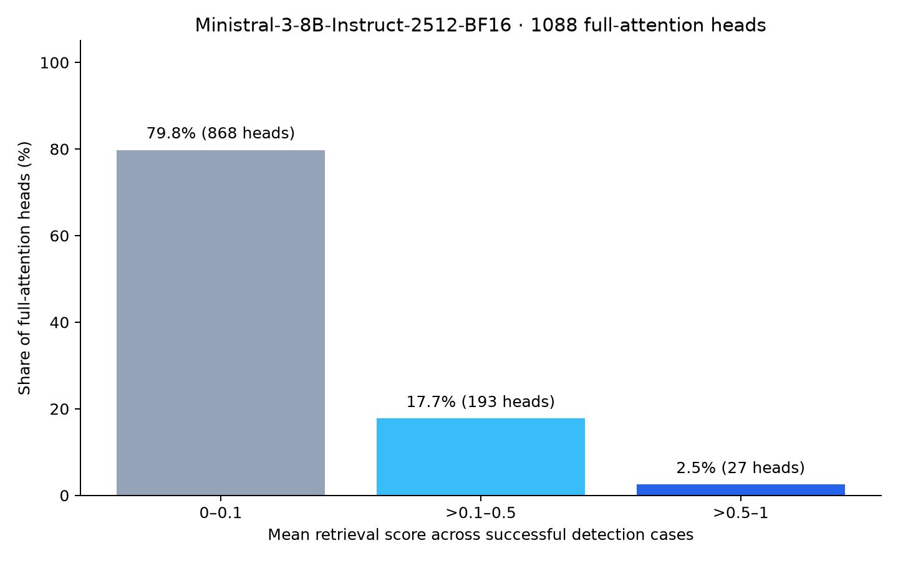
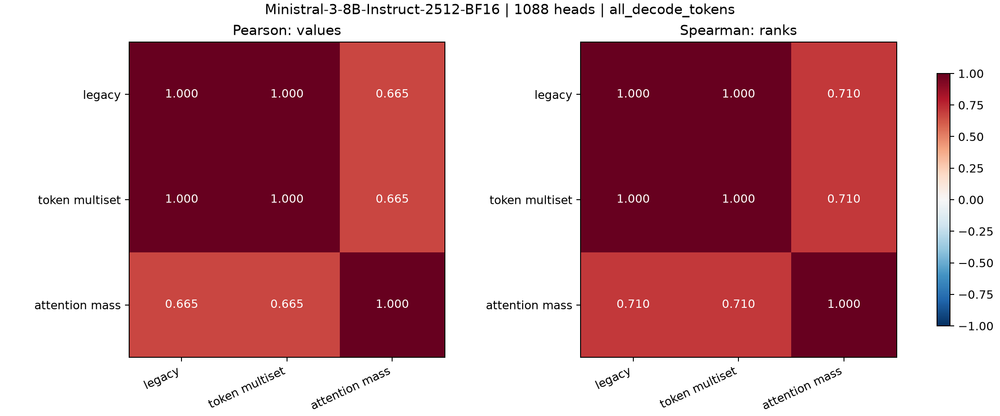
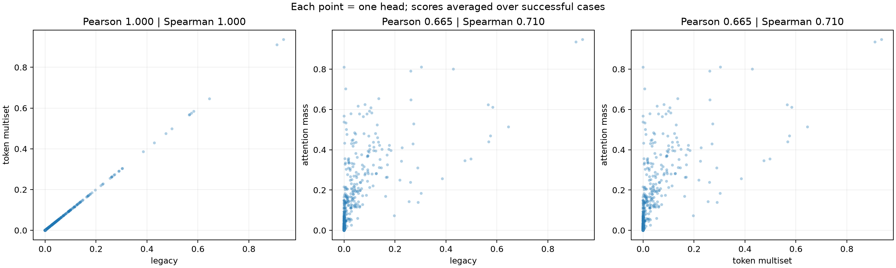
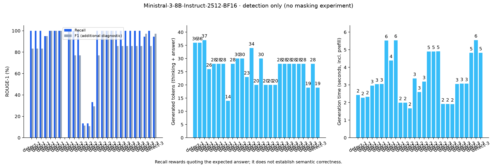

# Ministral 3 8B: retrieval heads, context-only survey

Job `bt1bc1qu2utq0m4b4mas`, 10 октября 2026. Официальные BF16-веса,
без thinking, A100, Flash prefill / наблюдаемый eager decode, лимит256.
Сетка: 3 detection-кейса × длины8000/16000/30000 × глубины15/45/75.
Средние scores голов рассчитаны по **23 случаям с ROUGE-1 recall >50**,
не по всем27. Всего1088 голов (34 слоя ×32), индексация `слой-голова` с нуля.
ROUGE — метрика ответа, retrieval scores — метрики голов; их не смешивать.

Источник: [manifest detection](../../datasphere-results/ministral3-context-only-download/ministral3-8b-context-only-survey/detection/run.json),
[manifest агрегации](../../datasphere-results/ministral3-context-only-download/ministral3-8b-context-only-survey/detection/aggregation/run.json).
Использованы те же `plot_results.py` и `plot_metric_correlations.py`, что для Qwen.
Подписи per-case точек идут в порядке `selected_cases` агрегации.

## Top-15 голов

Столбцы — средние, точки — оценки отдельных выбранных случаев.

### Legacy


### Token multiset



### Needle attention mass


## Карты всех слоёв и голов

### Legacy



### Token multiset


### Needle attention mass


## Распределения scores






## Связь метрик и конкретные головы

Корреляции по средним scores всех1088 голов, включая нулевые.
Legacy/multiset практически совпадают (Pearson≈1, Spearman≈1).
Multiset/mass: Pearson0.6651, Spearman0.7095.
840 голов имеют нулевой средний legacy/multiset score; у mass нулевых нет.
На подписанном scatter выделено объединение top-5 всех трёх метрик.






Числа: [correlations.json](metric-correlations/correlations.json).
Лидеры обеих основных метрик: `28-7` и `28-4`.
Большой detection score не доказывает причинную важность — masking не проводился.

## Дополнительная диагностика ответов



Средний ROUGE86.81, все27 ответов завершены по EOS (14–37 токенов).
Диагностика ответов одинакова для трёх метрик.

## Воспроизведение

Из `updated/`, отдельно для каждой метрики:

```bash
MPLCONFIGDIR=/tmp/retrieval-heads-mpl .venv-datasphere/bin/python plot_results.py \
  --run datasphere-results/ministral3-context-only-download/ministral3-8b-context-only-survey \
  --metric needle_attention_mass_v1 \
  --output report-assets/ministral3-8b-context-only-survey/needle_attention_mass_v1

MPLCONFIGDIR=/tmp/retrieval-heads-mpl .venv-datasphere/bin/python plot_metric_correlations.py \
  --run datasphere-results/ministral3-context-only-download/ministral3-8b-context-only-survey
```

Для остальных метрик заменить `needle_attention_mass_v1` на `legacy` или
`needle_token_multiset_v1` в обоих аргументах. Корреляционный скрипт сохраняет
графики в `plots/metric-correlations/` исходного run; копии здесь для галереи.
