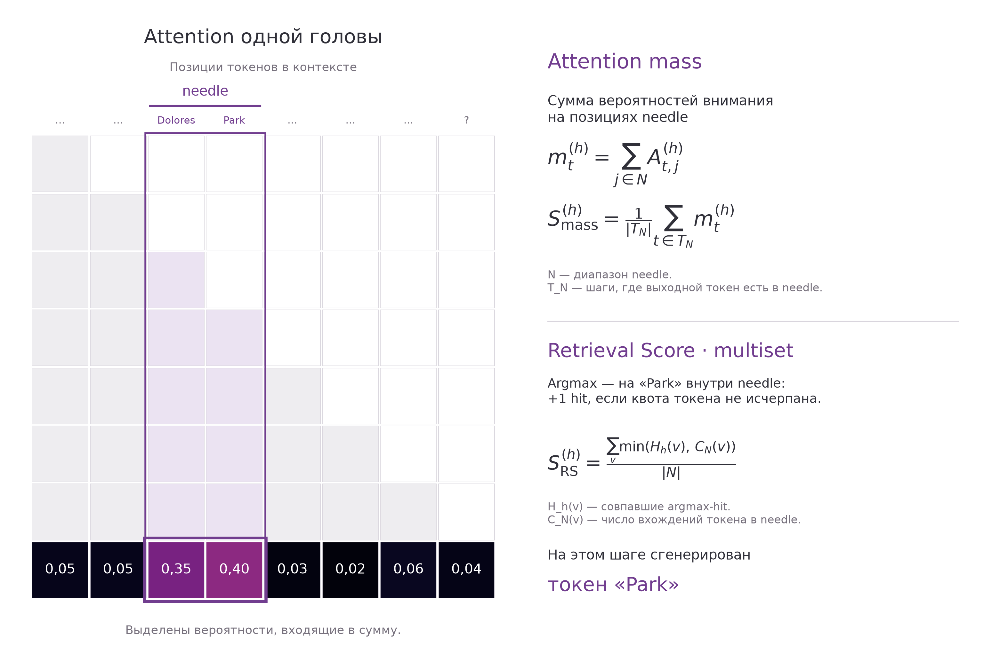

# Матрица внимания: Attention mass и Retrieval Score (multiset)

[SVG](attention_mass_scheme.svg) · [PDF](attention_mass_scheme.pdf) · [Пример](attention_mass_scheme.json)

Учебный пример, не измеренные результаты GLM. Матрица квадратная, фон прозрачен, всё в SVG векторное. Текущая строка — в палитре magma из прежних карт голов; прочие элементы — серые и фиолетовые. Стрелок и широкого пустого поля слева нет.

На текущем шаге сгенерирован токен Park. Его ID есть в целевом span Dolores Park. Attention mass на этом шаге — сумма выделенных вероятностей на всех позициях needle. Общий score головы — среднее масс по шагам T_N, для которых выходной ID встречается в needle. N — набор позиций целевого span.

У multiset учитывается другое событие: argmax внимания расположен внутри N, а ID ключевого токена в этой позиции совпадает с выходным ID. В примере максимум находится на Park, поэтому при ещё доступной квоте прибавляется один hit. Это не +1 к итоговому score: прирост score равен 1/|N|.

Формула multiset: сумма по ID токенов v значений min(H_h(v), C_N(v)), делённая на число токенов в N. H_h(v) считает все совпавшие argmax-hit для ID v; C_N(v) задаёт квоту — частоту этого ID в целевом span. Поэтому повторные hit сверх квоты не увеличивают score. Токеном в формулах является ID, не буквальное слово.

Строки матрицы — query-позиции, столбцы — key-позиции. Последняя query-строка используется при предсказании Park: выходной токен ещё не изображён как query/key. Верхний треугольник недоступен из-за causal mask. Другие строки схематичные, с равномерным вниманием по доступным ключам. Строки вероятностей суммируются в единицу.

В прежнем сравнении N — needle_span эталонного ответа, не обязательно весь case.needle. Подписи слов в примере условные: реальная токенизация может разбивать слова на несколько ID. Усреднение по survey-запросам здесь не показано.

Воспроизведение из updated: .venv/bin/python draw_poster_attention_mass_scheme.py
