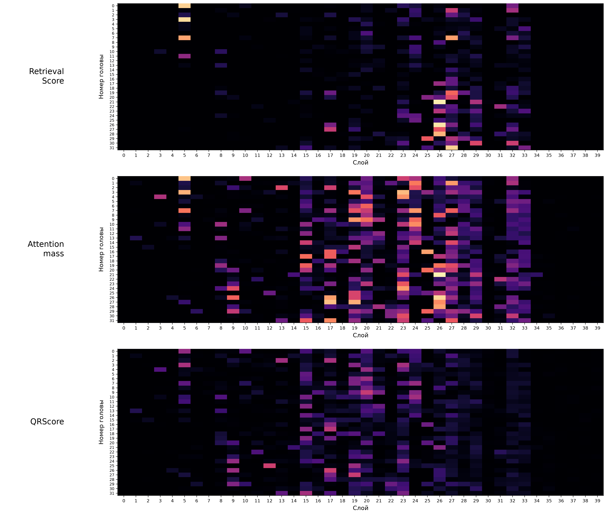

# GLM: оценки всех голов по трём метрикам

[SVG](head_scores_three_metrics.svg) · [PDF для печати](head_scores_three_metrics.pdf) · [CSV](head_scores.csv) · [Источники и проверка](head_scores_provenance.json)

Фон PNG/SVG/PDF прозрачен для размещения на плакате.

Три карты расположены сверху вниз в том же порядке, что строки рейтингов на фигуре маскирования: Retrieval Score, Attention mass, QRScore. Bottom-контроль не имеет отдельной метрики и здесь не повторяется. Названия слева — обычным начертанием, отступы согласованы с фигурой маскирования; номера слоёв и подпись X показаны под каждой картой. Палитра **magma** — как в исходных survey/head_heatmap: чёрный → фиолетовый → оранжевый → светло-жёлтый. Общий заголовок и цветовая шкала скрыты; номера голов 0–31 и подпись оси голов показаны на каждой карте.

По X — слои 0–39, по Y — Q-головы 0–31; одна клетка — одна из 1280 голов. Все три карты используют общую **линейную шкалу 0–1**, без нормировки на максимум или ранг. Цвет показывает среднюю исходную оценку головы, **не ROUGE и не качество ответа**. Малые ненулевые значения могут выглядеть как нулевые из-за линейной шкалы; точные оценки доступны в CSV.

Использованы ровно те замороженные рейтинги, по которым выбирались маски на соседней фигуре: `needle_token_multiset_v1`, `needle_attention_mass_v1`, `query_retrieval_score_v1`. Retrieval Score — краткая подпись нашей multiset-версии, не неизменённого legacy-кода авторов. Attention mass измерен на decode по прежнему span эталонного ответа, а не в эксперименте full-needle; QRScore — вопрос → needle на prefill.

Средние рассчитаны по 27 одинаковым survey-prompts; совпадение case ID, длины, глубины и prompt_sha256 проверено, порядок историй выровнен. Проверены все 1280 идентификаторов голов для каждой метрики, диапазоны и длины историй, а также совпадение QRScore с сохранёнными средними. Нет пропусков или подставленных нулей.

Воспроизведение из updated: `.venv/bin/python poster_plots/plot_poster_glm_head_scores.py`.
