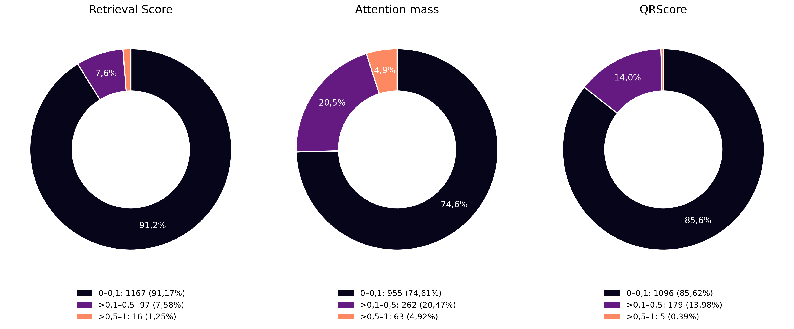

# GLM: доли голов по диапазонам score

[SVG](head_score_distribution_three_metrics.svg) · [PDF для печати](head_score_distribution_three_metrics.pdf) · [CSV](head_score_distribution.csv) · [Источники](head_score_distribution_provenance.json)

Фон PNG/SVG/PDF прозрачен, включая пустые центры кольцевых диаграмм.

Три диаграммы — Retrieval Score, Attention mass, QRScore. Каждая включает все 1280 Q-голов GLM; диапазоны среднего score одинаковы: [0; 0,1], (0,1; 0,5], (0,5; 1]. Это доли **количества голов**, не доли суммарного внимания и не качество ответов. Проценты всех диапазонов, включая маленькие секторы, подписаны под диаграммами.

Использованы те же проверенные рейтинги по 27 совпадающим survey-prompts, что на [картах голов](HEAD_SCORES.md) и в выборе масок. Палитра magma взята из карт голов, цвета секторов соответствуют серединам диапазонов. Retrieval Score — краткая подпись multiset-версии. Границы: ровно 0,1 входит в первый диапазон, ровно 0,5 — во второй. Значения score не округляются до распределения.

Воспроизведение из updated: `.venv/bin/python poster_plots/plot_poster_glm_score_pies.py`.
