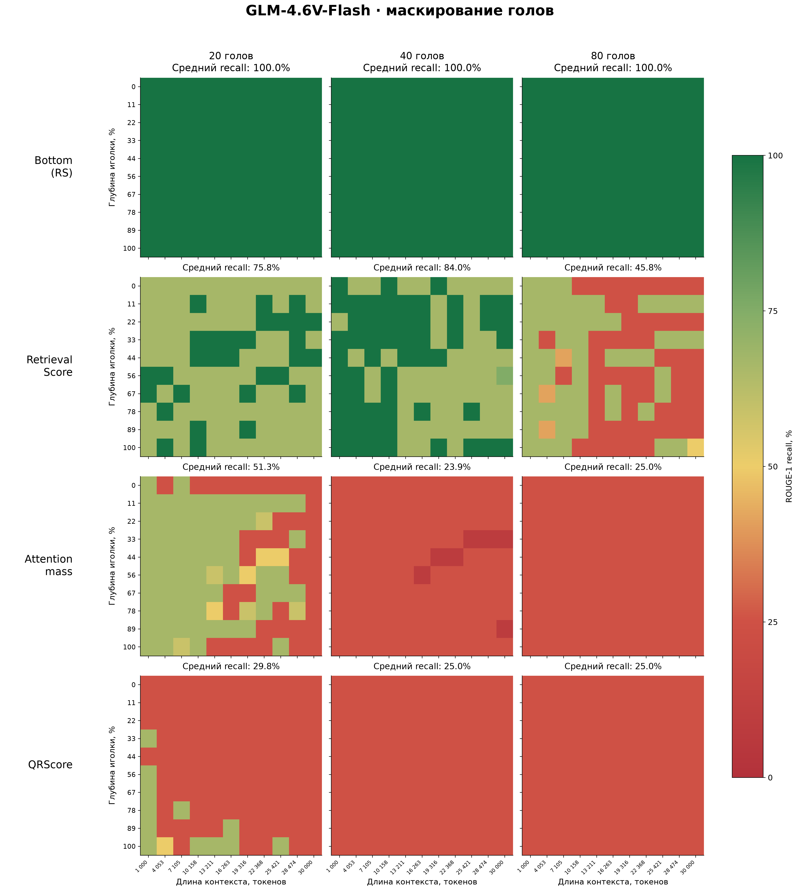
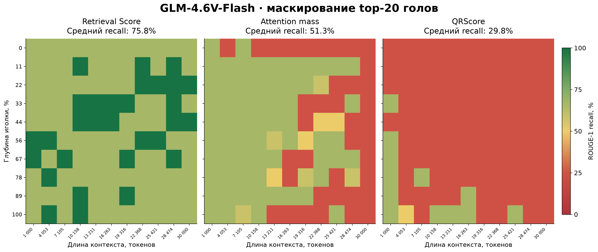
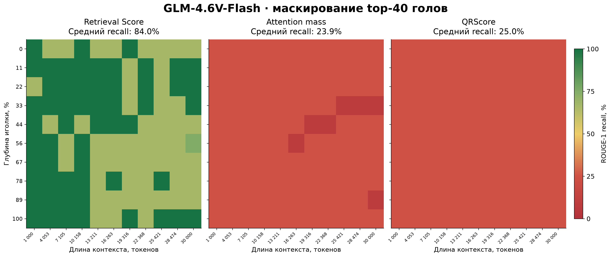
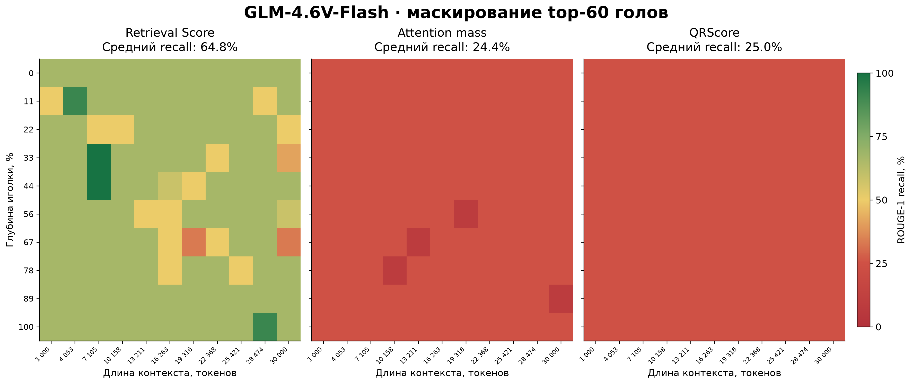
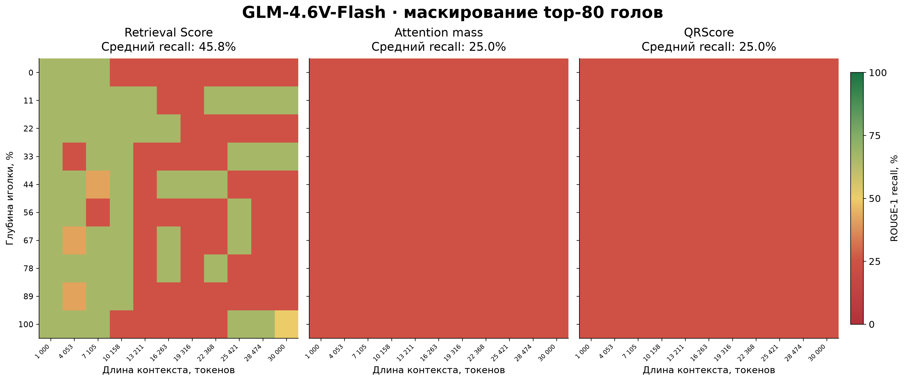

# GLM: три рейтинга retrieval heads для плаката

Ось X — длина контекста, ось Y — глубина needle. Общая умеренно насыщенная шкала: 0% кирпично-красный → 50% песочный → 100% тёмно-зелёный.

Фон актуальных PNG/SVG/PDF прозрачен для размещения на плакате.

В исходной [статье, раздел 2](https://arxiv.org/html/2404.15574v1#S2) метрика называется Retrieval Score (RS). На графиках используется краткая подпись «Retrieval Score»: данные получены нашей multiset-версией с ограничением повторных hit по частотам токенов needle, а не неизменённой legacy-реализацией авторов. Bottom (RS) — нижние головы того же multiset-рейтинга. В CSV сохранено прежнее имя Token multiset.

## Где multiset начинает заметно снижать извлечение

ROUGE-1 recall: top10 — 98.2%, top15 — 90.3%, top20 — 75.8%, top40 — 84.0%, top60 — 64.8%, top80 — 45.8%. Зависимость немонотонная: top40 лучше top20. После top40 снижение продолжается при top60/80. Для наглядной промежуточной карты подойдёт top80.

| top-k | Token multiset | Attention mass | QRScore |
|---|---:|---:|---:|
| 20 | 75.8% | 51.3% | 29.8% |
| 40 | 84.0% | 23.9% | 25.0% |
| 60 | 64.8% | 24.4% | 25.0% |
| 80 | 45.8% | 25.0% | 25.0% |

[Cases CSV](cases.csv) · [Средние](summary.csv) · [Источники](provenance.json)

## Прогрессия top20 → top40 → top80

Столбцы слева направо — 20, 40, 80 отключённых голов. Первая строка — bottom-k по Token multiset; затем top-k по Token multiset, Attention mass и QRScore. Названия строк вынесены слева, подпись длины контекста и числовые метки X — только в последней строке.

Bottom — головы с наименьшим score, не случайная выборка. Все 330 контрольных случаев взяты из исходного полного эксперимента; prompt-хэши и фактические наборы масок проверены. Средний ROUGE-1 recall: bottom20/40/80 — 100%. При этом bottom40/80 достигают лимита генерации в 56/93 случаях из 110: высокий recall не означает отсутствие повторов или сохранность качества всего ответа.

[SVG](masking_progression_20_40_80.svg) · [PDF](masking_progression_20_40_80.pdf)

## Оценки всех голов по трём метрикам

[Отдельная фигура: слой по X, номер головы по Y](HEAD_SCORES.md) · [SVG](head_scores_three_metrics.svg) · [PDF](head_scores_three_metrics.pdf)

[Три круговые диаграммы распределения голов](HEAD_SCORE_DISTRIBUTION.md) · [SVG](head_score_distribution_three_metrics.svg) · [PDF](head_score_distribution_three_metrics.pdf)

## Схема подсчёта Attention mass

[Учебная схема с матрицей внимания](ATTENTION_MASS_SCHEME.md) · [SVG](attention_mass_scheme.svg) · [PDF](attention_mass_scheme.pdf)

## Top-20

[SVG](top20_three_rankings.svg) · [PDF для печати](top20_three_rankings.pdf)

## Top-40

[SVG](top40_three_rankings.svg) · [PDF для печати](top40_three_rankings.pdf)

## Top-60

[SVG](top60_three_rankings.svg) · [PDF для печати](top60_three_rankings.pdf)

## Top-80

[SVG](top80_three_rankings.svg) · [PDF для печати](top80_three_rankings.pdf)

Все клетки измерены; нулевых замен нет. Baseline = 100% recall в каждой позиции.
Prompt-хэши совпадают между тремя рейтингами и baseline. Шкала одинакова у всех карт.
Masking: legacy_uniform, только decode, BF16/A100, no-thinking, seed42, выход ≤256 токенов.
Token multiset — модификация исходного hit-score, QRScore — дополнительный query-focused подход. Это собственное сравнение рейтингов в протоколе исходной статьи.

Воспроизведение из updated: `.venv/bin/python poster_plots/plot_poster_glm_top40.py`.
