# Ministral 3 8B: attention mass − QRScore

QRScore — точка отсчёта. Δ = качество ответа после masking по mass минус качество после masking по QRScore.
Единицы — процентные пункты ROUGE/точной фразы, не разница head-score.
Синий: mass оставил меньше качества; красный: QRScore оставил меньше качества.
880 пар: 8 top-k ×11 длин ×10 глубин. Prompt-хэши совпадают; все ответы включены.
Оба прогона no thinking, legacy_uniform decode, выход ≤256 токенов. Исходные результаты не изменены.
Источники survey/прогоны разные: дельта не изолирует исключительно эффект формулы метрики.
Среднее ROUGE-1/2/3 — нестандартный композит; точная фраза — наличие нормализованного эталона подряд.

[CSV пар](cases.csv) · [Средние дельты](summary.csv) · [Источники](provenance.json)

## top5: все метрики качества

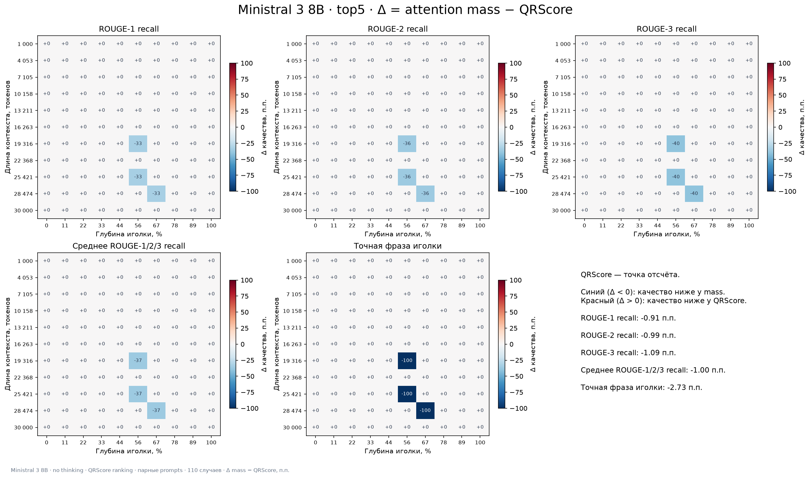

[SVG](plots/top5_delta_heatmaps.svg)

## top10: все метрики качества

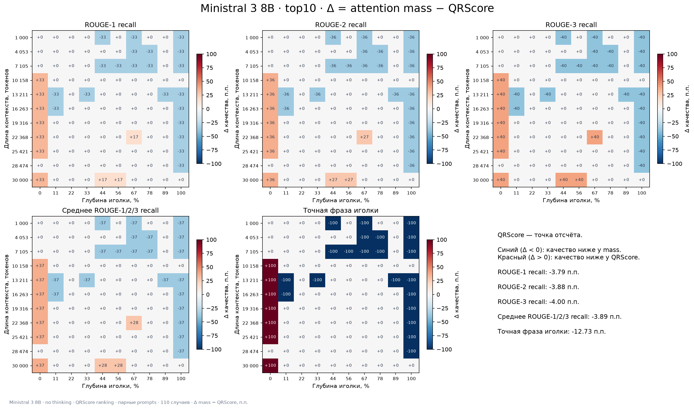

[SVG](plots/top10_delta_heatmaps.svg)

## top15: все метрики качества

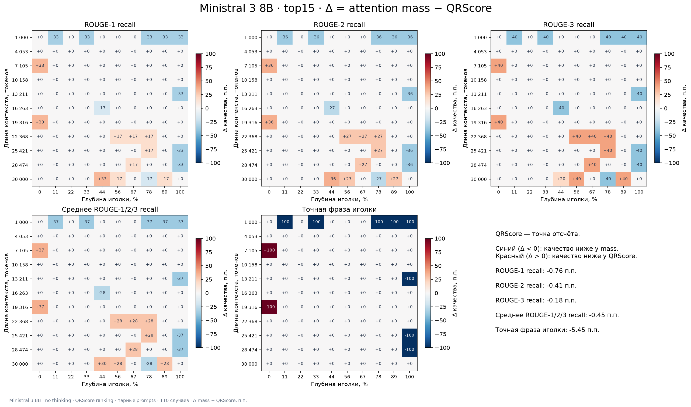

[SVG](plots/top15_delta_heatmaps.svg)

## top20: все метрики качества

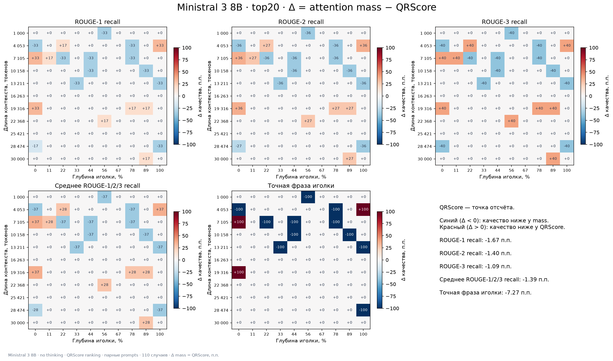

[SVG](plots/top20_delta_heatmaps.svg)

## top40: все метрики качества

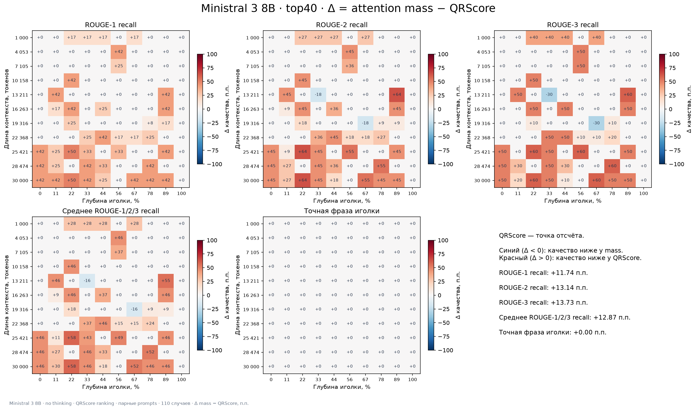

[SVG](plots/top40_delta_heatmaps.svg)

## top60: все метрики качества

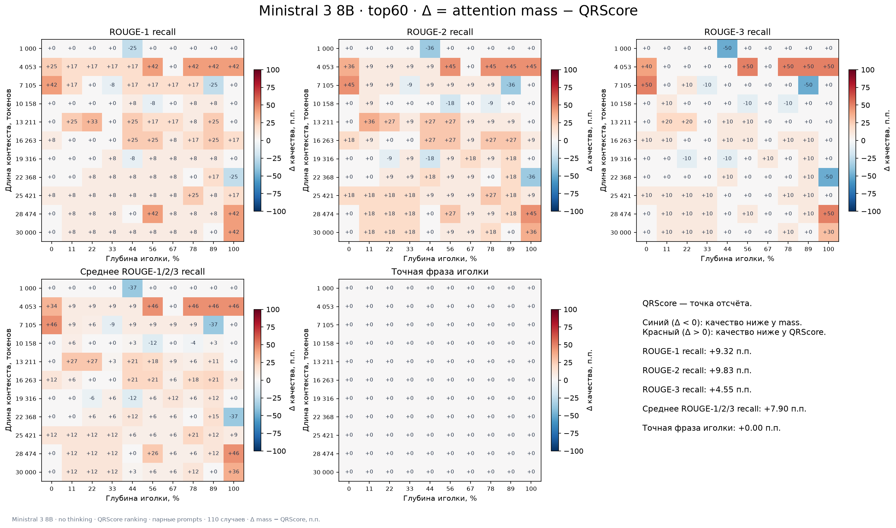

[SVG](plots/top60_delta_heatmaps.svg)

## top80: все метрики качества

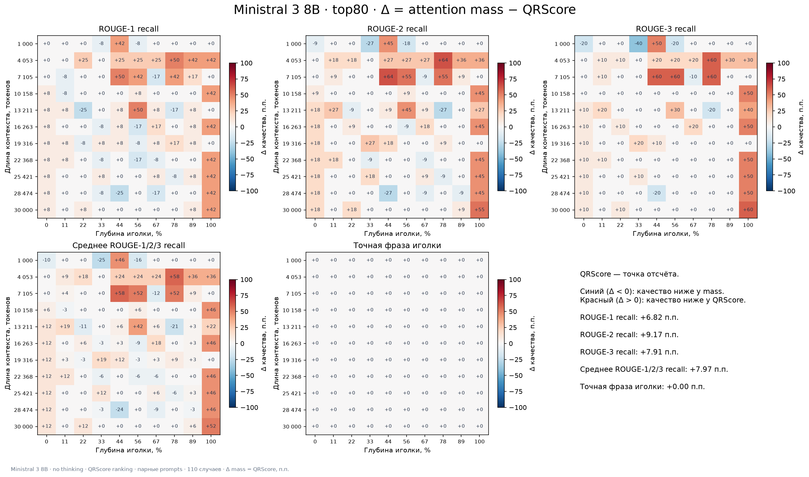

[SVG](plots/top80_delta_heatmaps.svg)

## top100: все метрики качества

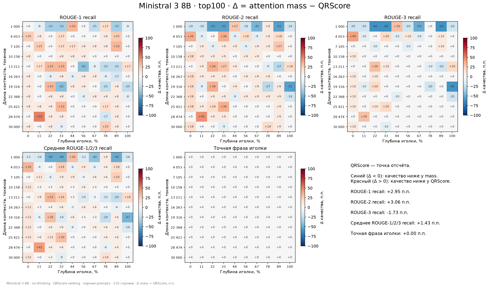

[SVG](plots/top100_delta_heatmaps.svg)

## ROUGE-1 recall: все top-k на одной странице

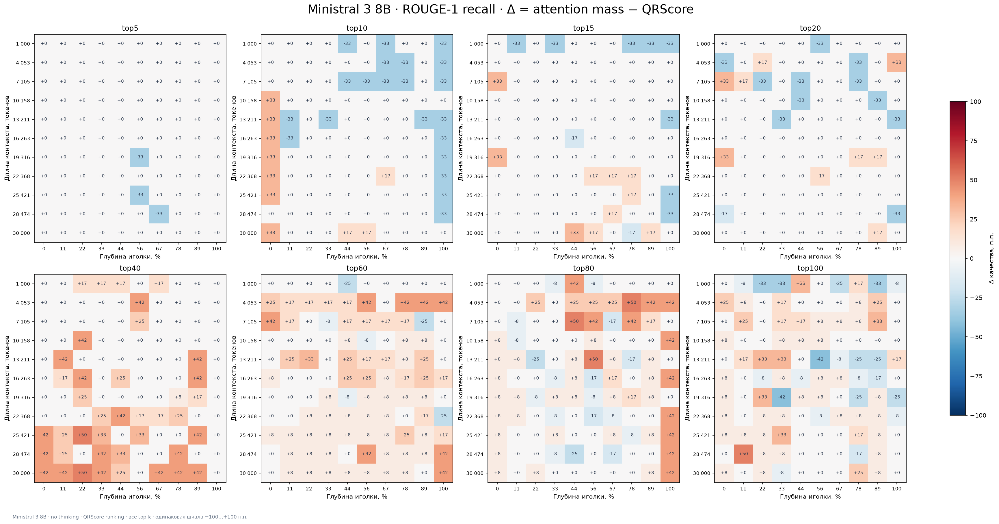

[SVG](plots/overview_rouge1_recall.svg)

## ROUGE-2 recall: все top-k на одной странице

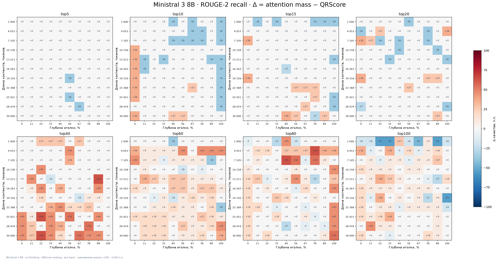

[SVG](plots/overview_rouge2_recall.svg)

## ROUGE-3 recall: все top-k на одной странице

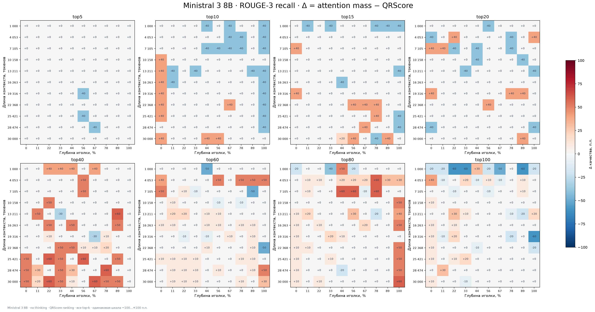

[SVG](plots/overview_rouge3_recall.svg)

## Среднее ROUGE-1/2/3 recall: все top-k на одной странице

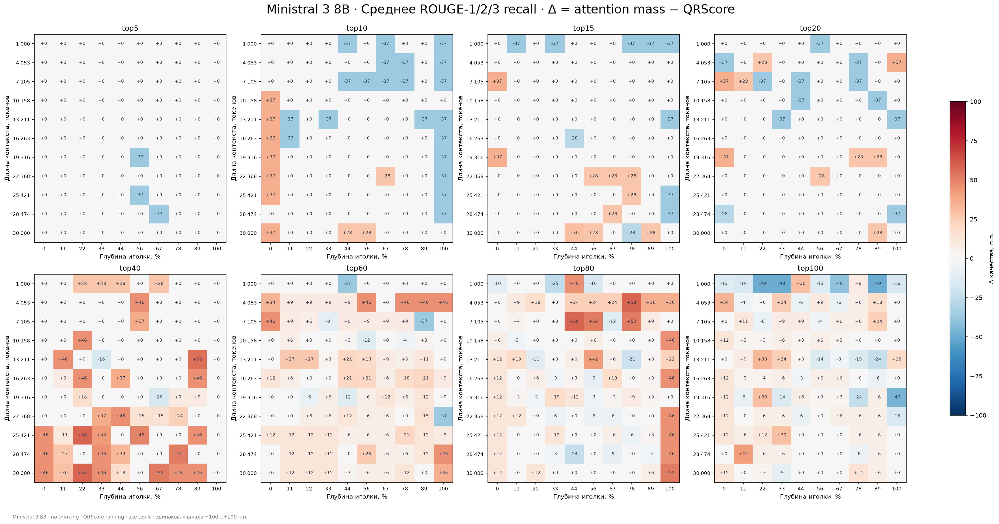

[SVG](plots/overview_rouge123_mean_recall.svg)

## Точная фраза иголки: все top-k на одной странице

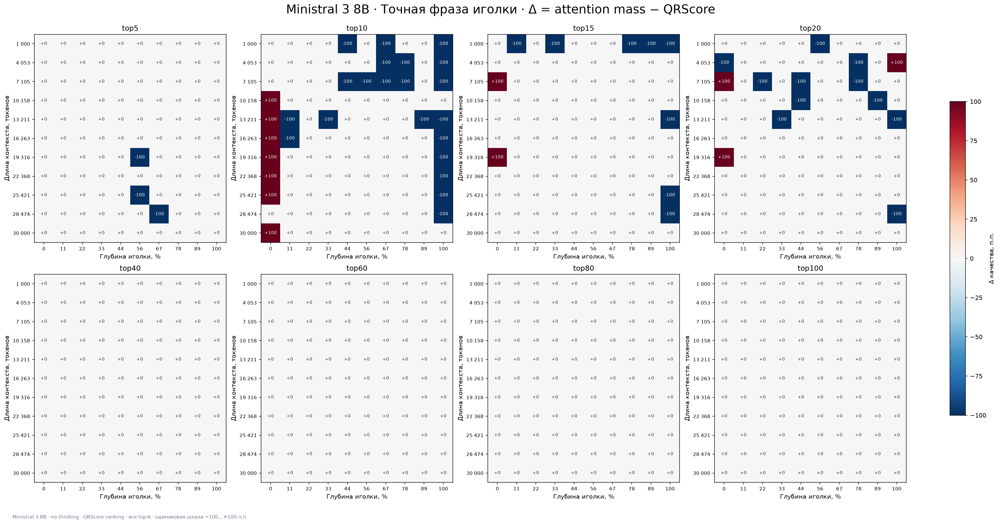

[SVG](plots/overview_exact_match.svg)
