# GLM: полный needle attention mass, обычный mass и QRScore

**11 отсутствующих top40 результатов заменены нулевыми оценками по запросу пользователя.**
Это допущение анализа: нулевое качество не было измерено. Штриховка /// отмечает эти клетки.
Исходный архив и manifests не изменены. Новые JSON ответов не создавались.
ROUGE-1/2/3 recall, их среднее и exact phrase для пропусков = 0. Длины ответов и EOS не выдумываются.
Для top40 также приводится сравнение на 99 реально сохранённых парных случаях.

## Рейтинги голов

27 случаев, 1280 Q-голов; old/full mass и QRScore измерены в одном survey.
Old mass → expected_answer; full mass и QRScore → одна и та же полная needle.
Обе decode-массы используют прежний общий token gate и одинаковое число шагов.
Старый span целиком внутри полного в 27/27 случаев.

| Сравнение с QRScore | Pearson | Spearman |
|---|---:|---:|
| Old mass | 0.8673 | 0.9629 |
| Full needle mass | 0.8833 | 0.9677 |

| top-k | Full ∩ old (один survey) | Full ∩ QR | Old ∩ QR | Full ∩ прежний mass masking |
|---|---:|---:|---:|---:|
| 5 | 5 | 0 | 0 | 5 |
| 10 | 9 | 4 | 4 | 9 |
| 15 | 14 | 6 | 5 | 14 |
| 20 | 18 | 9 | 7 | 18 |
| 40 | 38 | 23 | 23 | 38 |

## ROUGE-1 recall после masking

| Условие | Full needle mass, с нулями | Обычный mass | QRScore |
|---|---:|---:|---:|
| baseline | 100.00 | 100.00 | 100.00 |
| top5 | 98.48 | 98.48 | 92.12 |
| top10 | 72.20 | 71.82 | 70.53 |
| top15 | 58.18 | 60.45 | 60.45 |
| top20 | 29.92 | 51.29 | 29.77 |
| top40 | 21.74 | 23.94 | 25.00 |

## Основные наблюдения

Расширение span немного приближает общий рейтинг к QRScore: Spearman 0.9629 → 0.9677. Старый и полный mass почти идентичны по рангу (Spearman 0.9975), но их top20 различаются.
По сравнению с историческим рейтингом старого masking в top20 вошли **17-17** (в новом paired survey old rank32 → full rank15, QR rank5) и **20-9** (old rank23 → full rank20, QR rank4); вышли **24-1** и **19-3**. Именно эти две замены различают наборы голов в сравниваемых top20 masking. В новом paired survey old top20 вместо 19-3 содержит 5-7; поэтому замены между двумя рейтингами одного нового survey и фактическими masking-наборами не следует смешивать. CSV замен содержит отдельно historical old rank и same-run old rank.
При top20 ROUGE-1 recall: старый mass51.29%, полный mass29.92%, QRScore29.77%. Все110 результатов этого условия измерены: нулевые замены здесь не участвуют. Этот результат согласуется с тем, что границы needle были существенным источником различий верхушки рейтинга; он не определяет вклад каждой из четырёх голов по отдельности.
При top5 набор и ROUGE совпадают; при top10 полный mass немного менее разрушителен; при top15 полный mass сильнее снижает recall. Универсального превосходства нет.
На 99 наблюдавшихся top40 случаях средний ROUGE-1 одинаков у полного и старого mass: 24.16%. На полной сетке с нулями у полного mass21.74%, у старого23.94%; это среднее различие создаётся нулевыми заменами, а не измеренным улучшением ранжирования.

Все основные средние считаются по 110 позициям условия. Для top40 11 из них — допущенные нули.
Дельта = качество full mass минус качество указанного reference, в процентных пунктах.
Отрицательная дельта означает более сильное ухудшение при full-mass masking.
Exact phrase — наличие нормализованного эталона подряд; это не семантическая accuracy.
Корреляция scores не доказывает причинность. Masking — legacy_uniform, только decode.

[Cases CSV](cases_with_zero_imputation.csv) · [Сводка качества](quality_summary.csv) · [99 наблюдавшихся top40 случаев](observed_subset_summary.csv) · [Дельты](delta_summary.csv)

[Scores голов](head_scores.csv) · [Пересечения](head_intersections.csv) · [Замены top-k](head_topk_changes.csv) · [Spans](span_diagnostics.csv) · [11 нулевых замен](missing_cases_zero_filled.csv) · [Источники](provenance.json)

## Score всех голов

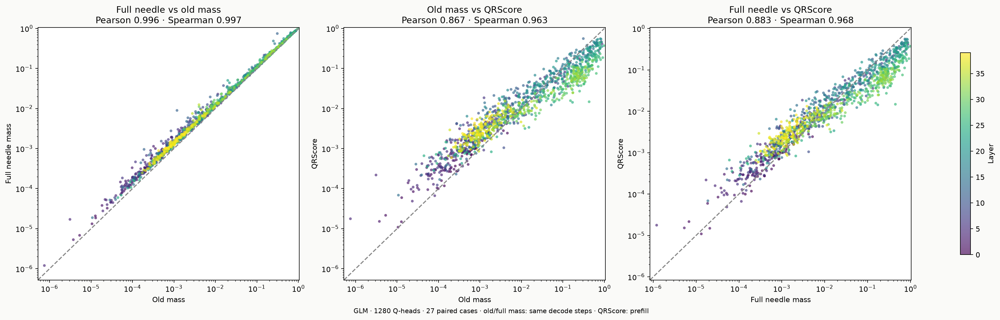

[SVG](plots/head_scatter.svg)

## Разница score и рангов по слоям и головам

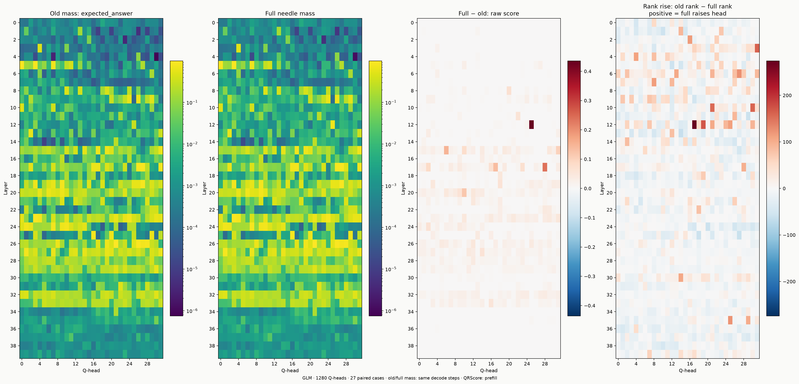

[SVG](plots/head_maps.svg)

## Ранги и пересечения top-k

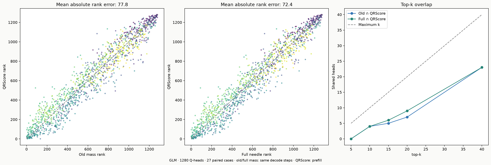

[SVG](plots/head_rankings.svg)

## Конкретные головы из объединения top-20

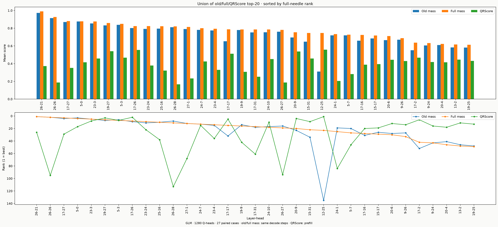

[SVG](plots/top20_heads.svg)

## Две замены, изменившие top20 masking

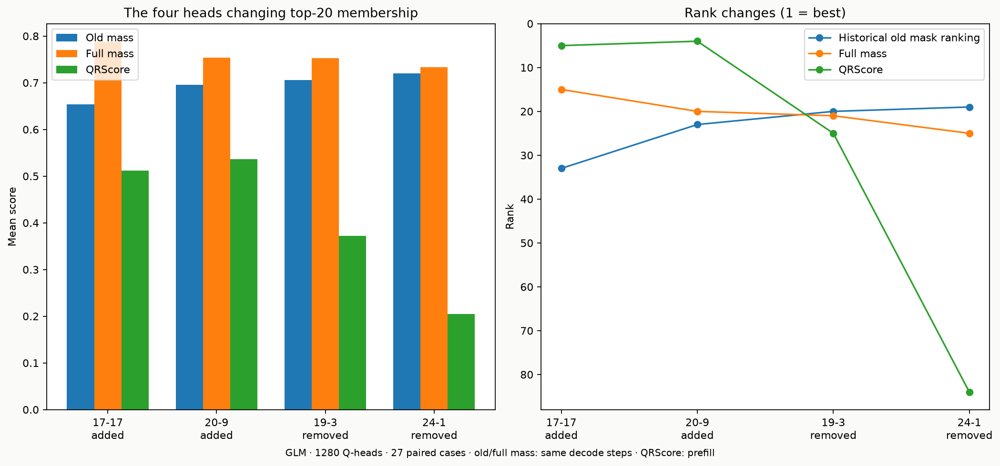

[SVG](plots/top20_replacements.svg)

## Full needle masking · ROUGE-1 recall

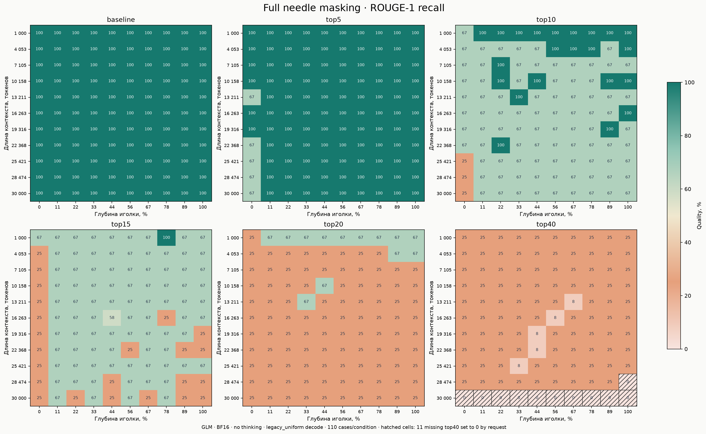

[SVG](plots/quality_rouge1.svg)

## Качество трёх рейтингов и чувствительность к пропускам

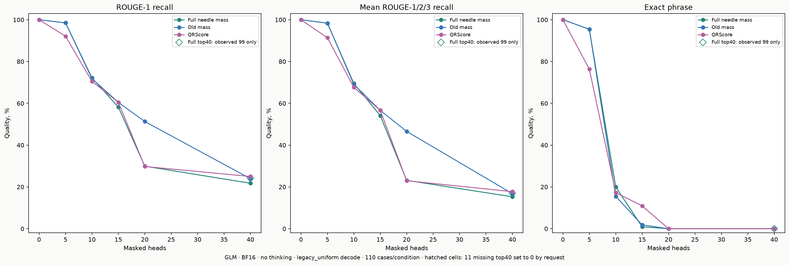

[SVG](plots/quality_comparison.svg)

## Δ ROUGE-1: full needle masking − its baseline

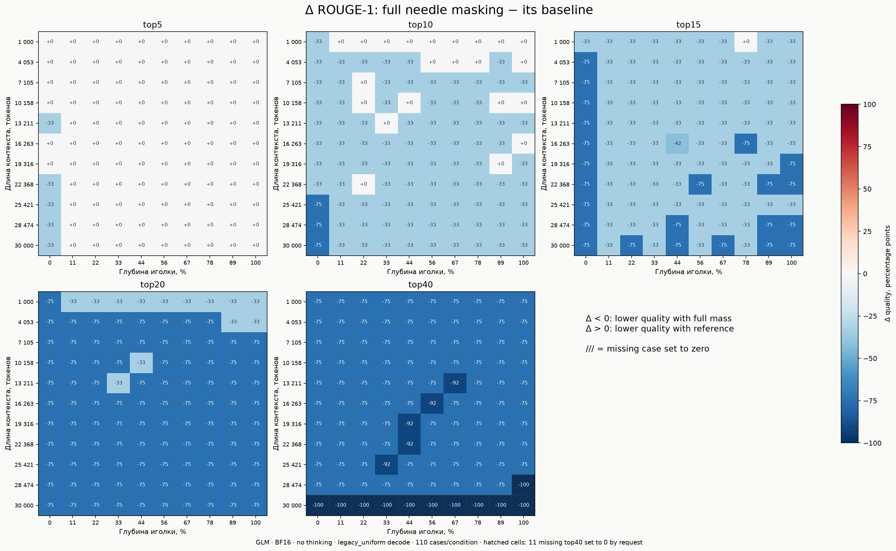

[SVG](plots/delta_baseline_rouge1.svg)

## Δ ROUGE-1 recall: full needle mass − Old mass

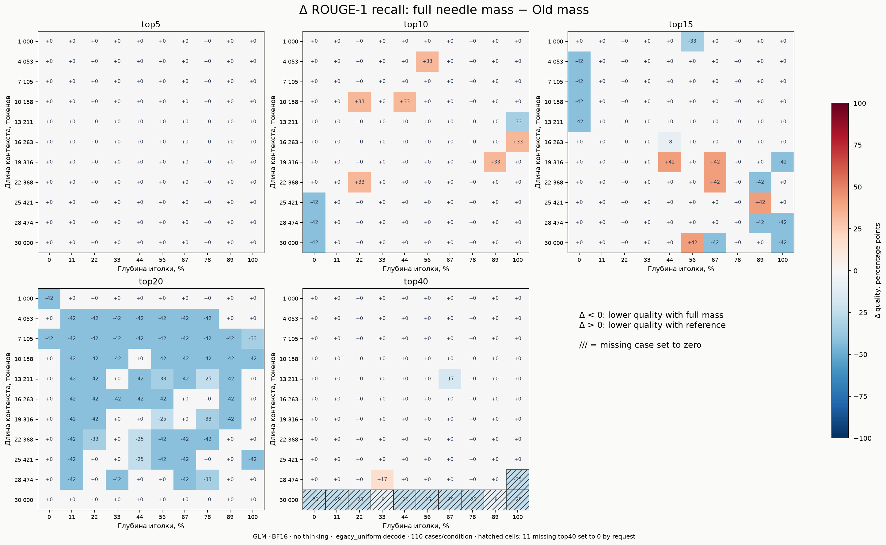

[SVG](plots/delta_old_mass_rouge1_recall.svg)

## Δ ROUGE-2 recall: full needle mass − Old mass

[SVG](plots/delta_old_mass_rouge2_recall.svg)

## Δ ROUGE-3 recall: full needle mass − Old mass

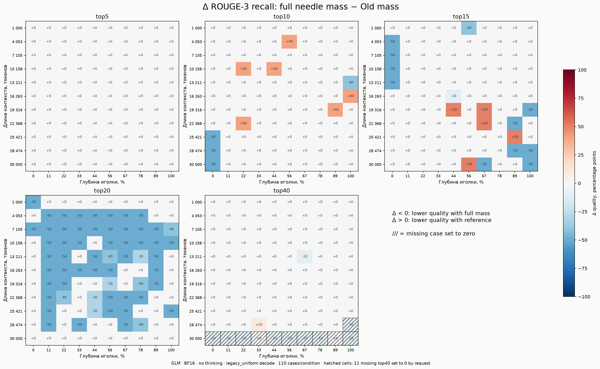

[SVG](plots/delta_old_mass_rouge3_recall.svg)

## Δ Среднее ROUGE-1/2/3 recall: full needle mass − Old mass

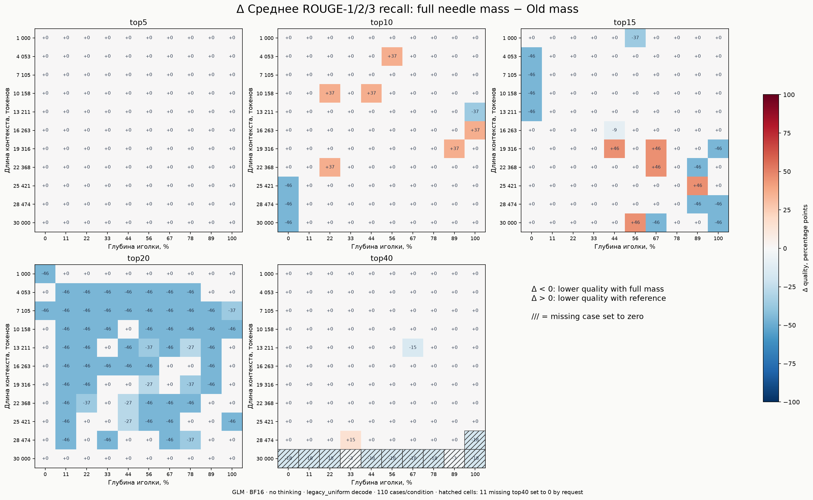

[SVG](plots/delta_old_mass_rouge123_mean_recall.svg)

## Δ Точная фраза иголки: full needle mass − Old mass

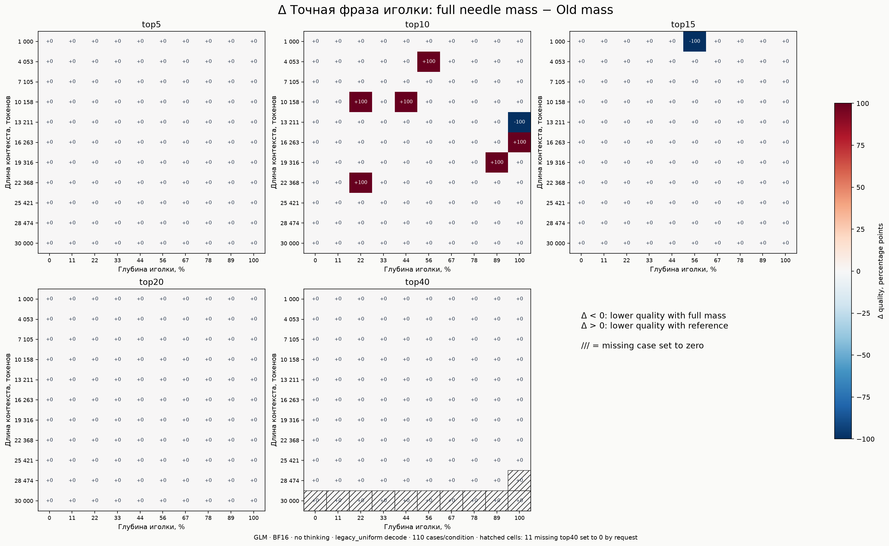

[SVG](plots/delta_old_mass_exact_match.svg)

## Δ ROUGE-1 recall: full needle mass − QRScore

[SVG](plots/delta_qr_rouge1_recall.svg)

## Δ ROUGE-2 recall: full needle mass − QRScore

[SVG](plots/delta_qr_rouge2_recall.svg)

## Δ ROUGE-3 recall: full needle mass − QRScore

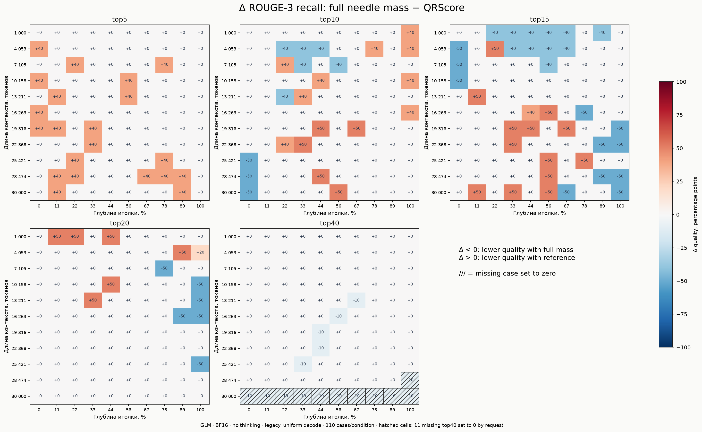

[SVG](plots/delta_qr_rouge3_recall.svg)

## Δ Среднее ROUGE-1/2/3 recall: full needle mass − QRScore

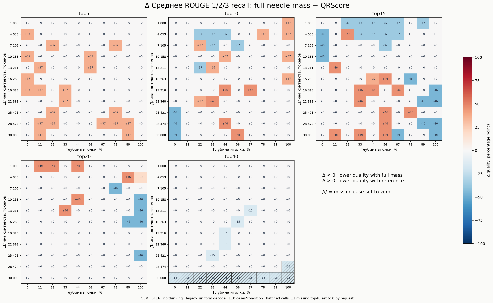

[SVG](plots/delta_qr_rouge123_mean_recall.svg)

## Δ Точная фраза иголки: full needle mass − QRScore

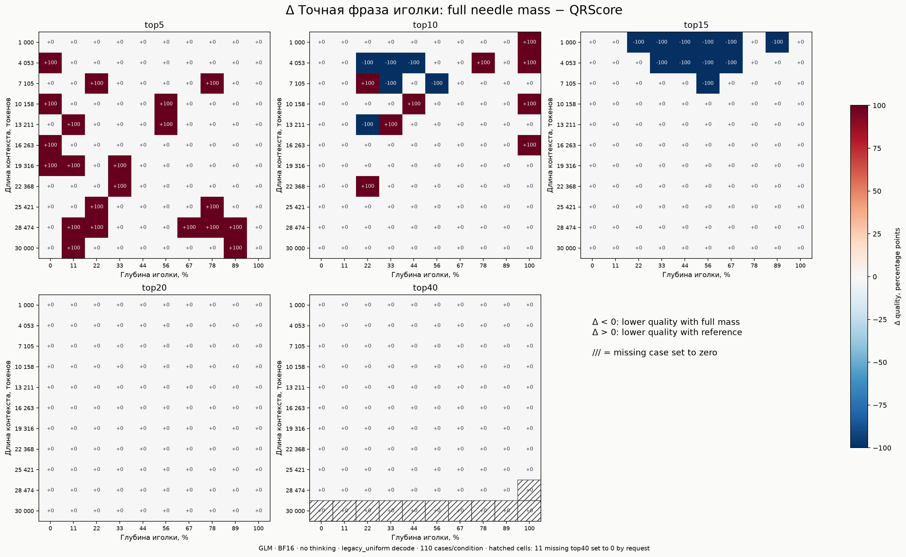

[SVG](plots/delta_qr_exact_match.svg)

Воспроизведение из `updated/`: `.venv/bin/python plot_glm_full_needle_mass.py`.
