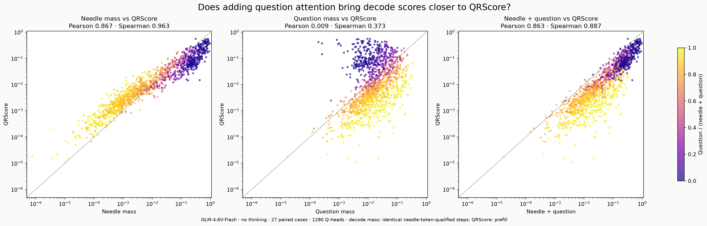
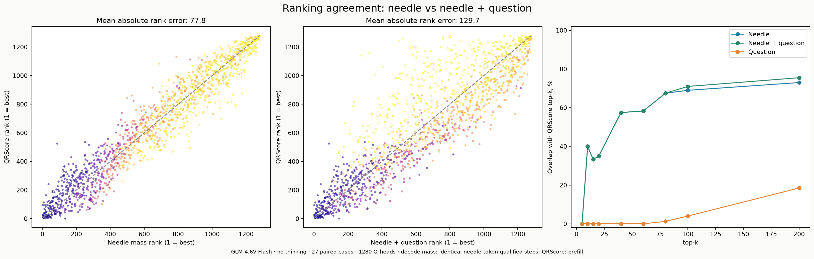
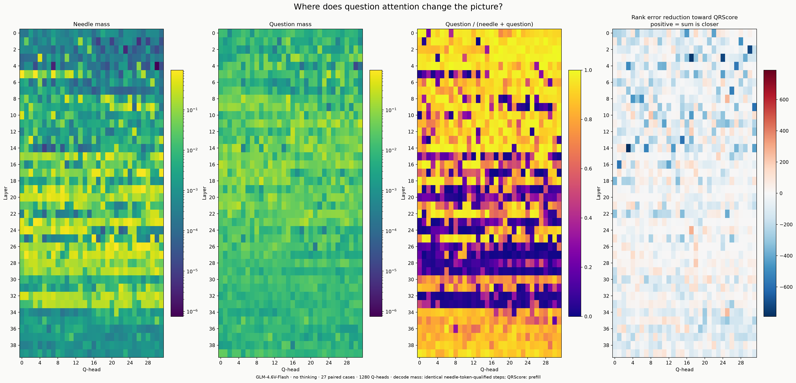
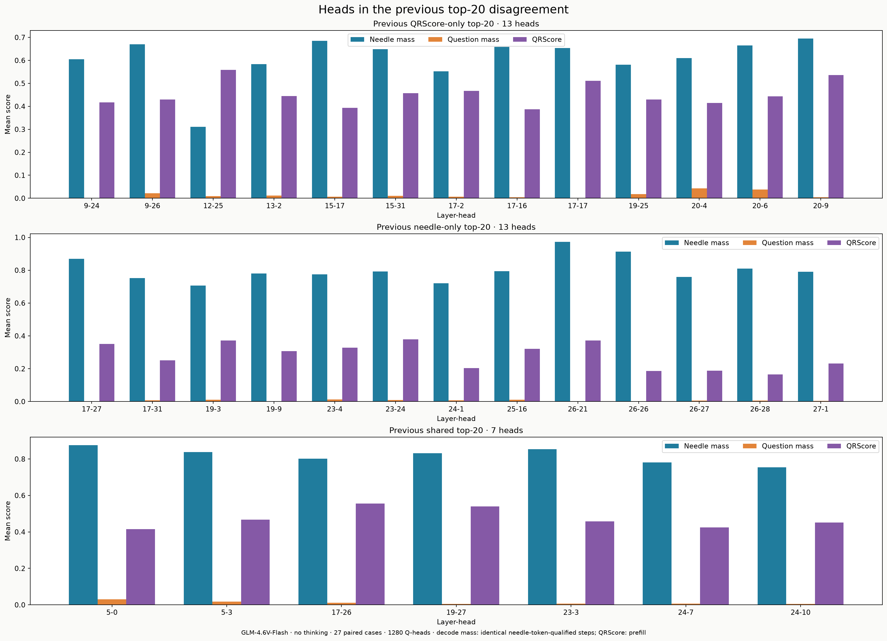
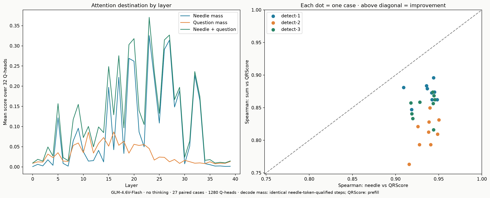

# GLM: needle + question mass и QRScore

1280 Q-голов, 27 случаев. Все три исходные метрики измерены в одном новом прогоне.
Needle и question mass используют одинаковые decode-шаги: generated token ID встречается в span expected_answer.
Needle здесь означает span expected_answer; QRScore использует полную вставленную needle.
Question span и needle не пересекаются. Их сумма — decode-внимание к объединению этих позиций.
Score усредняются сначала по qualifying steps случая, затем поровну по 27 случаям.
Доля вопроса — mean(question) / (mean(needle) + mean(question)), без нормализации на длину spans.

## Совпадение с QRScore

| Decode score | Pearson | Spearman |
|---|---:|---:|
| Needle mass | 0.8673 | 0.9629 |
| Question mass | 0.0088 | 0.3729 |
| Needle + question | 0.8634 | 0.8869 |

Spearman улучшается после добавления question mass в 0/27 отдельных случаях.

| top-k | Needle ∩ QR | (Needle + question) ∩ QR |
|---|---:|---:|
| 5 | 0 | 0 |
| 10 | 4 | 4 |
| 15 | 5 | 5 |
| 20 | 7 | 7 |
| 40 | 23 | 23 |
| 60 | 35 | 35 |
| 80 | 54 | 54 |
| 100 | 69 | 71 |
| 200 | 146 | 151 |

## Что получилось

Простая добавка question mass не объясняет расхождение рейтингов: Spearman падает с 0.9629 до 0.8869, средняя абсолютная ошибка ранга растёт с 77.8 до 129.7. В каждом из 27 случаев Spearman также снижается.
Top-20 сохраняет пересечение 7/20; небольшое улучшение есть для top-100 (69 → 71) и top-200 (146 → 151).
У 13 голов прежнего QRScore-only top-20 средняя question mass = 0.01338, needle mass = 0.60908, средняя доля вопроса = 2.16%. У 13 mass-only голов соответствующие значения 0.00598, 0.80298 и 0.77%. Эти группы различаются, но question mass мала относительно needle mass и не меняет пересечение top-20.
Наши данные не поддерживают объяснение «mass недооценивает QRScore-heads главным образом из-за неучтённого внимания к вопросу» в таком виде. Они не исключают переноса информации через вопрос: небольшое внимание тоже может иметь причинный вклад, а информация может передаваться через другие позиции и residual stream. Для этого нужен отдельный причинный тест.

Корреляция не доказывает перенос информации об ответе через вопрос или причинную важность головы.
Сумма — проверяемый диагностический score; masking по этому рейтингу ещё не выполнялся.
27 случаев — три вопроса на девяти позициях/длинах; головы и случаи не считаются независимыми репликациями.
Прежние prompts совпали в 27/27 случаях; диагностические top-20 группы взяты из прежних рейтингов.

[Scores CSV](head_scores.csv) · [По случаям](case_correlations.csv) · [Пересечения top-k](top_k_overlap.csv) · [Сводка](summary.json) · [Источники](provenance.json)

## Исходные score: needle, question, сумма против QRScore

[SVG](score_scatter.svg)

## Ранги и пересечения top-k

[SVG](ranking_agreement.svg)

## Все слои и головы

[SVG](head_heatmaps.svg)

## Головы из несовпадающих прежних top-20

[SVG](discordant_top20.svg)

## Распределение по слоям и устойчивость по случаям

[SVG](layers_and_cases.svg)

Воспроизведение из `updated/`: `.venv/bin/python plot_glm_question_mass.py`.
