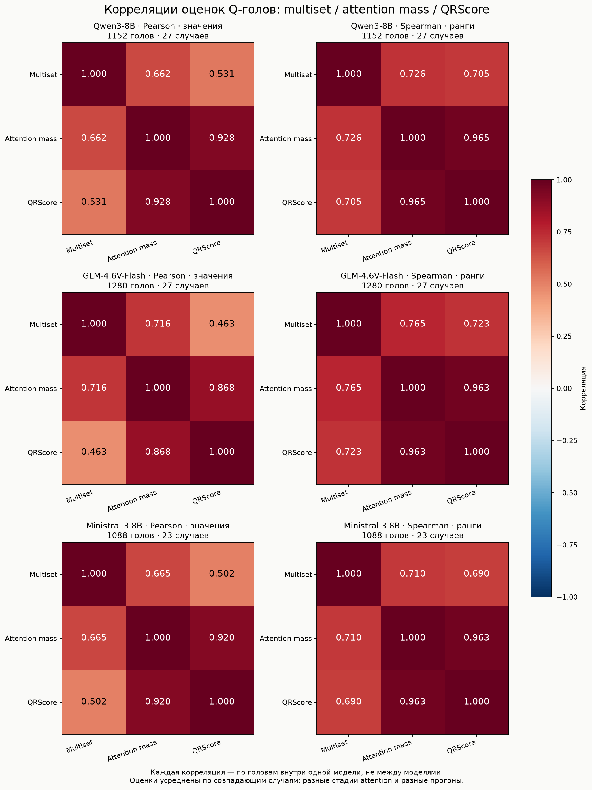
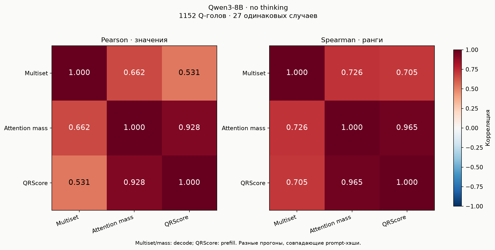
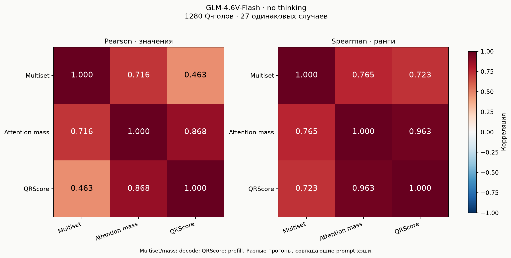
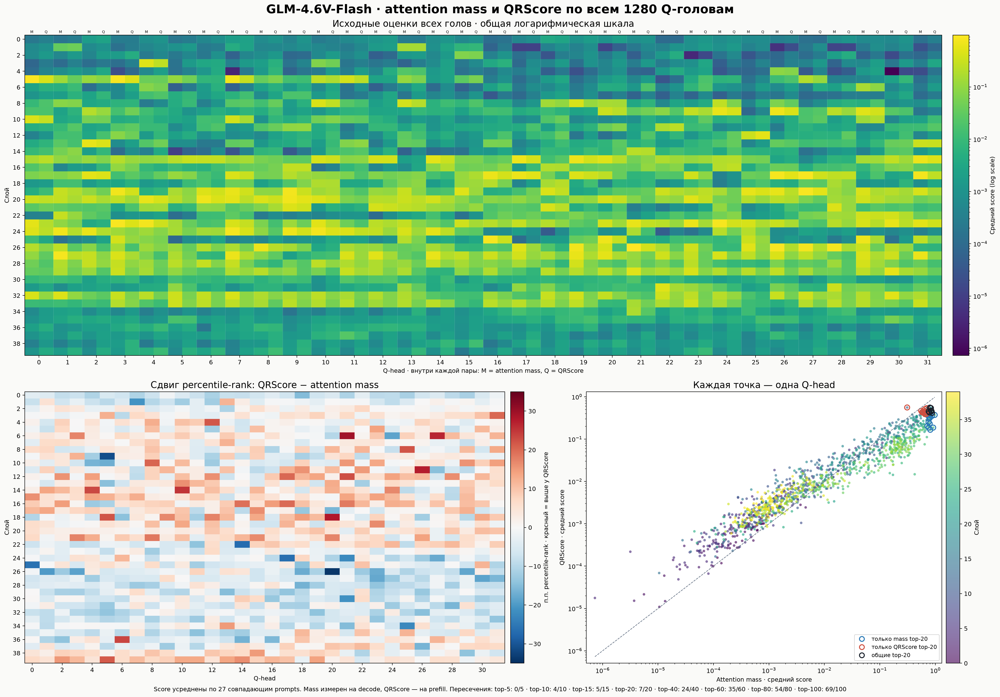

# Корреляции: multiset / mass / QRScore

[GLM: новый парный эксперимент needle + question mass против QRScore](../glm-question-mass/README.md)

Pearson — по средним значениям; Spearman — по рангам, с усреднением рангов при ties.
Наблюдение — одна и та же Q-голова внутри модели. Головы разных моделей не сопоставляются.
Multiset и mass взяты из старых no-thinking survey (decode), QRScore — из новых survey (prefill).
Это корреляции разных прогонов, не контролируемое сравнение метрик на одной генерации.
Совпадение prompt-хэшей проверено для каждого случая. Выборка старой агрегации сохранена:
Qwen и GLM — 27 случаев; Ministral — 23 успешных, QRScore также усреднён только по этим 23.

[SVG](all_models_correlation_matrices.svg)

## Qwen3-8B

[SVG](qwen3-8b/correlation_matrices.svg) · [Pearson CSV](qwen3-8b/pearson.csv) · [Spearman CSV](qwen3-8b/spearman.csv) · [Оценки голов](qwen3-8b/head_scores.csv) · [Источники](qwen3-8b/correlations.json)

## GLM-4.6V-Flash

[SVG](glm4-6v-flash/correlation_matrices.svg) · [Pearson CSV](glm4-6v-flash/pearson.csv) · [Spearman CSV](glm4-6v-flash/spearman.csv) · [Оценки голов](glm4-6v-flash/head_scores.csv) · [Источники](glm4-6v-flash/correlations.json)

### Attention mass и QRScore по всем головам

Верхняя карта показывает два исходных score для каждой головы на общей логарифмической шкале (M — attention mass, Q — QRScore). Нижняя карта показывает сдвиг percentile-rank: красные головы QRScore поднимает выше, синие выше ставит attention mass.

[SVG](glm4-6v-flash/head_level_mass_vs_qrscore.svg) · [Разница рангов CSV](glm4-6v-flash/head_rank_differences.csv)

## Ministral 3 8B

[SVG](ministral3-8b/correlation_matrices.svg) · [Pearson CSV](ministral3-8b/pearson.csv) · [Spearman CSV](ministral3-8b/spearman.csv) · [Оценки голов](ministral3-8b/head_scores.csv) · [Источники](ministral3-8b/correlations.json)
