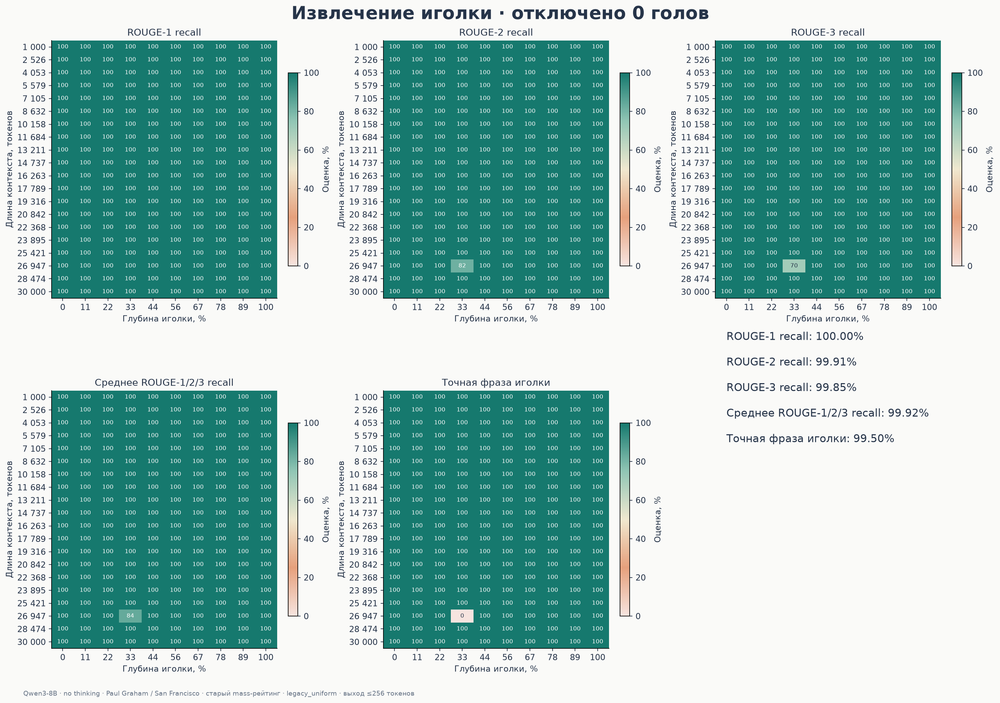
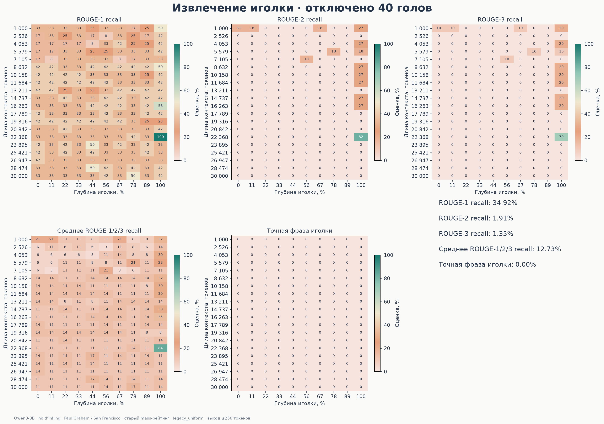
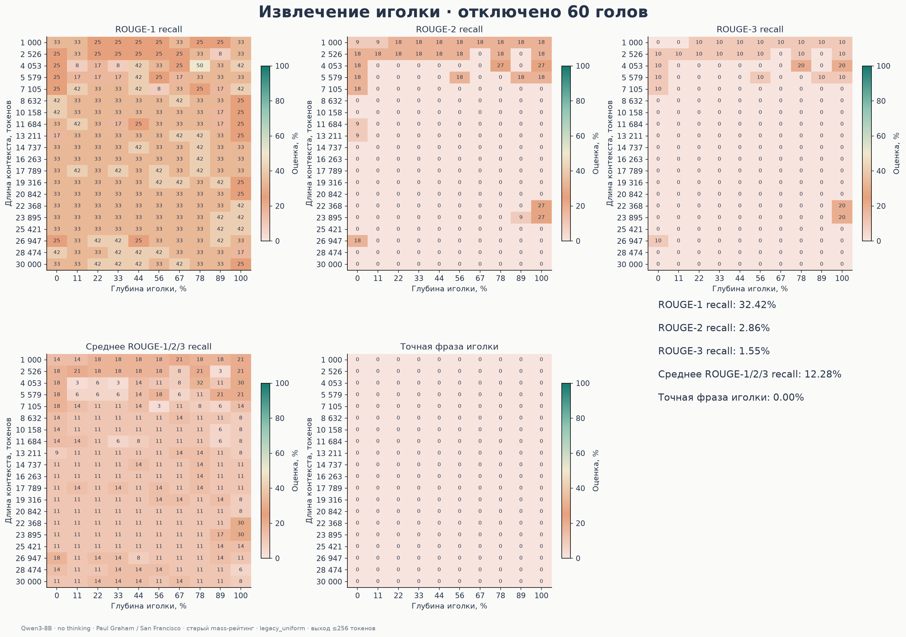
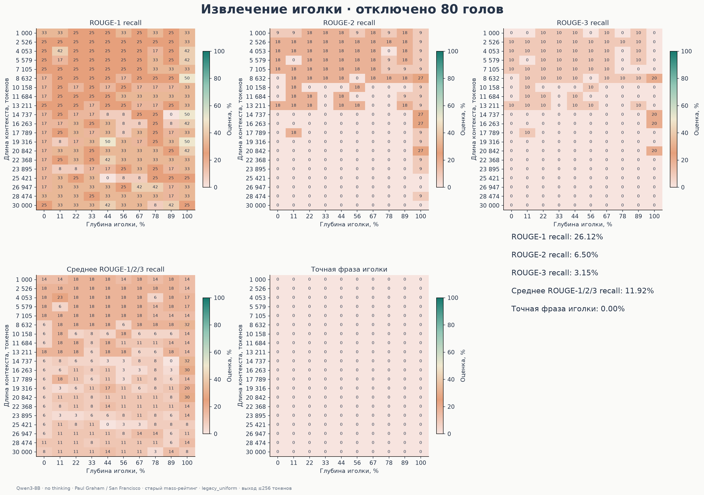
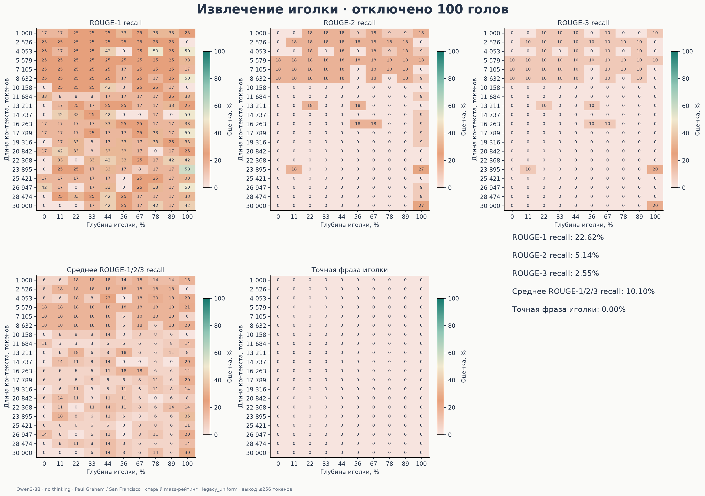
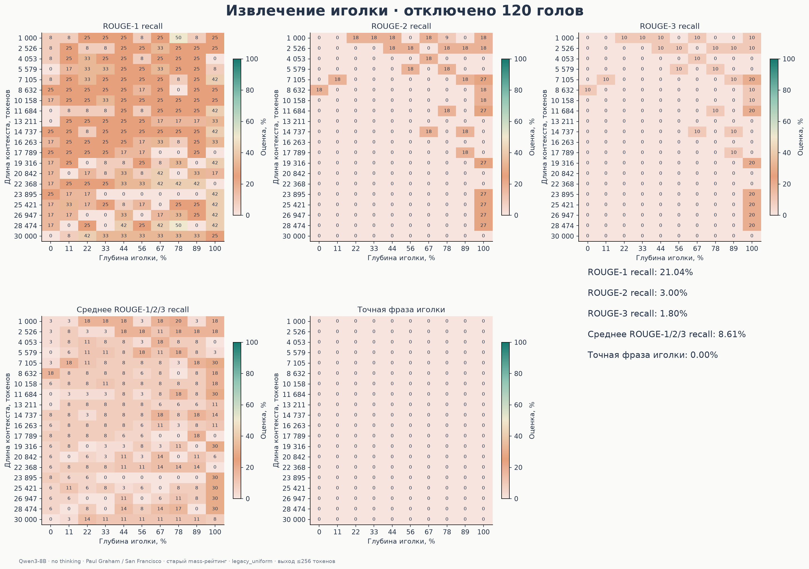
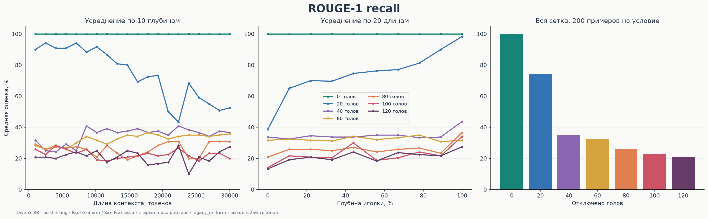
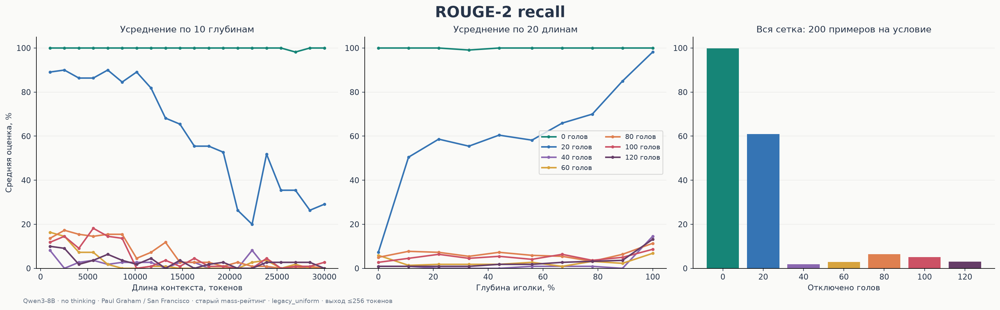
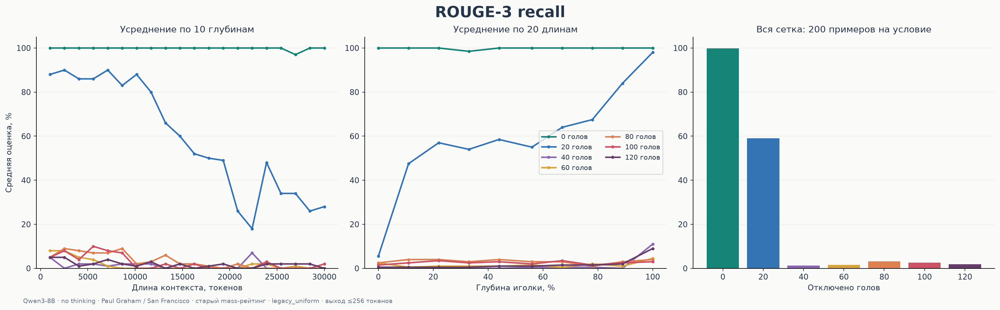
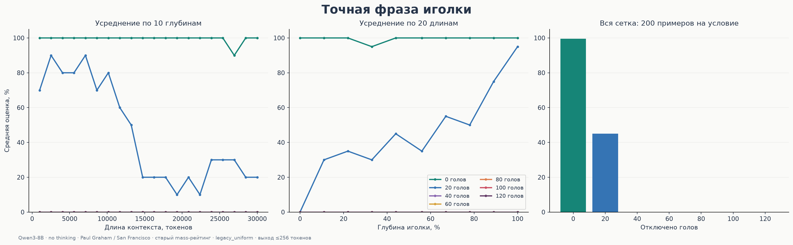

# Paul Graham: masking без thinking

Исходные JSON скачаны из задания bt1k7k78e6t20kj241br. Проверены все 1400 уникальных результатов и совпадение prompt_sha256 между условиями.

Сетка: 20 длин × 10 глубин × 7 условий. Рейтинг голов: старый thinking survey attention-mass, НЕ новый no-thinking survey. Маска legacy_uniform применялась при decode.

ROUGE-1/2/3 — overlap словесных n-грамм со stemming, шкала 0–100. Основной композит — арифметическое среднее трёх recall; это предложенная сводная метрика, не стандартный ROUGE. Precision и F1 тоже сохранены в CSV/JSON: recall не штрафует лишний текст. Exact match — наличие полной эталонной фразы подряд после нормализации регистра и пунктуации, без stemming; это не семантическая проверка.

Оценка идёт по сохранённому model_response. Исходные score и результаты не изменены. Контрольные слова/перефразирование могут влиять на оценки; графики не доказывают функциональную специализацию голов.

| Отключено | ROUGE-1 | ROUGE-2 | ROUGE-3 | Среднее 1/2/3 | Exact match |
|---:|---:|---:|---:|---:|---:|
| 0 | 100.00 | 99.91 | 99.85 | 99.92 | 99.50 |
| 20 | 74.08 | 60.95 | 59.10 | 64.71 | 45.00 |
| 40 | 34.92 | 1.91 | 1.35 | 12.73 | 0.00 |
| 60 | 32.42 | 2.86 | 1.55 | 12.28 | 0.00 |
| 80 | 26.12 | 6.50 | 3.15 | 11.92 | 0.00 |
| 100 | 22.62 | 5.14 | 2.55 | 10.10 | 0.00 |
| 120 | 21.04 | 3.00 | 1.80 | 8.61 | 0.00 |

Данные: [cases.csv](cases.csv), [summary.csv](summary.csv), [scores.json](scores.json). Все картинки доступны в PNG и SVG.

## 0 отключённых голов — все метрики

[SVG](plots/heads_000_heatmaps.svg)

## 20 отключённых голов — все метрики

[SVG](plots/heads_020_heatmaps.svg)

## 40 отключённых голов — все метрики

[SVG](plots/heads_040_heatmaps.svg)

## 60 отключённых голов — все метрики

[SVG](plots/heads_060_heatmaps.svg)

## 80 отключённых голов — все метрики

[SVG](plots/heads_080_heatmaps.svg)

## 100 отключённых голов — все метрики

[SVG](plots/heads_100_heatmaps.svg)

## 120 отключённых голов — все метрики

[SVG](plots/heads_120_heatmaps.svg)

## ROUGE-1 recall — сравнение условий

[SVG](plots/comparison_rouge1_recall.svg)

## ROUGE-2 recall — сравнение условий

[SVG](plots/comparison_rouge2_recall.svg)

## ROUGE-3 recall — сравнение условий

[SVG](plots/comparison_rouge3_recall.svg)

## Среднее ROUGE-1/2/3 recall — сравнение условий

[SVG](plots/comparison_rouge123_mean_recall.svg)

## Точная фраза иголки — сравнение условий

[SVG](plots/comparison_exact_match.svg)
