# Paul Graham: masking без thinking

Исходные JSON скачаны из задания bt1fsj89jp523daa3n8g. Проверены все 1800 уникальных результатов и совпадение prompt_sha256 между условиями.

Сетка: 20 длин × 10 глубин × 9 условий. Рейтинг голов: новый no-thinking survey attention-mass. Маска legacy_uniform применялась при decode.

ROUGE-1/2/3 — overlap словесных n-грамм со stemming, шкала 0–100. Основной композит — арифметическое среднее трёх recall; это предложенная сводная метрика, не стандартный ROUGE. Precision и F1 тоже сохранены в CSV/JSON: recall не штрафует лишний текст. Exact match — наличие полной эталонной фразы подряд после нормализации регистра и пунктуации, без stemming; это не семантическая проверка.

Оценка идёт по сохранённому model_response. Исходные score и результаты не изменены. Контрольные слова/перефразирование могут влиять на оценки; графики не доказывают функциональную специализацию голов.

| Отключено | ROUGE-1 | ROUGE-2 | ROUGE-3 | Среднее 1/2/3 | Exact match |
|---:|---:|---:|---:|---:|---:|
| 0 | 100.00 | 99.91 | 99.85 | 99.92 | 99.50 |
| 5 | 99.67 | 99.50 | 99.50 | 99.56 | 99.50 |
| 10 | 99.50 | 99.00 | 99.00 | 99.17 | 99.00 |
| 15 | 85.54 | 79.64 | 78.05 | 81.08 | 69.00 |
| 20 | 60.92 | 40.55 | 38.20 | 46.55 | 16.00 |
| 25 | 44.67 | 16.64 | 14.45 | 25.25 | 3.50 |
| 30 | 41.71 | 13.50 | 11.45 | 22.22 | 1.50 |
| 35 | 39.08 | 11.27 | 9.75 | 20.04 | 0.00 |
| 40 | 34.96 | 5.09 | 3.15 | 14.40 | 0.00 |

Данные: [cases.csv](cases.csv), [summary.csv](summary.csv), [scores.json](scores.json). Все картинки доступны в PNG и SVG.

## 0 отключённых голов — все метрики

[SVG](plots/heads_000_heatmaps.svg)

## 5 отключённых голов — все метрики

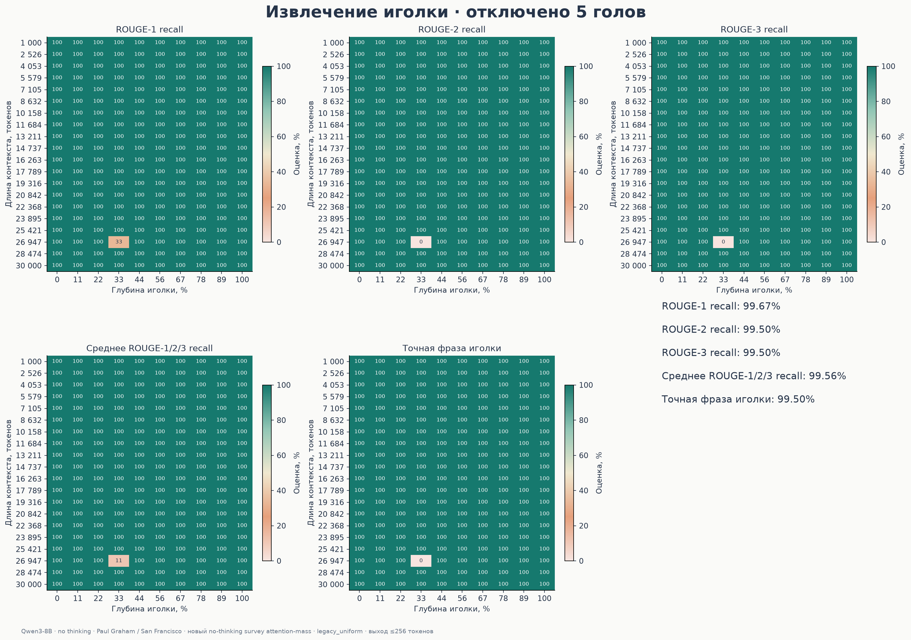

[SVG](plots/heads_005_heatmaps.svg)

## 10 отключённых голов — все метрики

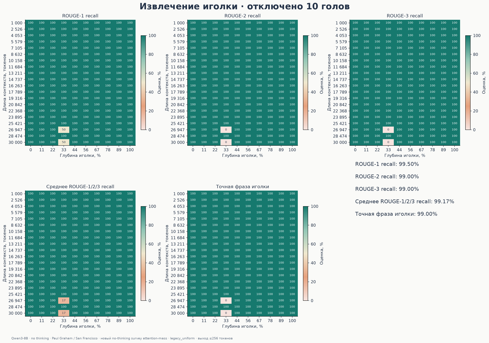

[SVG](plots/heads_010_heatmaps.svg)

## 15 отключённых голов — все метрики

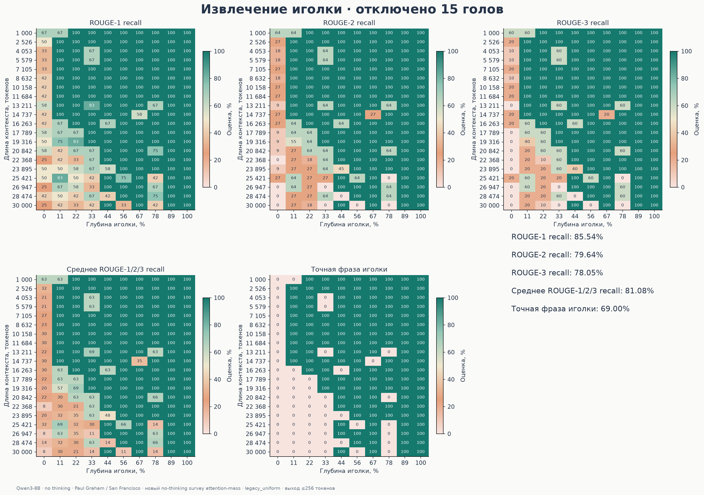

[SVG](plots/heads_015_heatmaps.svg)

## 20 отключённых голов — все метрики

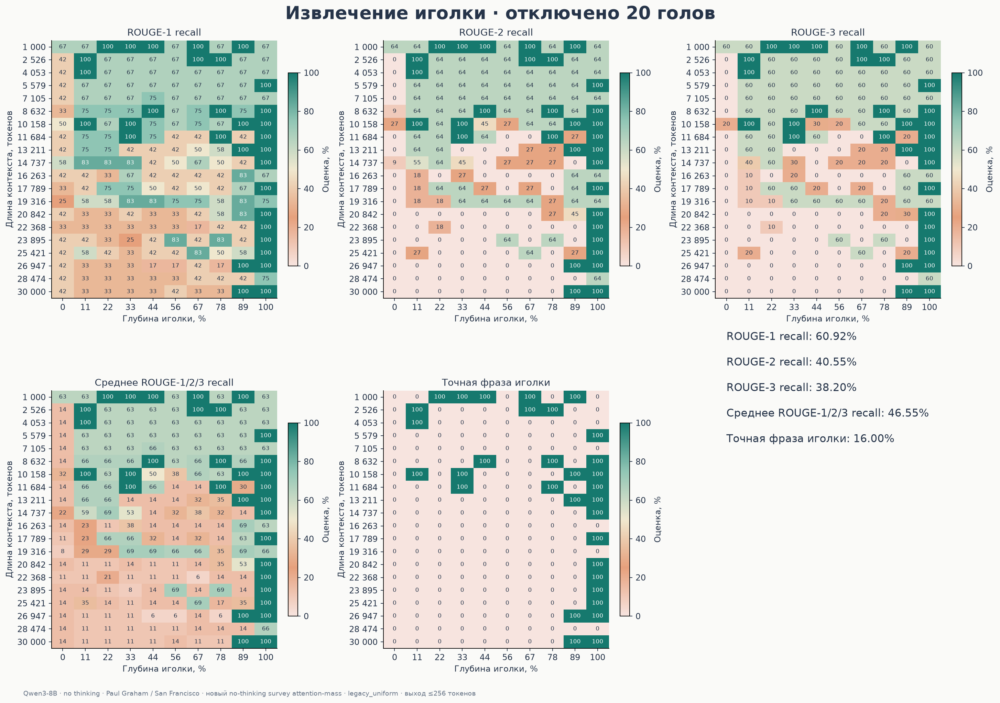

[SVG](plots/heads_020_heatmaps.svg)

## 25 отключённых голов — все метрики

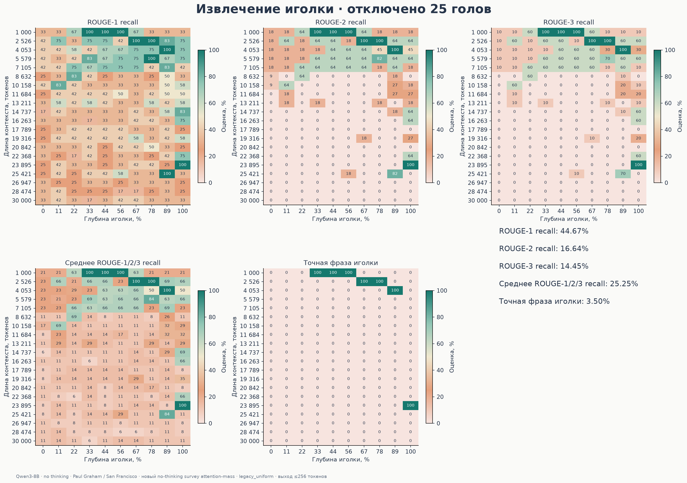

[SVG](plots/heads_025_heatmaps.svg)

## 30 отключённых голов — все метрики

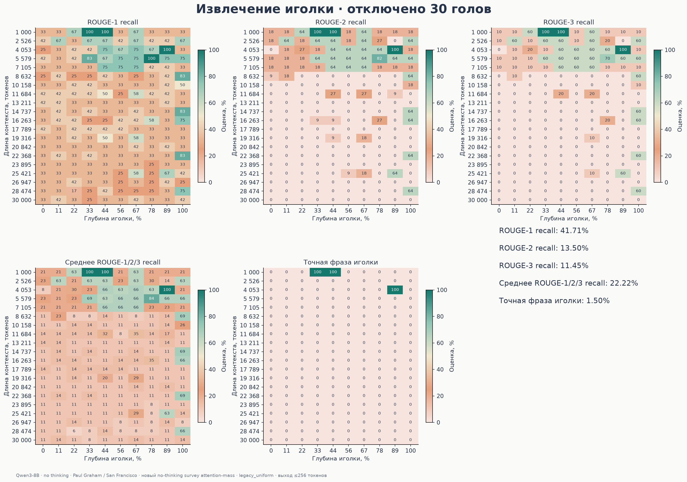

[SVG](plots/heads_030_heatmaps.svg)

## 35 отключённых голов — все метрики

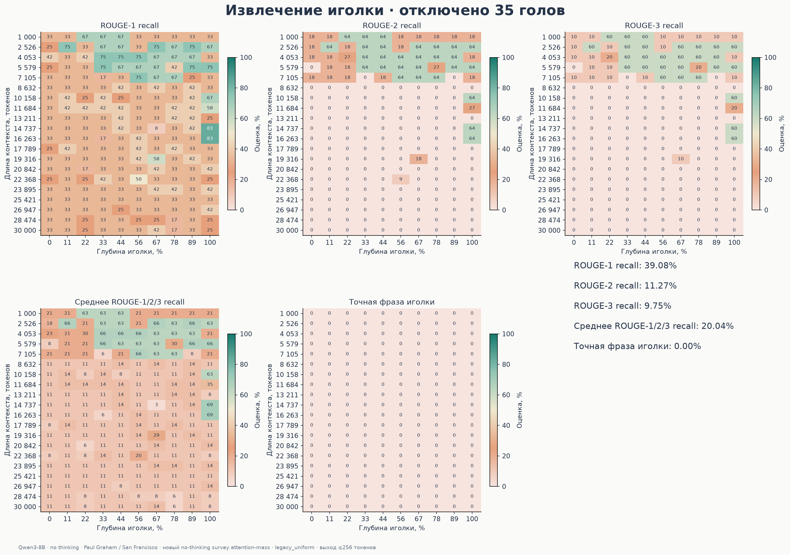

[SVG](plots/heads_035_heatmaps.svg)

## 40 отключённых голов — все метрики

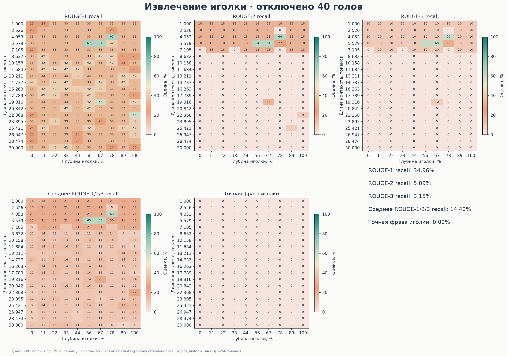

[SVG](plots/heads_040_heatmaps.svg)

## ROUGE-1 recall — сравнение условий

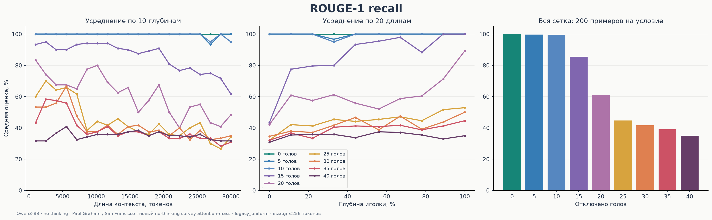

[SVG](plots/comparison_rouge1_recall.svg)

## ROUGE-2 recall — сравнение условий

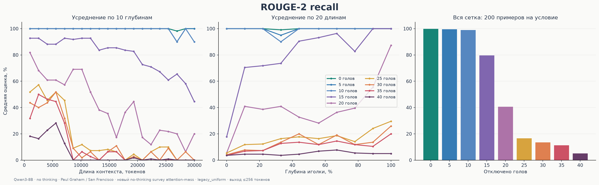

[SVG](plots/comparison_rouge2_recall.svg)

## ROUGE-3 recall — сравнение условий

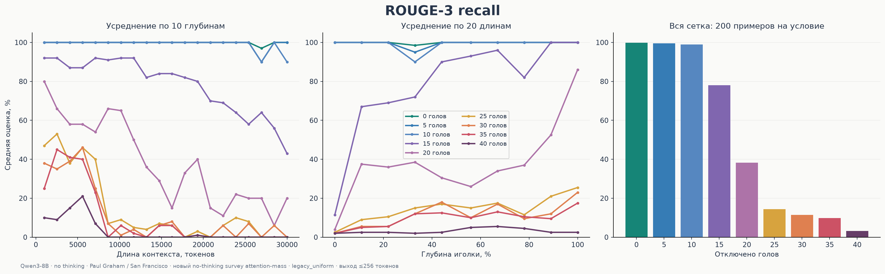

[SVG](plots/comparison_rouge3_recall.svg)

## Среднее ROUGE-1/2/3 recall — сравнение условий

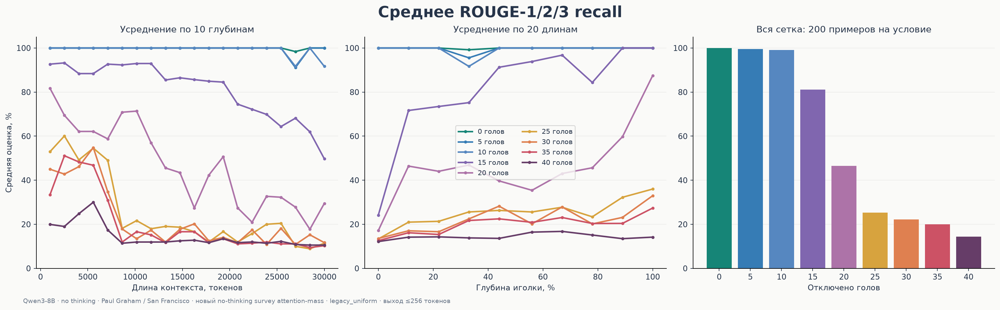

[SVG](plots/comparison_rouge123_mean_recall.svg)

## Точная фраза иголки — сравнение условий

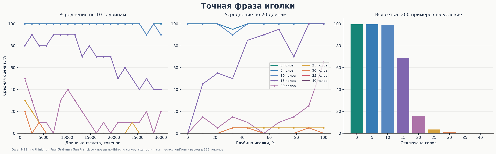

[SVG](plots/comparison_exact_match.svg)
