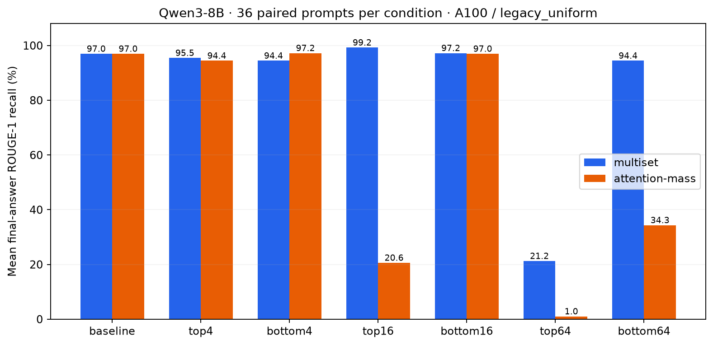
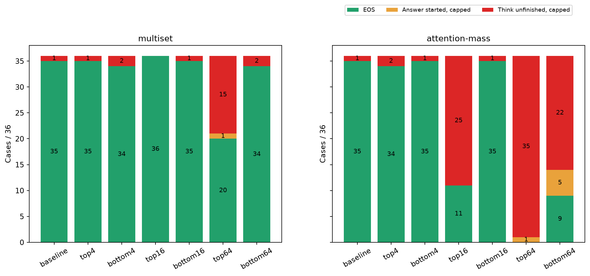
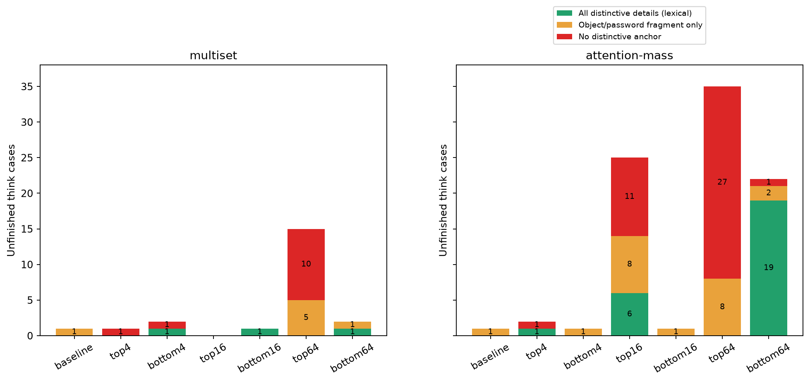
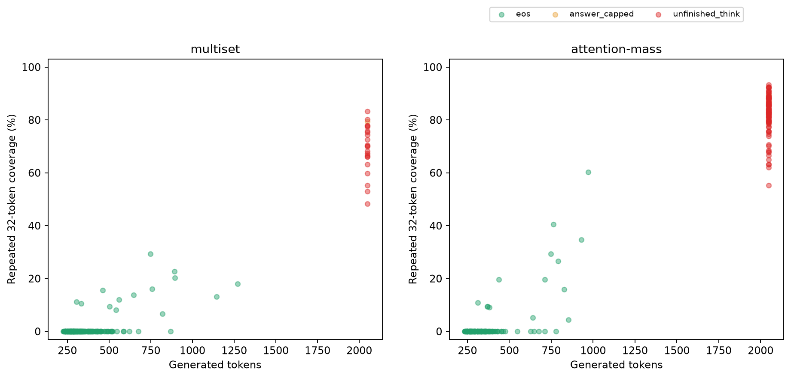
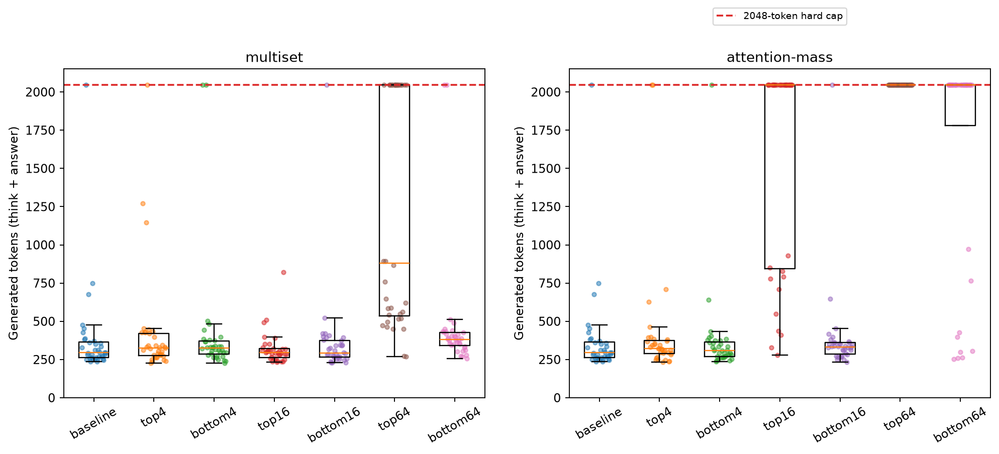
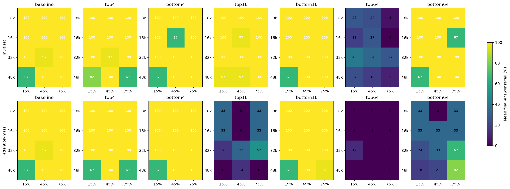
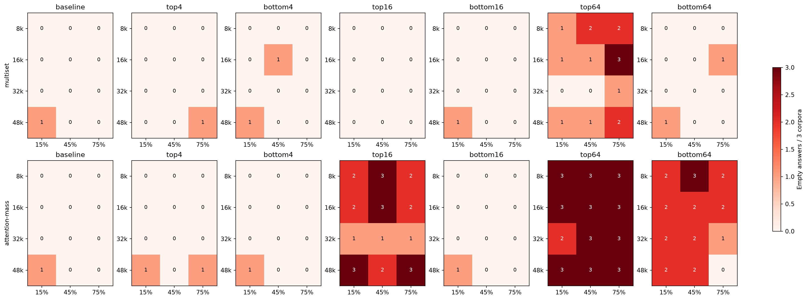
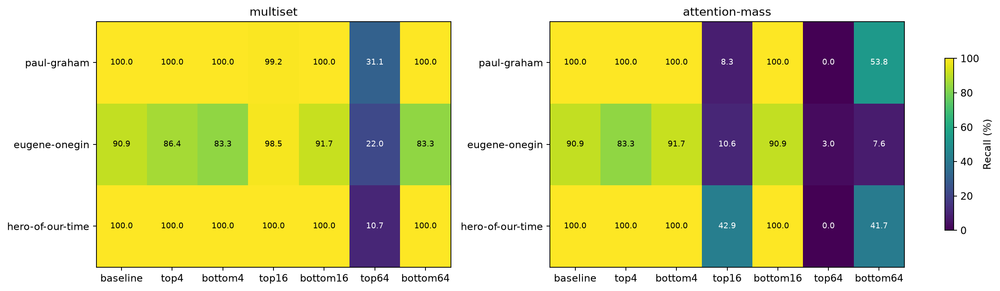
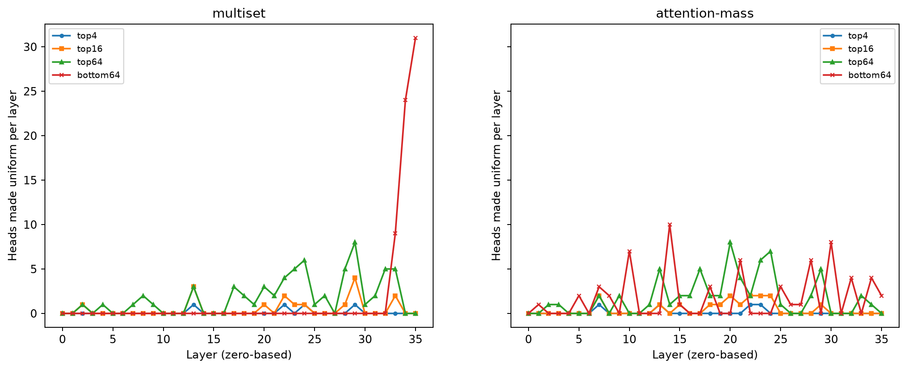

# Qwen3-8B: два рейтинга, три корпуса, masking на A100

## Главный вывод

Провал оценки — смесь **искажения/недостаточного восстановления факта** и **срыва завершения генерации**. Нельзя интерпретировать каждую нулевую оценку как «голова извлечения выключена, факт потерян». Однако нельзя и объяснить всё только выключением «голов завершения think»: при сильных вмешательствах модель часто генерирует неправильный объект или теряет детали.

Особенно показательно различие attention-mass:

- **top64:** 35/36 ответов не вышли из think; ни в одном из этих 35 не найден полный набор характерных деталей needle. Единственный начавшийся ответ выдумывает snow globe.
- **bottom64:** 22/36 не вышли из think; в 19 из этих 22 правильные характерные детали уже встречались в рассуждении. Здесь срыв завершения заметно отделяется от полного отсутствия доступности факта.
- **top16:** 25/36 не вышли из think; 6 из них содержат весь строгий набор деталей. Ещё один случай содержит смысловой вариант `nine blue spots` вместо `nine blue dots`, который строгий тест не засчитывает.

Это анализ сохранённых выходов, а не доказательство функциональной специализации конкретных голов. Для последнего нужны новые контролируемые вмешательства и сравнение логитов/внутренних состояний.

## Данные и проверка корректности сравнения

Два законченных прогона, по 252 генерации. Каждый: 3 корпуса × 4 длины (8000, 16000, 32000, 48000) × 3 глубины (15%, 45%, 75%) × 7 условий. Одна needle на корпус, один context seed 42. Рейтинг заморожен по прежнему survey, не пересчитывался на валидации.

Проверки анализатором:

- Все 504 JSON прочитаны; в каждом условии ровно 36 уникальных комбинаций.
- SHA256 prompt совпадает между условиями и между рейтингами для каждой из 36 комбинаций. Это парное сравнение на одинаковом тексте, а не на случайно разных окнах.
- Все 36 baseline имеют **идентичные последовательности выходных токенов** между двумя заданиями.
- Сохранённый score пересчитан как ROUGE-1 recall с stemming по **финальному ответу**, совпадение с JSON в пределах 1e-6.
- Каждый `max_new_tokens` действительно имеет ровно 2048 выходных токенов.
- 388 генераций закончились EOS, 116 — лимитом. Из обрывов **109 внутри think и 7 после начала ответа**. Все 109 нулевых оценок — пустой финальный ответ после незавершённого think.

504 — число файлов двух заданий, не 504 независимых наблюдения: baseline продублирован, тексты парные, seed один. В предыдущем сообщении была неверная разбивка 111/5; правильная — 109/7.

## Итоговые оценки и завершение

В каждой ячейке 36 случаев. Score — средний ROUGE-1 recall (%), не доля семантически правильных ответов.

| Условие | Multiset score | Mass score | Multiset: обрыв в think / ответе | Mass: обрыв в think / ответе |
|---|---:|---:|---:|---:|
| baseline | 96.97 | 96.97 | 1 / 0 | 1 / 0 |
| top4 | 95.45 | 94.44 | 1 / 0 | 2 / 0 |
| bottom4 | 94.44 | 97.22 | 2 / 0 | 1 / 0 |
| top16 | 99.24 | 20.60 | 0 / 0 | 25 / 0 |
| bottom16 | 97.22 | 96.97 | 1 / 0 | 1 / 0 |
| top64 | 21.25 | 1.01 | 15 / 1 | 35 / 1 |
| bottom64 | 94.44 | 34.34 | 2 / 0 | 22 / 5 |





Multiset top16 выше baseline не доказывает улучшение модели: в маленьком фиксированном наборе исчез единственный провальный baseline, но остаются небольшие потери деталей в отдельных ответах. Нужны дополнительные needles/seeds.

## Что именно прекращает генерацию

В [qwen_common.py](../../retrieval_heads/models/qwen_common.py) decode — цикл `range(max_new_tokens)`. На каждом шаге берётся argmax логитов, токен добавляется в выход; при EOS происходит `break`. Если EOS не появился, цикл заканчивается с `finish_reason=max_new_tokens`. Отдельного принудительного бюджета think, переключения к ответу или детектора повторов нет.

В [qwen3.py](../../retrieval_heads/models/qwen3.py) `</think>` выделяет начало финального ответа, но **не останавливает генерацию**. Если think открыт, а закрывающий токен не появился, финальный ответ пуст. Поэтому 0 в таких случаях — следствие отсутствия финального ответа; это не оценка текста рассуждения и не сбой BPE-локатора.

Непосредственная причина всех 116 обрывов установлена точно: **жёсткий лимит выходных токенов**. Поведенческая причина его достижения — длительные повторы/циклическая перепроверка. Почему именно вмешательство переводит сеть в эти режимы, по сохранённым ответам можно лишь выдвинуть гипотезы.

Не видно признаков ошибки CUDA, аварии задания или урезания выгрузки: завершены все комбинации, причины остановки и длины согласованы. Но полную корректность всех численных вычислений одна проверка JSON доказать не может.

## Разбор всех обрывов

[TRUNCATION_CASES.md](TRUNCATION_CASES.md) содержит **116 отдельных карточек**: условие, корпус, длина/глубина, причина остановки, детали needle внутри think, статистика повторов, начало и конец текста, правильный ответ baseline и ссылку на полный исходный JSON. Это полный перечень, а не выборка удачных иллюстраций. Оба файла одного провального baseline включены и явно относятся к одинаковому prompt.

Все случаи распределяются следующим образом:

| Группа | Обрывов | Полный строгий набор деталей в незавершённом think | Частичный | Нет характерного якоря |
|---|---:|---:|---:|---:|
| Multiset baseline | 1 | 0 | 1 | 0 |
| Multiset top4 | 1 | 0 | 0 | 1 |
| Multiset bottom4 | 2 | 1 | 0 | 1 |
| Multiset top16 | 0 | 0 | 0 | 0 |
| Multiset bottom16 | 1 | 1 | 0 | 0 |
| Multiset top64 | 16, из них 1 в ответе | 0 | 5 | 10 |
| Multiset bottom64 | 2 | 1 | 1 | 0 |
| Mass baseline | 1 | 0 | 1 | 0 |
| Mass top4 | 2 | 1 | 0 | 1 |
| Mass bottom4 | 1 | 0 | 1 | 0 |
| Mass top16 | 25 | 6 | 8 | 11 |
| Mass bottom16 | 1 | 0 | 1 | 0 |
| Mass top64 | 36, из них 1 в ответе | 0 | 8 | 27 |
| Mass bottom64 | 27, из них 5 в ответе | 19 | 2 | 1 |

Всего внутри незавершённого think: 29 полных строгих наборов деталей, 28 частичных, 52 без характерного якоря. Под «полным» здесь понимается присутствие всех характерных слов в окне 60 слов. **Это не entailment:** модель может правильно цитировать и тут же отрицать ответ. Например, mass bottom64 / Hero / 48k / 15% повторяет правильный объект, добавляя `No, that's not it`. Для Hero / mass top16 / 32k / 75% полный смысловой вариант с `spots` попадает в строгую категорию partial; в карточке добавлено пояснение ручной проверки.



### 1. Исходная трудность текста: Onegin и поиск по цитатам

Baseline уже обрывается на Onegin / 48k / 15%. Модель ходит между описанием Ленского, стихами и примечаниями, вспоминает compass, но не собирает полный ответ и не заканчивает think. Это общий для двух заданий исходный провал, не следствие отключения голов.

Все 7 обрывов multiset вне top64 — Onegin. Для bottom4 / 16k / 45%, bottom16 / 48k / 15%, bottom64 / 16k / 75% нужный полный компас появляется, затем текст возвращается к посторонним примечаниям. В остальных — общие поиски/частичный compass. Multiset top4 / 48k / 75% перебирает стихотворные цитаты: повторы менее периодичны, чем у больших вмешательств.

Малые условия attention-mass дают похожие поиски/перепроверки Onegin. Значит, один этот корпус имеет собственную уязвимость в выбранных окнах; нельзя переносить все его обрывы на остальные тексты.

### 2. Multiset top64: одновременно плохое содержание и цикл

15 незавершённых think: 3 Onegin, 8 Hero, 4 Paul Graham. Полного строгого ответа нет ни в одном. Есть частичный compass, porcelain beetle без точек, beetle with nine dots без материала/цвета, отдельное velvet. Другие ответы выдумывают book, bottle, pebble или повторяют «details are not specified».

Оставшийся обрыв уже после think: Paul Graham / 32k / 45%. Модель выдумывает пароль `emergency`, бумагу и безопасное место, затем повторяет этот ответ. Его score 45.45 — пересечение общих слов, **не правильное извлечение**.

Даже среди 21 непустого ответа top64 средняя оценка всего 36.43. Следовательно, удаление пустых ответов не устраняет провал содержания. Это не только проблема закрывающего токена.

### 3. Attention-mass top16: смешанный режим

25 think-обрывов: 11 Paul Graham, 9 Onegin, 5 Hero. В шести строгий набор деталей появляется, но модель продолжает цитировать, сомневаться и переутверждать его. Например, Paul Graham / 16k / все три глубины воспроизводит полный пароль и silver thimble, но не выходит из think.

Остальные случаи либо помнят лишь часть (velvet, thimble, compass), либо уходят в ложный объект/нерелевантные цитаты. Есть крайне короткие циклы: Paul Graham / 32k / 45% повторяет `I've been through the same thing`; одна 32-токенная последовательность встречается 213 раз.

У 11 непустых ответов средняя оценка 67.41, также не близкая к baseline. Вывод: на top16 уже страдают и завершение, и содержание.

### 4. Attention-mass top64: почти полная генеративная деградация

Все 36 достигают лимита. 35 не закрывают think; единственный финальный ответ — Onegin / 32k / 15%, повторяющий неправильный `snow globe` (score 36.36 из-за общих слов).

В think встречаются compass без его свойств, porcelain beetle без точек, thimble без пароля. Другие варианты — violin вместо compass, sled, pig, porcelain figure, общие определения `strange object`, перестановки user/object/answer. Нет полного набора needle ни у одного из 35. Это более широкая деградация, чем просто невозможность закончить рассуждение.

### 5. Attention-mass bottom64: сильный срыв завершения при сохранённых деталях

22 think-обрыва: 11 Onegin, 7 Hero, 4 Paul Graham; 19 уже содержат полный строгий набор деталей. Циклы часто прямо повторяют правильный объект: `The compass is the object`, `porcelain beetle with nine blue dots`, полный пароль.

Однако содержание не всегда стабильно: Paul Graham / 16k / 45% начинает с `velvet-pelican-47`, а позже повторяет `velvet-pelvic-47`. Поэтому «правильный факт однажды появился» не означает «факт сохранён до конца».

Ещё пять обрывов — **после начала ответа**, все Paul Graham:

| Длина / глубина | Score | Что происходит |
|---|---:|---|
| 16k / 15% | 100.00 | Полный правильный ответ повторяется до лимита; retrieval успешен, EOS не достигнут |
| 32k / 15% | 72.73 | Повторяет место хранения, не сообщает полный пароль |
| 48k / 15% | 54.55 | Полный пароль есть в think, но финальный ответ оставляет только место |
| 48k / 45% | 63.64 | Повторяет silver thimble, не сообщает пароль |
| 48k / 75% | 54.55 | Тот же цикл места хранения без пароля |

Таким образом, нарушение не сводится к `</think>`: EOS после ответа тоже часто не возникает. В двух дополнительных bottom64 Paul Graham случаях модель повторяется, но всё же достигает EOS (8k / 15%, 764 токена; 32k / 75%, 971 токен), оба score 100.

## Повторы и бюджет токенов

Детектор считает точные 32-токенные n-граммы. Покрытие — доля токенов, накрытых повторными вхождениями, кроме первого; это не оценка всех смысловых повторов. «Сильный повтор»: минимум 6 вхождений одной 32-граммы и минимум 15% повторного покрытия. Порог — диагностическая эвристика, не обученный классификатор причин.

115/116 обрывов удовлетворяют этому признаку. Единственный ниже порога — multiset top4 / Onegin / 48k / 75%: максимум 5 вхождений, но покрытие 48.2%; текст повторно перебирает стихотворные цитаты. Поэтому нельзя называть его «без повторов».

| Условие | Медиана повторного покрытия среди обрывов | Максимальное число вхождений одной 32-граммы |
|---|---:|---:|
| Multiset top64 | 71.6% | 70 |
| Mass top16 | 75.8% | 213 |
| Mass top64 | 85.8% | 141 |
| Mass bottom64 | 86.1% | 277 |





У завершившихся EOS генераций медиана 321 токен, максимум 1270. Для большинства нормальных ответов 2048 достаточно. Для вошедшего в цикл ответа увеличение до 4096 не гарантирует ничего: возможно, оно лишь удвоит повторяющийся хвост. Но утверждать, что ни один случай не спасётся большим бюджетом, без эксперимента нельзя.

Суммарное сохранённое время отдельных генераций: multiset 1.70 часа, mass 3.20 часа; это не полное оплачиваемое время облачного задания с загрузкой/подготовкой. Выходных токенов соответственно 129604 и 247352. Циклы объясняют значительную часть разницы во времени.

## Длины, глубины и корпуса







Количество пустых ответов по длинам 8k / 16k / 32k / 48k (каждая длина: 9 примеров):

- Multiset top64: **5 / 5 / 1 / 4**.
- Mass top16: **7 / 7 / 3 / 8**.
- Mass top64: **9 / 9 / 8 / 9**.
- Mass bottom64: **7 / 6 / 5 / 4**.

Следовательно, 48k без YaRN не является достаточным объяснением: тяжёлые провалы уже есть на 8k/16k; у bottom64 их даже меньше на 48k. Это не доказывает безопасность экстраполяции: выбран лишь один seed и три needles, а один baseline-провал действительно на 48k.

У multiset top64 глубина 75% проваливается чаще: 8 пустых из 12 против 3 на 15% и 4 на 45%. У mass top16 почти равномерно 8/9/8, у top64 11/12/12, у bottom64 8/9/5. Эти небольшие парные выборки не дают устойчивых общих законов о позиции.

## Почему рейтинги нельзя считать взаимозаменяемыми

Совпадение наборов голов между рейтингами:

| Набор | Общие головы |
|---|---:|
| top4 | 1 из 4 |
| top16 | 4 из 16 |
| top64 | 35 из 64 |
| bottom4 | 0 из 4 |
| bottom16 | 0 из 16 |
| bottom64 | 6 из 64 |



У multiset bottom64 все головы в последних трёх слоях: слой 33 — 9, слой 34 — 24, слой 35 — 31. Mass bottom64 распределён по 17 слоям: в частности слой 14 — 10 голов, слой 30 — 8, слой 10 — 7. Они вмешиваются в разные места сети. Низкий retrieval score **не означает**, что голова не нужна для генерации или остановки.

Дополнительно top16 mass и multiset совпадают всего по четырём головам. Контраст 20.60 против 99.24 говорит о чувствительности к **разным выбранным наборам**, а не устанавливает превосходство одной метрики в измерении «чистого retrieval».

## Что делает вмешательство и чего эти результаты не доказывают

По [flash.py](../../retrieval_heads/attention/flash.py) выбранным Q-головам зануляется Q после нормализации/RoPE; их logits QK становятся нулевыми, softmax — равномерным по доступному KV-префиксу. **V и выход головы не зануляются:** она продолжает добавлять усреднённый сигнал. Это `legacy_uniform`, не удаление головы. Потеря селективности и добавление такого сигнала могут влиять на извлечение, проверку, формулирование и завершение одновременно.

Вмешательство действует при decode, включая рассуждение и финальный ответ. Prefill текста проходит без маски; последний токен prompt считается первым masked decode шагом. Это проверка генерации из исходного контекста под изменённым decode, а не полного прогона модели с удалёнными головами на всей последовательности.

По данным можно утверждать: некоторые выбранные наборы вызывают сильное ухудшение поведения **в этом режиме**. Нельзя пока утверждать:

- что attention-mass обнаружил специализированные головы закрытия think или EOS;
- что нулевая финальная оценка эквивалентна потере извлечённого факта;
- что uniform и zero_output дадут одинаковый результат;
- что Flash вызывает циклы: для этого нужен парный eager/Flash контроль конкретных провальных случаев; прежний небольшой smoke не покрывает всю текущую сетку;
- что результат переносится на другие seeds, needles, вопросы и корпуса.

## Следующий диагностический эксперимент — без запуска сейчас

Чтобы разделить причины, достаточно выбрать по несколько случаев из трёх классов: правильные детали внутри think + цикл; неправильный/частичный факт + цикл; правильный финальный ответ + нет EOS.

1. Сравнить обычный thinking с `enable_thinking=False` на тех же prompts/головах. Это новый режим, результаты нельзя просто смешивать с текущей метрикой.
2. Сравнить decode-only маску на всём выходе и маску только после закрытия think. Если первый режим ломается, а второй нет, это локализует чувствительность к фазе рассуждения, но ещё не к конкретному закрывающему токену.
3. Проверить те же наборы через `zero_output` в поддерживающем его backend, отделив потерю функции головы от добавленного uniform-сигнала.
4. Для нескольких циклов сделать 4096-token контроль и посмотреть не только score, но выход из think/EOS и повторы.
5. Парный eager/Flash контроль на нескольких провалах; для выяснения механизма — логиты `</think>` и EOS до/после возникновения цикла, а не только итоговый текст.

Ничего из этого в рамках анализа не запускалось. Текущие YAML и результаты не изменены.

## Файлы и воспроизведение анализа

- [Все 116 карточек обрывов](TRUNCATION_CASES.md).
- [Машиночитаемые данные всех 504 случаев](analysis.json).
- [CSV всех случаев](cases.csv).
- Графики сохранены и как PNG, и как SVG рядом с этим отчётом.
- [Анализатор](../../analyze_mask_runs.py), [тесты диагностических эвристик](../../tests/test_mask_run_analysis.py).

Из `updated/`, в окружении с matplotlib, numpy, rouge-score:

```bash
.venv/bin/python analyze_mask_runs.py
```

Анализатор только читает выгруженные результаты и создаёт этот каталог; GPU, загрузка модели и доступ к облаку не требуются. Текст этого отчёта — аналитические выводы, он не перезаписывается скриптом.
