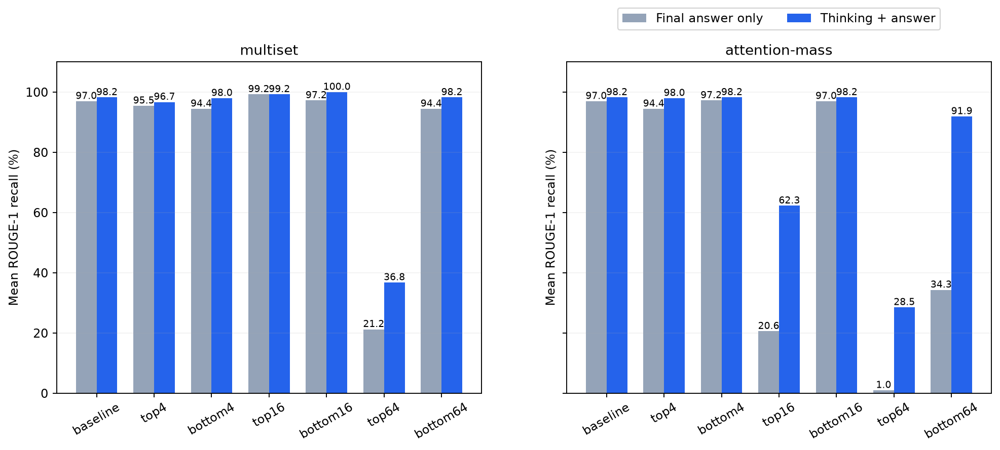

# ROUGE по полной генерации: think + ответ

Все 504 случая пересчитаны отдельно. Исходные JSON и оценки не изменены. Использован тот же ROUGE-1 recall со stemming, шкала 0–100. Из raw_model_response удалены только служебные маркеры Qwen; содержимое think сохранено целиком.

**Prompt/исходный контекст не включён:** там уже находится needle, и оценка по нему тривиально завысила бы результат. «Полный текст» здесь означает только сгенерированные моделью мысли и ответ.

| Рейтинг | Условие | Только ответ | Think + ответ | Нулей до → после |
|---|---|---:|---:|---:|
| multiset | baseline | 96.97 | 98.23 | 1 → 0 |
| multiset | top4 | 95.45 | 96.72 | 1 → 0 |
| multiset | bottom4 | 94.44 | 97.98 | 2 → 0 |
| multiset | top16 | 99.24 | 99.24 | 0 → 0 |
| multiset | bottom16 | 97.22 | 100.00 | 1 → 0 |
| multiset | top64 | 21.25 | 36.80 | 15 → 0 |
| multiset | bottom64 | 94.44 | 98.23 | 2 → 0 |
| attention-mass | baseline | 96.97 | 98.23 | 1 → 0 |
| attention-mass | top4 | 94.44 | 97.98 | 2 → 0 |
| attention-mass | bottom4 | 97.22 | 98.23 | 1 → 0 |
| attention-mass | top16 | 20.60 | 62.27 | 25 → 0 |
| attention-mass | bottom16 | 96.97 | 98.23 | 1 → 0 |
| attention-mass | top64 | 1.01 | 28.54 | 35 → 0 |
| attention-mass | bottom64 | 34.34 | 91.92 | 22 → 0 |

Это дополнительная диагностика доступности слов ответа, а не замена основной метрики. Правильная цитата с последующим отрицанием тоже засчитывается; высокий recall не требует законченного ответа и почти не штрафует бесконечные повторы. Precision и F1 дополнительно сохранены, чтобы видеть объём постороннего текста.

[Все оценки JSON](scores.json) · [Все случаи CSV](cases.csv) · [Сводка CSV](summary.csv). Индивидуальные пересчёты находятся в подкаталогах каждого рейтинга/условия.

[Полная галерея: 10 переоформленных графиков](plots/README.md). Воспроизведение галереи: `.venv/bin/python plot_full_generation_analysis.py`.

Воспроизведение из updated/: `.venv/bin/python rescore_full_generation.py`.
