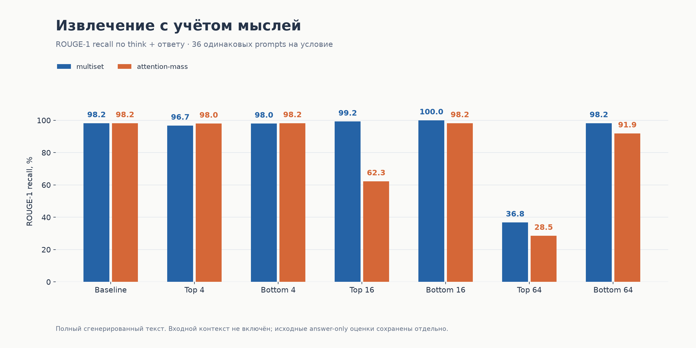
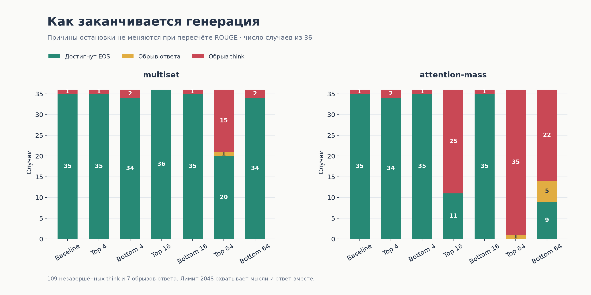
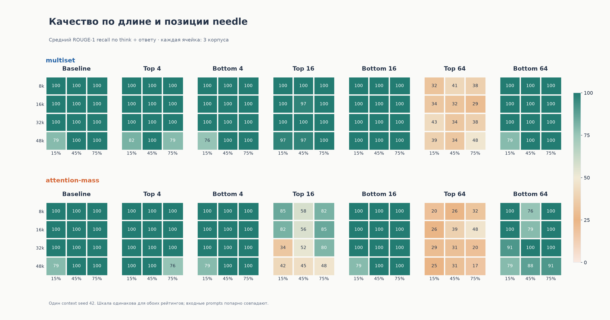
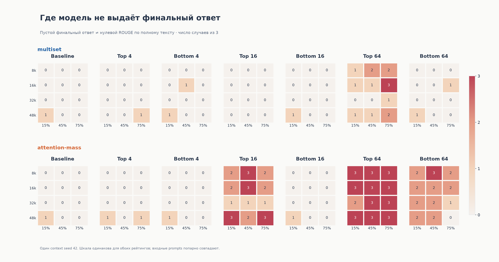
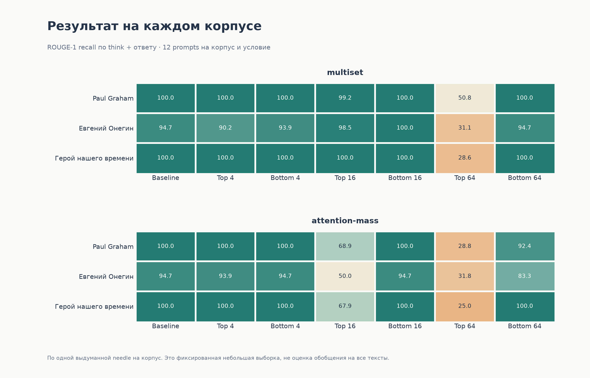
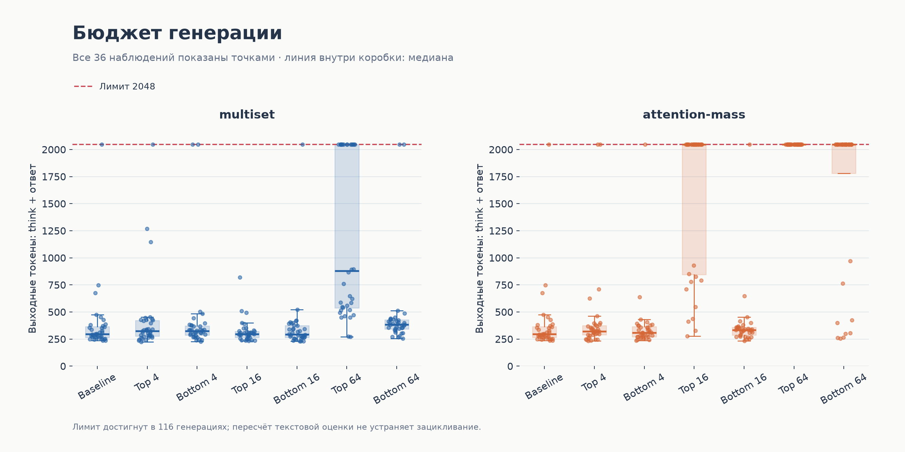
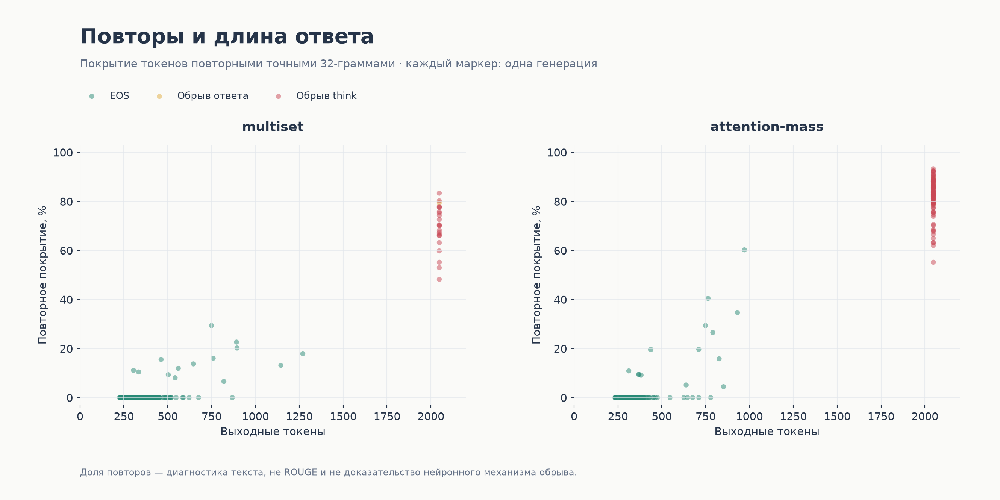
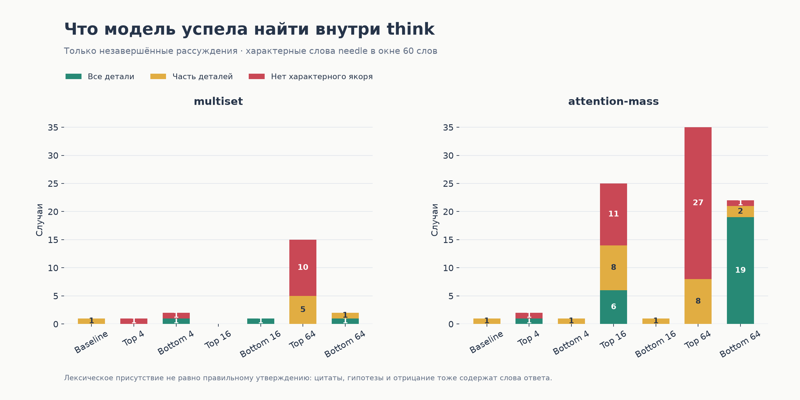
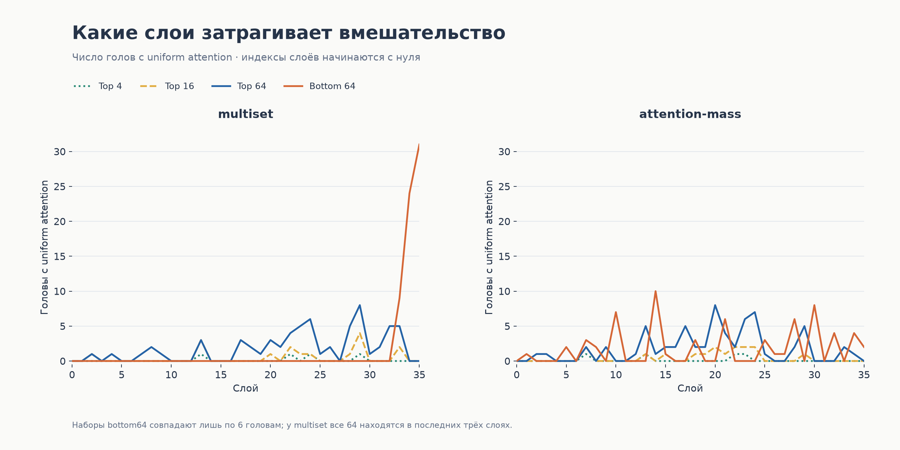
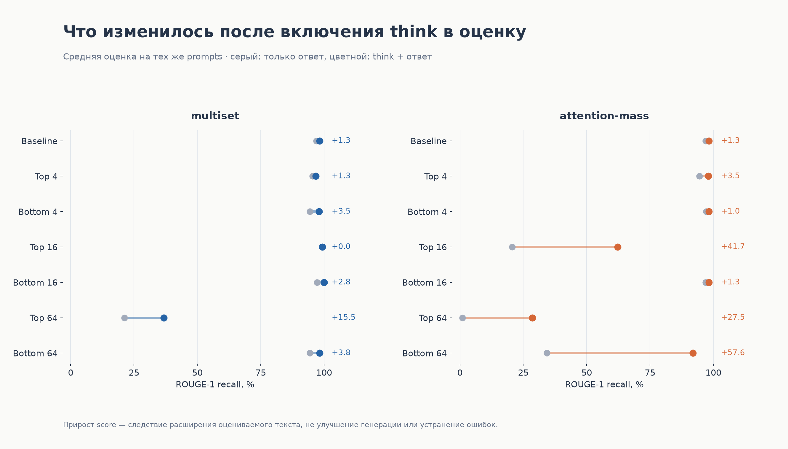

# Полная галерея: ROUGE по think + ответу

Все графики оформлены заново. В графиках качества используется пересчитанный full-generation ROUGE-1 recall со stemming. Диагностики остановки, токенов, повторов и выбранных голов используют исходные наблюдения: пересчёт ROUGE не меняет их.

504 файла двух заданий; baseline продублирован, не является независимым повтором. Входной контекст исключён. Ненулевой score не означает правильный ответ: общие слова, гипотезы и отрицания засчитываются.

## Сводные оценки

[PNG](01_scores.png) · [SVG](01_scores.svg)

## Завершение генерации

[PNG](02_termination.png) · [SVG](02_termination.svg)

## Оценки по длине и глубине

[PNG](03_length_depth_scores.png) · [SVG](03_length_depth_scores.svg)

## Пустые финальные ответы

[PNG](04_length_depth_failures.png) · [SVG](04_length_depth_failures.svg)

## Отдельные корпуса

[PNG](05_corpora.png) · [SVG](05_corpora.svg)

## Токены

[PNG](06_tokens.png) · [SVG](06_tokens.svg)

## Повторы

[PNG](07_repetition.png) · [SVG](07_repetition.svg)

## Детали внутри think

[PNG](08_evidence_in_unfinished_think.png) · [SVG](08_evidence_in_unfinished_think.svg)

## Распределение голов

[PNG](09_head_layers.png) · [SVG](09_head_layers.svg)

## Изменение оценки

[PNG](10_score_change.png) · [SVG](10_score_change.svg)

## Воспроизведение

Из `updated/`: `.venv/bin/python plot_full_generation_analysis.py`.

[Данные всех графиков](plot_data.json) · [Таблица пересчитанных оценок](../README.md). Исходная галерея answer-only не изменена.